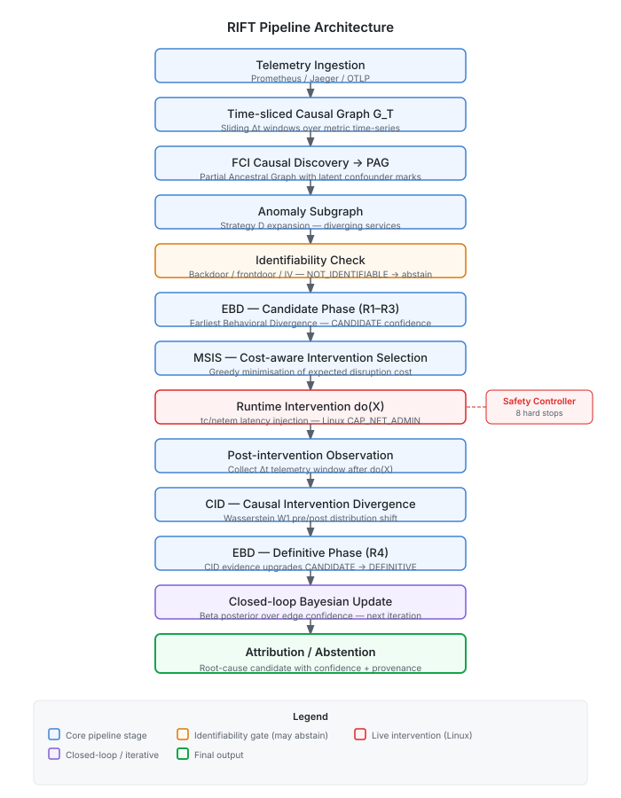
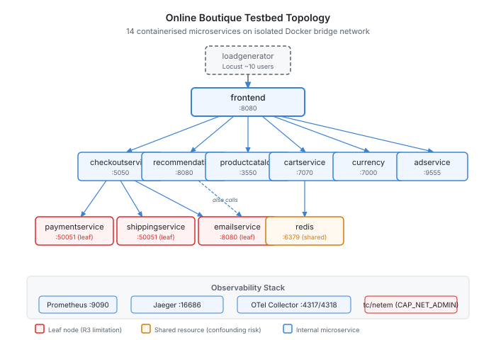

# RIFT — Intervention-Grounded Detection of Behavioral Divergence

A prototype for exploring whether controlled interventions can improve root-cause analysis in distributed microservice systems.

Standard observability (metrics, traces, logs) tells you what changed around the same time a failure occurred — it's correlation. RIFT explores whether deliberately perturbing a service — injecting latency via `tc netem` — and measuring what happens downstream gives better signal for identifying what actually *caused* the problem.

> **Status:** Research prototype. Implementation complete; live empirical evaluation on the Linux testbed is pending (one N=1 feasibility trial exists). A synthetic-benchmark study (Sprints 4.3–4.5) is documented below: it has produced **no positive result against a trivial always-abstain policy**; its only positive finding is that the later version (V3) makes fewer unsafe attributions than the earlier one (V2), on scenarios V3 was developed on. A confirmatory experiment has been designed but **not yet run**. Every number in this README is tied to a claim status in [`docs/recovery/SPRINT7_FINAL_CLAIMS_LEDGER.md`](docs/recovery/SPRINT7_FINAL_CLAIMS_LEDGER.md). See [Current Status](#current-status) and [Research status](#research-status-synthetic-benchmark-sprints-4345).

---

## The idea

When service A and service B both show elevated latency, standard RCA tools rank them by anomaly score. That ranking conflates cause and effect.

RIFT runs a different query: if I inject 200ms of latency into service A and service B's latency goes up proportionally, that's evidence A causes B. If injecting into A doesn't change B, the correlation was spurious.

There's also the harder case: when a hidden shared dependency makes two services appear correlated without a direct causal link. RIFT uses a causal discovery algorithm (FCI/PAG) to detect that structure and abstain from attributing blame in those cases, rather than producing a confident wrong answer.

---

## System overview

<p align="center">
  
</p>

The pipeline:

1. **Causal discovery** — FCI runs on time-series telemetry and produces a Partial Ancestral Graph (PAG) representing possible causal structures
2. **Identifiability check** — determines whether the PAG supports a causal attribution, or whether confounding makes it ambiguous
3. **Intervention selection** — picks which service to perturb, minimizing operational disruption
4. **Injection** — `tc netem` latency/loss injection on the isolated Docker network
5. **Divergence measurement** — Wasserstein W1 distance between pre/post metric distributions
6. **Bayesian update** — updates edge confidence in the causal graph based on what the intervention revealed
7. **Attribution** — returns a root cause with confidence, or abstains if the evidence is insufficient

---

## Claims at a glance

Statuses are defined in [`docs/recovery/SPRINT7_FINAL_CLAIMS_LEDGER.md`](docs/recovery/SPRINT7_FINAL_CLAIMS_LEDGER.md). Figures that have circulated informally but have no source are listed so nobody repeats them.

| Claim | Status | One-line truth |
|---|---|---|
| "P@1 = 0.875 (35/40)" | WITHDRAWN | Appears in no file; no 40-scenario set exists. |
| "3 testbeds" | WITHDRAWN | One testbed (Online Boutique), one N=1 trial; results come from a simulator. |
| "25/25 negative-control abstentions" | WITHDRAWN | Appears in no file. |
| "24/24 confounded abstentions" | QUALIFIED | Oracle graph is handed the confounder flag; 4 distinct scenarios; learned graph abstains on 0/24. |
| "Beats 7/8 baselines" | QUALIFIED | Higher utility than 7 comparators on simulated dev/val (the 8th is the oracle); B6 and B7 are outcome-identical; does not beat always-abstain. |
| "39.2% fewer unsafe attributions" | QUALIFIED | V3 vs V2 (79 → 48 of 252), on scenarios V3 was developed on, partly via abstaining more; not reproduced on a re-opened held-out set. |
| "MSIS cuts intervention overhead >50% vs random" | WITHDRAWN | Hard-coded constants; V3 uses ~2.2× more interventions than the random baseline. |
| Utility bounds | QUALIFIED | U ∈ [−3, 1] (not [0, 1]); ceiling 0.393; V3 mean −0.338 vs always-abstain 0; point break-even λ\* = 0.94 at κ = 0, significant only for λ ≤ 0.61. |
| H1–H4 (live hypotheses), confirmatory run | BLOCKED | Not run. |

---

## Research questions

| RQ | Question |
|----|----------|
| RQ1 | Does controlled intervention improve root-cause attribution accuracy vs. observational ranking? |
| RQ2 | Can identifiability analysis detect when attribution isn't supported and correctly abstain? |
| RQ3 | Does cost-aware intervention selection reduce disruption vs. random selection? |
| RQ4 | Does iterative closed-loop update outperform single-shot intervention on multi-cause faults? |

These correspond to hypotheses H1–H4. None of them are confirmed yet — the live evaluation is pending.

---

## Testbed

<p align="center">
  
</p>

[Online Boutique](https://github.com/GoogleCloudPlatform/microservices-demo) — **one** testbed. The only executed live trial used the 14-container stack in `deploy/podman-compose.yaml` (Boutique images tagged v0.8.1, Podman on RHEL 9.6, 11 Boutique services incl. load generator + `redis-cart` + OTel Collector + Prometheus); the Docker stack in `docker/` (v0.9.0, with Jaeger) has not been the subject of a live trial. Synthetic load only; no production data or real traffic. There is no second or third testbed: all quantitative results below come from a simulator, not from any testbed.

Observability: Prometheus (metrics) and OTel Collector (spanmetrics bridge) in the executed trial; Jaeger (traces) in the `docker/` stack only.

Fault injection: `tc netem` with per-destination `u32` filters. Requires Linux `CAP_NET_ADMIN`.

**Synthetic benchmark scenarios** (`datasets/rift_v2/`; simulator-generated, authored faults — not live incidents):

| Split | Scenarios | Notes |
|-------|-----------|-------|
| Development | 180 | 68 ATTRIBUTE + 112 ABSTAIN_REQUIRED |
| Validation | 72 | 31 ATTRIBUTE + 41 ABSTAIN_REQUIRED |
| Held-out | 108 | 45 ATTRIBUTE + 63 ABSTAIN_REQUIRED (spent under V2) |

---

## Current status

```
Implementation                COMPLETE (known defects tracked in docs/recovery/ALGORITHM_AUDIT.md)
Automated tests (local run)   1,017 passed, 8 failed (all 8 = installed library versions differ from the
                              canonical Python 3.9 lock in tests/unit/test_final_reproducibility.py), 0 other failures
Automated tests (CI, py3.11)  earlier figure: 664 passed, 2 protected-material checks UNAVAILABLE (not a pass); not re-verified
Linux environment             PASS (RHEL 9.6, Podman, tc/netem confirmed) - single host
Online Boutique testbed       PASS (14/14 containers healthy) - one feasibility trial
Safety hard stops             IMPLEMENTED + unit/dry-run tested; NOT enforced on the executed live path (see audit SF-1)
tc/netem injection            PASS for one N=1 trial (inline commands, 50 ms on cartservice, rollback confirmed);
                              the library backend has a known qdisc-handle defect and was never run live

Live telemetry pipeline       PENDING (Prometheus client + OTel wiring)
Full live evaluation          PENDING
H1 / H2 / H3 / H4            PENDING
Held-out evaluation           SEALED / PENDING
```

Three known blockers (Prometheus client wiring, OTel integration, tc band index) are implemented and Mac-tested; they need one more Linux deployment run.

### Development-set numbers *(synthetic, not final)*

None of these represent live system performance. Two different synthetic benchmarks are involved; do not mix them.

**(a) v2 benchmark, learned graph (the benchmark used for all V2/V3 comparisons):**

| Metric | Value |
|--------|-------|
| V3 correct root on ATTRIBUTE scenarios | 32/68 = 47.1% (dev, 180 scenarios); 13/31 = 41.9% (val, 72); pooled 45/99 = 45.5% |
| V3 answers on abstain-required scenarios | 38 of 153 pooled (25%); i.e. correct abstention on 115/153 = 75.2% |
| Unsafe attributions, V2 → V3 (strict, pooled N=252) | 79 → 48 (−39%, cluster 95% CI −23% to −54%); development evidence, V3 was tuned on these scenarios. On the spent held-out set (re-opened once in Sprint 7; not valid for final claims) V3 showed no advantage over V2 (utility −0.664 vs −0.594) |
| V3 mean utility vs always-abstain (λ=2, κ=0.05) | −0.338 strict [−0.46, −0.22], −0.195 operational; always-abstain = 0. V3 does **not** beat always-abstain |

**(b) legacy 36-scenario harness with an oracle graph (upper-bound consistency check only):**

| Metric | Value |
|--------|-------|
| P@1 on non-confounded scenarios | 10/12 = 83.3% with a ground-truth PAG built from the data-generating path |
| Confounded scenarios flagged | 24/24, **because the oracle graph is given the confounder flag**; they are 4 distinct scenarios, and the simulator does not put confounding in the data. With a learned graph the same pipeline abstains on 0/24. This is not evidence that RIFT detects confounding. |

Figures `analysis/figures/*` and tables `analysis/tables/*` are empty templates (marked "RESULTS NOT YET AVAILABLE" / `PENDING`); they contain no results.

---

## Research status (synthetic benchmark, Sprints 4.3–4.5)

Everything in this section comes from a **synthetic** simulator benchmark, not from the live testbed or production telemetry. It must not be read as evidence of real-world effectiveness.

- **Sprint 4.3 held-out (spent):** V2 attributed correctly in 60/108 scenarios versus 63/108 for an always-abstain baseline. It did not beat always-abstain. In Sprint 7 the frozen V3 was run once on the same set as a re-opening (flagged not valid for final claims): mean utility −0.664 vs V2 −0.594, below always-abstain, no advantage over V2.
- **V3 (development/validation only, non-confirmatory):** mean utility U = C − 2.0·S − 1.0·(n_do/20) was −0.338 against always-abstain (U ≡ 0); V2 was −0.562. V3 improves on V2 but does not beat always-abstain on dev/val. The utility weights are normative choices, not calibrated constants.
- **Known validity concerns:** the ground-truth label reuses part of RIFT's own detection vocabulary (partial circularity); scenarios are not independent (template groups nested in 16 fixed structural strata); CID can show spurious divergence under time-varying faults.
- **Confirmatory experiment:** protocol drafted and committed but **not recorded or approved** (no preregistration hash; no named independent reviewer) and **not run**. No confirmatory data exist. Required human decisions (including an independent human scientific review) are still open.
- **CI:** two tests guard protected material that is deliberately not in Git. In CI they are reported as *unavailable*, which is **not** a pass.

Details: [`docs/FINAL_PREPUBLICATION_STATUS.md`](docs/FINAL_PREPUBLICATION_STATUS.md) · [`docs/FINAL_APPROVAL_MATRIX.md`](docs/FINAL_APPROVAL_MATRIX.md) · [`docs/FINAL_SCIENTIFIC_VALIDITY_CLOSURE.md`](docs/FINAL_SCIENTIFIC_VALIDITY_CLOSURE.md) · [`docs/FINAL_INDEPENDENT_REVIEW_PACKAGE.md`](docs/FINAL_INDEPENDENT_REVIEW_PACKAGE.md) · [`docs/IEEE_ACCESS_MANUSCRIPT_BLUEPRINT.md`](docs/IEEE_ACCESS_MANUSCRIPT_BLUEPRINT.md)

---

## Running it

```bash
git clone https://github.com/ManasSakthivel/RIFT-Intervention-Grounded-Detection-of-Behavioral-Divergence.git
cd RIFT-Intervention-Grounded-Detection-of-Behavioral-Divergence

python3.11 -m pip install -r requirements.txt

# Run the test suite (Mac/Linux — no testbed required)
python3.11 -m pytest tests/ -q
# CI (earlier figure): 664 pass; two protected-material tests cannot run in a clean checkout (their inputs are
# not in Git). Use the reproducibility-aware runner to see them reported as UNAVAILABLE, not as passes:
python3.11 scripts/sprint442_run_tests.py tests

# Run development validation
make reproduce-all

# List registered experiments
PYTHONPATH=src python3.11 -m rift.experiments.run --list   # PYTHONPATH=src is required unless the package is installed

# Run a single experiment in dry-run mode
make experiment EXP=EXP-001
```

For live mode (Linux + Docker + `CAP_NET_ADMIN`):
```bash
./scripts/start_testbed.sh
./scripts/health_check_testbed.sh
make experiment EXP=EXP-001
```

---

## Repository structure

```
src/rift/
  fci/              # FCI/PAG causal discovery
  identifiability/  # backdoor/frontdoor/IV identifiability check
  intervention/     # tc netem injection engine
  safety/           # 8 hard stops (kill switch, namespace guard, budget, etc.)
  ebd/              # Earliest Behavioral Divergence criteria
  cid/              # Causal Intervention Divergence (Wasserstein W1)
  optimizer/        # intervention selector (minimize disruption)
  loop/             # closed-loop Bayesian graph update
  baselines/        # observational RCA, random, one-shot, oracle
  evaluation/       # attribution metrics, power analysis

experiments/        # registered experiment configs
tests/              # unit and integration tests (see Current status for the measured count)
docs/               # formal model, hypotheses, intervention semantics, limitations
artifacts/          # frozen state manifests
```

---

## Limitations

- Evaluated only on Online Boutique — a demo application. Behavior on larger or real production systems is unknown.
- Fault scenarios are authored, not drawn from production incidents.
- Live empirical results (H1–H4) haven't been collected yet.
- FCI assumes causal Markov and near-faithfulness. Microservice dynamics may violate these locally.
- Services at the leaves of the call graph (sinks in the PAG) can't satisfy the causal relevance criterion (R3), which limits attribution to non-leaf root causes.
- SIEVE-LIKE is a methodological reimplementation for baseline purposes — no claims about the original Sieve system.

Full detail: [docs/missing_capabilities.md](docs/missing_capabilities.md) and [docs/causal_assumptions.md](docs/causal_assumptions.md)

---

## Citation

```bibtex
@software{sakthivel2026rift,
  author  = {Sakthivel, Manas},
  title   = {{RIFT}: Intervention-Grounded Detection of Behavioral Divergence},
  year    = {2026},
  url     = {https://github.com/ManasSakthivel/RIFT-Intervention-Grounded-Detection-of-Behavioral-Divergence},
}
```

---

## License

MIT — see [LICENSE](LICENSE).
