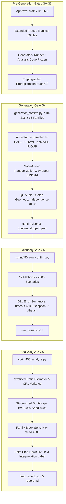
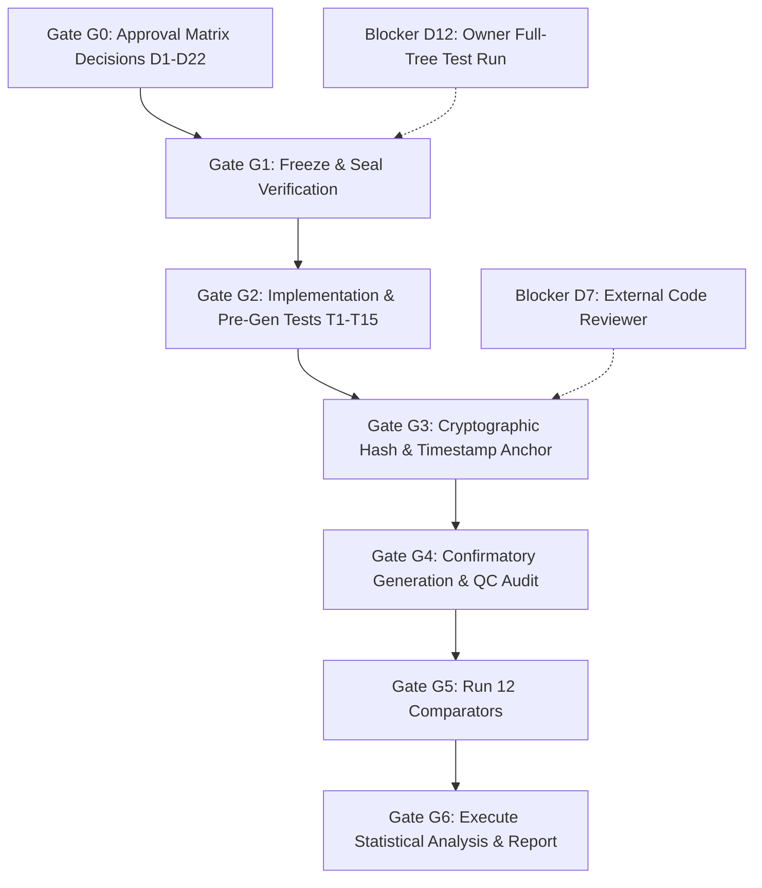

# Sprint 4.5.0 / Final Pre-Publication — Confirmatory Infrastructure Implementation Plan

**Document Path:** [`docs/FINAL_CONFIRMATORY_INFRASTRUCTURE_PLAN.md`](docs/FINAL_CONFIRMATORY_INFRASTRUCTURE_PLAN.md)  
**Status:** ARCHITECTURAL & IMPLEMENTATION PLAN ONLY.  
**Strict Protocol Safeguards:**
1. No confirmatory data are generated or drawn in this phase.
2. No code is executed against sealed held-out material (`datasets/rift_v2/heldout_candidate.json`, `heldout_status.json`, or `artifacts/sprint4_3_0/results/held_out/`).
3. No frozen algorithm implementations, ground-truth label functions, significance thresholds, or utility parameters are modified.
4. All work is pre-generation planning and verification against readable pilot/development/validation data.

**Governing Documents:**
- [`docs/SPRINT4_5_0_PREREGISTRATION.md`](docs/SPRINT4_5_0_PREREGISTRATION.md) (PRE)
- [`docs/SPRINT4_5_0_DATASET_PROTOCOL.md`](docs/SPRINT4_5_0_DATASET_PROTOCOL.md) (DP)
- [`docs/SPRINT4_5_0_STATISTICAL_ANALYSIS_PLAN.md`](docs/SPRINT4_5_0_STATISTICAL_ANALYSIS_PLAN.md) (SAP)
- [`docs/SPRINT4_5_0_CID_EXPERIMENT_DESIGN.md`](docs/SPRINT4_5_0_CID_EXPERIMENT_DESIGN.md) (CID)

---

## 1. Status Table of the Ten Confirmatory Components

| Component | Status on Disk | Reusable Foundation | Exact Technical Gap to Complete |
|---|---|---|---|
| **1. Independent Confirmatory Generator** | **PARTIAL** | Prototype implementation in [`scripts/sprint451_dataset_protocol_checks.py`](scripts/sprint451_dataset_protocol_checks.py:52-110) (`MOTIFS`, `_proto_topology`); simulator in [`src/rift/scenarios/simulator.py`](src/rift/scenarios/simulator.py:1-80); labeling logic in [`src/rift/scenarios/generator_v2.py`](src/rift/scenarios/generator_v2.py:193-250) (`compute_ground_truth`). | Standalone production module `src/rift/scenarios/generator_confirm.py` does not exist. Must implement Route A with clean public interface, node-order randomization, generator tag `rift-confirm-gen/1.0.0`, shallow-copy labeling wrapper for S13/S14, and acceptance sampler (`R-CAP1`, `R-OWN`, `R-NOVEL`, `R-DUP`, template/cell quotas). Note: calling frozen `generator_v2.build_scenario("confirm", ...)` raises `KeyError: 'confirm'` because `_SIZE_BAND`, `SPLIT_PREFIX`, and `SPLIT_SEED` lack `"confirm"` ([`src/rift/scenarios/generator_v2.py`](src/rift/scenarios/generator_v2.py:65-68,197)). |
| **2. Hashed Confirmatory Runner** | **MISSING** | Benchmark harness in [`src/rift/evaluation/benchmark_v2.py`](src/rift/evaluation/benchmark_v2.py:124-150) (`_timed`, `METHOD_ERROR`, `TIMEOUT_S=60.0`, `_out_to_rec`); dev/val runner in [`scripts/sprint440_run_v3.py`](scripts/sprint440_run_v3.py:33-49). | `scripts/sprint450_run_confirm.py` does not exist. Must enforce D21 error semantics (strict 60s timeout per scenario, unhandled exception trap -> `error_flag=1`, charged $n_{\text{do}}$ penalty), strip label keys prior to method dispatch, execute all 12 comparators under identical observation seeds, and enforce $\ge 95\%$ record completeness integrity stop. |
| **3. Preregistered Analysis Script** | **PARTIAL** | Monte Carlo & sensitivity scripts: [`scripts/sprint451_power_mc_verify.py`](scripts/sprint451_power_mc_verify.py), [`scripts/sprint451_stratified_power.py`](scripts/sprint451_stratified_power.py), [`scripts/sprint451_family_block_power.py`](scripts/sprint451_family_block_power.py), [`scripts/sprint451_doc_consistency_check.py`](scripts/sprint451_doc_consistency_check.py). | `scripts/sprint450_analyze.py` does not exist. Must assemble stratified ratio estimator, CR1 cluster variance, studentized bootstrap-$t$ (seed 4505), family-block sensitivity (seed 4506), Holm step-down over H2–H4, interpretation function (5 discrete states), and break-even $(\lambda^*, \pi^*)$ solvers into a unified executable script. |
| **4. Dataset Manifest & Integrity Verification** | **EXISTS** | Extended manifest generator [`scripts/sprint451_extended_manifest.py`](scripts/sprint451_extended_manifest.py:1-60) (69 tracked files); freeze closure validator [`scripts/sprint451_freeze_closure.py`](scripts/sprint451_freeze_closure.py); [`scripts/verify_heldout_sealed.py`](scripts/verify_heldout_sealed.py). | Need confirmatory run integrity script `scripts/verify_confirm_integrity.py` to verify pre-run freeze hashes, dataset SHA-256, label-stripped SHA-256, and post-run result record hashes against `artifacts/sprint4_5_0/confirm/provenance.json`. |
| **5. Result Records Schema** | **PARTIAL** | V2 benchmark record in [`src/rift/evaluation/benchmark_v2.py`](src/rift/evaluation/benchmark_v2.py:130-139) and V3 dev/val JSON schema in [`scripts/sprint440_run_v3.py`](scripts/sprint440_run_v3.py:55-59). | Confirmatory schema must formalize row-level columns (SAP §1), template/stratum level aggregations, separate raw method outputs from scored evaluations, and record runtime, memory, $n_{\text{do}}$, and error flags. |
| **6. Statistical Analysis & Confidence Intervals** | **EXISTS (prototyped)** | Prototyped and verified in Sprint 4.5.1 Monte Carlo verification scripts (`sprint451_stratified_power.py:35-85`, `sprint451_family_block_power.py:40-90`). | Needs integration into public library functions with test coverage against synthetic known-truth tables. |
| **7. Baseline Comparison** | **EXISTS** | Method registry in [`src/rift/evaluation/benchmark_v2.py`](src/rift/evaluation/benchmark_v2.py:73-89) (12 methods: B0-E, B0-H, B1, B3, B5, B6, B7, RIFT-FULL-LEGACY, RIFT-FULL-V2, RIFT-FULL-V2G, ORACLE-PAG, ORACLE-GRAPH, ORACLE-UB). | Confirmatory runner integration to dispatch all registered methods on identical observation windows and intervention random states in a single execution pass. |
| **8. CID Estimator Comparison (Phase A)** | **MISSING** | Bounding envelope proof ($W_1$ triangle inequality) and estimator specs E0–E7 in [`docs/SPRINT4_5_0_CID_EXPERIMENT_DESIGN.md`](docs/SPRINT4_5_0_CID_EXPERIMENT_DESIGN.md:27-120). | Standalone module `src/rift/cid_reliability/` not implemented. Needs synthetic series generator, estimators E0–E7, and V0 gate evaluation harness. |
| **9. Error & Abstention Accounting** | **EXISTS** | Implemented in [`src/rift/evaluation/benchmark_v2.py`](src/rift/evaluation/benchmark_v2.py:141-150) (`_timed`). | Must be faithfully mirrored in confirmatory runner with explicit logging of timeout/exception types and $n_{\text{do}}$ cost charging. |
| **10. Reproducibility Metadata** | **EXISTS** | [`scripts/sprint442_capture_environment.py`](scripts/sprint442_capture_environment.py:1-120) captures OS, CPU, Python, pip freeze, Git commit, dirty state, and hardware details. | Must explicitly capture `causal-learn` version via `importlib.metadata.version('causal-learn')` (since `causallearn` does not expose `__version__` at module root). |

---

## 2. Implementation Specifications per Component



### 2.1 Module: `src/rift/scenarios/generator_confirm.py`

#### Independence by Construction
- **Novel Graph Motifs:** Implements 16 structural motifs `S01`–`S16` ([`docs/SPRINT4_5_0_DATASET_PROTOCOL.md`](docs/SPRINT4_5_0_DATASET_PROTOCOL.md:64-81)):
  - `S01_spine_with_leaves`: $r \to a \to b \to c$, with leaves off $a$ and $b$.
  - `S02_two_level_fanout`: $r \to \{a,b,c\}$, each branching to a grandchild node.
  - `S03_ladder`: Parallel chains $r \to a \to b$ and $p \to c \to d$ with rungs $a \to c, b \to d$.
  - `S04_double_diamond`: Two-stage diamond $r \to \{a,b\} \to d \to \{e,f\} \to g$.
  - `S05_late_merge`: $r \to a \to m, p \to q \to m, m \to d$ (two-hop convergence).
  - `S06_bypass_chain`: $r \to a \to b \to c$ with direct bypass edge $r \to c$.
  - `S07_two_stage_hub`: $f_1, f_2 \to h_1 \to h_2, f_3 \to h_2, h_2 \to d$.
  - `S08_triangle_with_tail`: $r \to a, r \to b, a \to b, b \to c$.
  - `S09_staggered_roots`: $r_1 \to a \to b, r_2 \to b \to c$ with independent fault onsets.
  - `S10_latent_confounded_diamond`: Hidden node $h \to \{r, c\}$ with observed diamond $r \to a \to c, r \to b \to c$.
  - `S11_hidden_driver_chain`: Hidden node $h \to x \to y, h \to z$ (unobserved root).
  - `S12_hidden_driver_diamond`: Hidden node $h \to \{a, b\}, a \to c, b \to c$ (unobserved root).
  - `S13_mutual_pair_merge`: Cyclic pair $a \rightleftarrows b \to c, p \to c, c \to d$.
  - `S14_mutual_pair_fanout`: Cyclic pair $a \rightleftarrows b, b \to \{c, d\}$.
  - `S15_sink_with_two_chains`: Converging paths $r \to a \to s, p \to q \to s$.
  - `S16_pendant_cluster`: Dense sub-cluster $r \to a \to b, a \to c, b \to c, c \to d$.
- **Imports:** Imports simulator physics from [`src/rift/scenarios/simulator.py`](src/rift/scenarios/simulator.py) and ground-truth calculator from [`src/rift/scenarios/generator_v2.py`](src/rift/scenarios/generator_v2.py:12-14). Never imports or reads `datasets/rift_v2/heldout_candidate.json` or any sealed file.
- **R-NOVEL Verification:** Dynamically checks generated graph skeletons against the frozen 11-structure design space across all periphery sizes (extra $\in \{0, \dots, 4\}$). Any isomorphic graph is discarded.

#### Public Interface & Signatures
```python
def build_confirmatory_scenario(
    idx: int,
    structure: str,
    family: str,
    temporal: str,
    workload: str,
    observability: str,
    intervention: str,
    negative: Optional[str] = None,
    split: str = "confirm",
    tag: str = "rift-confirm-gen/1.0.0"
) -> Dict[str, Any]:
    """Generates a single confirmatory scenario deterministically from seed."""

def generate_confirmatory_dataset(
    target_n: int = 2000,
    tag: str = "rift-confirm-gen/1.0.0",
    max_candidates_per_structure: int = 10000,
    seed_offset: int = 0
) -> Tuple[List[Dict[str, Any]], Dict[str, Any]]:
    """Generates the full confirmatory dataset under acceptance rules, returning scenarios and provenance."""
```

#### Seed Formula, Identifiers & Node-Order Randomization
- **Seed Derivation:** `seed = int(hashlib.sha256(f"{tag}|{split}|{idx}".encode()).hexdigest()[:8], 16) & 0x7FFFFFFF` ([`docs/SPRINT4_5_0_DATASET_PROTOCOL.md`](docs/SPRINT4_5_0_DATASET_PROTOCOL.md:100)).
- **Scenario ID:** `f"V3C-{idx:05d}"` (opaque running integer; strictly contains no structure or label token; DP §4).
- **Node-Order Permutation:** Node ordering in `graph["nodes"]`, `graph["edges"]`, and telemetry observation dictionaries is shuffled using a seed-derived permutation independent of causal role (`rng_order = np.random.default_rng(seed ^ 0x5A5A5A5A)`), eliminating the root-first generation artifact (DP §3.5).

#### Labeling Wrapper for S13/S14
- In `compute_ground_truth()`, symmetric mutual dependencies are triggered when `dimensions["structure"] == "ambiguous"`.
- The generator passes a shallow copy of the scenario dictionary with `dimensions["structure"] = "ambiguous"` specifically for S13 and S14. The scenario is assigned label `SYMMETRIC_MUTUAL_DEPENDENCY` while preserving its true structure name in stored metadata ([`docs/SPRINT4_5_0_DATASET_PROTOCOL.md`](docs/SPRINT4_5_0_DATASET_PROTOCOL.md:88-90)).

#### Scenario Record Fields & Schema Separation
- **Stored Scenario Object (`confirm.json`):**
  - Metadata: `scenario_id`, `split`, `seed`, `generator_version`, `template_id`, `content_hash`.
  - Generative Dimensions: `dimensions` (`structure`, `family`, `temporal`, `workload`, `observability`, `intervention`, `negative`).
  - Model Artifacts: `graph` (nodes, edges, hidden, latent), `faults`, `telemetry`, `workload_params`, `intervention`.
  - Design Stratification (`design`): `drift_stat` (max $|d(y)|/\sigma_y$ over non-ancestor $y$), `stratum` (`none`, `mild`, `substantial`), and if D23 is approved: `snr_noise_free`, `l_struct`, `expected_do_effect`.
  - Ground Truth (`ground_truth`): `expected_outcome` (`ATTRIBUTE` or `ABSTAIN_REQUIRED`), `identifiability`, `roots`, `abstain_reason`.
- **Method-Facing View (`confirm_stripped.json`):**
  - Strictly strips `ground_truth` and `design` keys ([`src/rift/scenarios/validators.py`](src/rift/scenarios/validators.py:140-144)). Methods receive only `observe(sc)` outputs and intervention callables.

#### Acceptance Rules & Quotas
- **Sampling Rules (DP §6.2):**
  - `R-CAP1`: At most 1 accepted scenario per topology hash.
  - `R-OWN`: Topology hash owned exclusively by the first requesting template.
  - `R-NOVEL`: Rejects candidates matching frozen design-space hashes.
  - `R-DUP`: Rejects within-set content/dynamics duplicates and cross-set readable similarity $\ge 0.88$.
  - `template_full` / `cell_full`: Caps per-template and per-(structure, label) counts.
- **Quota Allocation:**
  - $N = 2000$ across 16 structures and 256 templates ($K = 256$, group size 5–9, max 14).
  - Quotas: ATTRIBUTE = 800 (40.0%), WEAK_SIGNAL = 360 (18.0%), ROOT_UNOBSERVED = 240 (12.0%), SYMMETRIC = 180 (9.0%; S13 = 90, S14 = 90; exception X11), INSUFFICIENT_BASELINE = 180 (9.0%), NO_DISCRIMINATING_EVIDENCE = 140 (7.0%), NO_FAULT = 100 (5.0%).
  - Temporal Confound Stratum: Substantial drift ($\ge 0.3\sigma$) natural share target $\ge 25\%$ ($\sim 500$ scenarios). Evaluated as a pre-generation QC check. If natural share falls short, the realized count is reported; the protocol is never altered post-hoc (DP §5.3).

---

### 2.2 Module: `scripts/sprint450_run_confirm.py`

#### Interface & Execution Flow
```python
def run_confirmatory_benchmark(
    dataset_path: Path,
    output_path: Path,
    methods: Optional[Sequence[str]] = None,
    timeout_s: float = 60.0
) -> Dict[str, Any]:
    """Executes all registered comparators on stripped scenarios, enforcing D21 error semantics."""
```

#### D21 Error Semantics & Timeout Enforcement (PRE §9, SAP §7)
- Reads `confirm_stripped.json`.
- Dispatches each method inside a thread/process worker with strict `TIMEOUT_S = 60.0`.
- On unhandled exception or timeout:
  - Records `error_flag = 1`, `answered = False`, `abstention_reason = "METHOD_ERROR:<Type>"` or `"TIMEOUT"`.
  - Captures and charges all $n_{\text{do}}$ interventions consumed up to failure toward cost $c_i = n_{\text{do}} / 20$.
  - Row is recorded in `raw_results.json` as an evaluable abstention record (never dropped).
- **Completeness Gate:** If unresolvable crashes cause completeness $< 95\%$ for any method after 1 permitted harness rerun, triggers an integrity stop for that method.

---

### 2.3 Module: `scripts/sprint450_analyze.py`

#### Interface & Analysis Flow
```python
def evaluate_confirmatory_results(
    raw_results_path: Path,
    ground_truth_path: Path,
    output_dir: Path,
    bootstrap_b: int = 20000,
    seed_primary: int = 4505,
    seed_sensitivity: int = 4506
) -> Dict[str, Any]:
    """Computes stratified ratio estimates, bootstrap-t CIs, Holm adjustments, and interpretation labels."""
```

#### Mathematical Formulations (SAP §1, §3)
- **Stratified Ratio Estimator:**
  $$\hat{\theta} = \sum_{s=1}^{16} W_s \hat{\theta}_s, \quad \hat{\theta}_s = \frac{1}{n_s} \sum_{g \in s} S_g, \quad W_s = \frac{n_s}{N}$$
- **Stratified CR1 Cluster Variance:**
  $$\hat{v} = \sum_{s=1}^{16} W_s^2 \frac{K_s}{K_s - 1} \sum_{g \in s} \frac{(S_g - n_g \hat{\theta}_s)^2}{n_s^2}, \quad \hat{\text{se}} = \sqrt{\hat{v}}$$
- **Studentized Group Bootstrap-$t$ (Primary, Seed 4505, $B=20,000$):**
  Resamples $K_s$ templates with replacement within each structure stratum $s$, keeping $W_s$ fixed.
  $$t^*_b = \frac{\hat{\theta}^*_b - \hat{\theta}}{\hat{\text{se}}^*_b}, \quad \text{CI}_{95\%} = \left[\hat{\theta} - q_{0.975}(t^*)\hat{\text{se}}, \, \hat{\theta} - q_{0.025}(t^*)\hat{\text{se}}\right]$$
- **Family-Block Bootstrap (D19 Sensitivity, Seed 4506, $B=20,000$):**
  Resamples 16 fault-family columns across all structures to evaluate crossed-dependence robustness.
- **Multiple Comparison Procedure (SAP §5):**
  - Gatekeeper H1 tested at $\alpha = 0.025$ one-sided.
  - If H1 rejected ($lo > 0$), test H2–H4 via Holm step-down adjusted $p$-values: $\tilde{p}_{(j)} = \min(1, \max_{k \le j} (3-k+1)p_{(k)})$.
- **Preregistered Interpretation Function (PRE §10):**
  - `POSITIVE-USEFUL`: $lo > 0 \land \hat{\theta} \ge \delta (0.10) \land lo_{\text{op}} > 0$.
  - `POSITIVE-SUBSTANDARD`: $lo > 0 \land (\hat{\theta} < 0.10 \lor lo_{\text{op}} \le 0)$.
  - `NEGATIVE-WORSE`: $hi < 0$.
  - `NEGATIVE-NO-USEFUL-EFFECT`: $lo \le 0 \le hi \land hi < 0.10$.
  - `INCONCLUSIVE`: $lo \le 0 \land hi \ge 0.10$.
- **Required Sensitivities & Secondary Endpoints:**
  - Zero-unsafe decomposition: $U_{\text{if\_zero\_unsafe}} = \bar{C} - \gamma \bar{c}$ (SAP §8.6).
  - Break-even parameters $(\lambda^*, \pi^*)$ (SAP §9.2).
  - Pair-level robustness endpoint D22: False-confirmation rate of non-ancestral pairs across drift strata (SAP §8.2).
  - Realized ICC and design effect (DEFF) reporting (SAP §8.5).

---

### 2.4 Manifest and Integrity Verification
- **Extended Freeze Manifest:** Maintained by [`scripts/sprint451_extended_manifest.py`](scripts/sprint451_extended_manifest.py:1-60) (69 files covering V3, V2, evaluation framework, baselines, generators, test suites, locks, and protocols).
- **Run Verification Script:** `scripts/verify_confirm_integrity.py` computes SHA-256 hashes of `confirm.json`, `confirm_stripped.json`, runner scripts, analysis scripts, and result records, writing `artifacts/sprint4_5_0/confirm/provenance.json`.
- **Environment Capture:** Reuses [`scripts/sprint442_capture_environment.py`](scripts/sprint442_capture_environment.py:1-120), explicitly capturing `causal-learn` distribution version via `importlib.metadata.version('causal-learn')`.

---

## 3. Comprehensive Verification and Test Plan

| Test ID | Module & Function | Verification Target | Pass Criterion | CI / Clean Clone Execution |
|---|---|---|---|---|
| **T1** | `tests/unit/test_confirm_generator.py::test_replication` | Replicate dev/val specs in legacy registry mode (DP §7). | $100\%$ byte-identical `content_hash` and labels for 100 dev + 50 val scenarios. | **CI Clean** (uses readable `dev.json`/`val.json`). |
| **T2** | `tests/unit/test_confirm_generator.py::test_label_wrapper` | Label routing for S13/S14 and S11/S12 (DP §7). | S13/S14 -> `SYMMETRIC_MUTUAL_DEPENDENCY`; S11/S12 -> `ROOT_UNOBSERVED`. | **CI Clean**. |
| **T3** | `tests/unit/test_confirm_generator.py::test_schema` | Emitted dictionary schema against required keys ([`src/rift/scenarios/validators.py`](src/rift/scenarios/validators.py:16-24)). | All required keys present; dimensions within domain. | **CI Clean**. |
| **T4** | `tests/unit/test_confirm_generator.py::test_determinism` | Seed determinism under `rift-confirm-gen/1.0.0` (DP §7). | 200 pilot scenarios generated twice are byte-identical. | **CI Clean**. |
| **T5** | `tests/unit/test_confirm_generator.py::test_non_isomorphism` | Non-isomorphism of S01–S16 cores vs frozen 11 structures (DP §7). | Zero isomorphic motif cores against frozen design space. | **CI Clean**. |
| **T6** | `tests/unit/test_confirm_generator.py::test_quota_feasibility` | Acceptance rules & quota matrix reachability (DP §7). | All 256 cells feasible; group sizes 5–9 (max $\le 14$). | **CI Clean**. |
| **T7** | `tests/unit/test_confirm_generator.py::test_independence_dry_run` | Pilot independence vs dev/val/adversarial (DP §7). | Zero shared hashes/templates; spec similarity $< 0.88$. | **CI Clean**. |
| **T8** | `tests/unit/test_confirm_generator.py::test_leakage_interface` | Label stripping & poisoning invariance (DP §7). | Method inputs identical before and after label poisoning; ID has `V3C-` prefix. | **CI Clean**. |
| **T9** | `docs/SPRINT4_5_0_FINAL_PREREGISTRATION_AUDIT.md` | Independent human code review checklist (D7, DP §7). | Signed review checklist by named independent researcher. | **Manual / External**. |
| **T10** | `tests/unit/test_confirm_generator.py::test_node_order_invariance` | Uniform root position & order invariance (DP §7). | Root index $\chi^2$ $p > 0.01$; V3 invariant under 3 node permutations on dev/val. | **CI Clean**. |
| **T11** | `tests/unit/test_confirm_generator.py::test_s13_s14_quotas` | S13/S14 quota exception validation (DP §5.2, X11). | S13=90, S14=90, Total SYMMETRIC=180; total matrix sums to 2000. | **CI Clean**. |
| **T12** | `tests/unit/test_confirm_analyze.py::test_bootstrap_size_under_h0` | Bootstrap-$t$ size and Holm arithmetic on synthetic tables (SAP §12.5). | Size $\le 0.030$ under $H_0$ ($\alpha=0.025$); exact Holm arithmetic matches manual. | **CI Clean**. |
| **T13** | `tests/unit/test_confirm_analyze.py::test_interpretation_function` | Exhaustiveness & mutual exclusivity of interpretation labels (PRE §10). | $100\%$ coverage of $[lo, hi, \hat{\theta}]$ parameter space; zero overlap. | **CI Clean**. |
| **T14** | `tests/unit/test_confirm_runner.py::test_error_semantics` | D21 exception & timeout trapping in confirmatory runner (PRE §9). | Injected exceptions/timeouts produce `error_flag=1`, charged $n_{\text{do}}$, no crash. | **CI Clean**. |
| **T15** | `tests/unit/test_confirm_integrity.py::test_manifest_tamper_detection` | Extended manifest & checksum tamper verification ([`scripts/sprint451_extended_manifest.py`](scripts/sprint451_extended_manifest.py:1-25)). | Single-byte alteration in any tracked file raises integrity violation. | **CI Clean**. |
| **T16** | `tests/unit/test_sprint440_attribution_v3.py::test_dev_val_pins_and_freeze_intact` | Full tree freeze integrity ([`src/rift/evaluation/dataset_registry_v2.py`](src/rift/evaluation/dataset_registry_v2.py:28-36)). | Verifies hash integrity of all frozen files. | **PROTECTED-AWARE** (Passes in CI via skip/unavailable handler; passes on full tree). |

*CI Compatibility Rule:* All new test modules (T1–T8, T10–T15) must execute strictly on readable development/validation datasets or synthetic in-memory objects, ensuring complete passing execution in the clean GitHub Actions CI environment.

---

## 4. Execution Sequencing, Gates (G0–G6), and Decision Dependencies



- **Gate G0 (Pre-Commitment Approvals):** All decisions D1–D22 confirmed.
  - *Hard Blocker D7:* Independent human code review of generator/analysis scripts must be signed off.
  - *Hard Blocker D12:* Repository owner must run full-tree protected test and record output.
- **Gate G1 (Pre-Flight Freeze & Seal Verification):**
  - Verify 69 files in `extended_manifest.json` via [`scripts/sprint451_freeze_closure.py`](scripts/sprint451_freeze_closure.py).
  - Verify sealed held-out status untouched via [`scripts/verify_heldout_sealed.py`](scripts/verify_heldout_sealed.py).
- **Gate G2 (Implementation & Pilot Verification):**
  - Implement `generator_confirm.py`, `sprint450_run_confirm.py`, `sprint450_analyze.py`.
  - Execute full unit test suite T1–T15 on pilot and dev/val data.
- **Gate G3 (Cryptographic Preregistration Seal):**
  - Hash all protocol documents, manifests, and script sources into `artifacts/sprint4_5_0/prereg/prereg.sha256`.
  - Record commit SHA and external timestamp anchor (signed Git tag).
- **Gate G4 (Confirmatory Generation & QC Audit):**
  - Generate sequence `V3C-00001` ... `V3C-02000` under seed tag `rift-confirm-gen/1.0.0`.
  - Execute automated QC audit (T3, T6, T7, T10, T11). Max 3 attempts allowed (D15).
  - Write `confirm.json`, `confirm_stripped.json`, and `artifacts/sprint4_5_0/confirm/provenance.json`.
- **Gate G5 (Confirmatory Benchmark Execution):**
  - Execute `sprint450_run_confirm.py` across all 12 registered comparators.
  - Verify $\ge 95\%$ record completeness. Re-verify sealed held-out file.
- **Gate G6 (Preregistered Analysis & Reporting):**
  - Execute `sprint450_analyze.py` to produce final tables, bootstrap CIs, and interpretation label.

### Engineering Effort Estimates

| Work Package | Core Deliverables | Estimated Effort |
|---|---|---|
| **WP1: Confirmatory Generator** | `generator_confirm.py`, acceptance sampler, T1–T11 unit tests | 1.5 – 2.5 engineer-days |
| **WP2: Confirmatory Runner** | `sprint450_run_confirm.py`, D21 timeout/error harness, T14 tests | 1.0 – 1.5 engineer-days |
| **WP3: Statistical Analysis** | `sprint450_analyze.py`, bootstrap-$t$, Holm step-down, T12–T13 tests | 1.5 – 2.0 engineer-days |
| **WP4: Pre-Run Auditing & G0–G3** | Manifest verification, sealed check, independent review sign-off (D7) | 1.0 – 2.0 engineer-days |
| **Total Engineering Effort** | **End-to-End Implementation & Pre-Run Validation** | **5.0 – 8.0 engineer-days** |

### Implementation Risks & Mitigations
1. **Generation QC Runtime & Rare-Label Scarcity:** Candidate rejection rate is high for rare labels (`partial_degradation` ATTRIBUTE). *Mitigation:* Budget capped at 10,000 candidates per structure; shortfall rule permits $N \ge 1990$ (shortfall $\le 10$) without invalidating design (DP §5.2).
2. **Similarity Proxy Heuristic:** 3 candidate pairs in dry runs had cross-set specification similarity $\ge 0.88$. *Mitigation:* `R-DUP` operational rule rejects candidates $\ge 0.88$ prior to acceptance, ensuring accepted set strictly satisfies QC.
3. **First-Time Generator Risk:** New generator module has not undergone independent external audit. *Mitigation:* Gate G3 strictly blocked until named independent researcher completes T9 checklist (D7).

---

## 5. Explicit Scope Boundaries ("What This Plan Deliberately Does NOT Do")

1. **NO Confirmatory Data Generation:** Does not draw, generate, or store any confirmatory scenario data in this phase.
2. **NO Algorithm Redesign or Retuning:** Does not modify frozen RIFT V3 or V2 source code, thresholds, weights, or heuristics.
3. **NO Access to Sealed Held-Out Material:** Does not open, read, hash, list, or inspect `datasets/rift_v2/heldout_candidate.json`, `heldout_status.json`, or `artifacts/sprint4_3_0/results/held_out/`.
4. **NO Retrospective Relabeling or Metric Changes:** Does not alter the preregistered utility parameters ($\lambda=2.0, \gamma=1.0, \delta=0.10$), primary estimand $\theta$, or ground-truth labeling criteria.
5. **NO Uncontrolled Upgrades:** Maintains strict isolation of dependencies in accordance with frozen CI environments.

---

## 6. Documented Interface Discrepancies and Reconciliations

During pre-implementation interface verification against existing code, the following discrepancies were identified and reconciled:

1. **`generator_v2.py` Split Namespace Limitation:**
   - *Code Fact:* `generator_v2.py` lines 65–68 define `SPLIT_PREFIX = {"dev": "D", "val": "V", "held_out": "H"}` and `_SIZE_BAND = {"dev": (0, 1), "val": (2, 2), "held_out": (3, 3)}`. Calling `build_scenario("confirm", ...)` raises `KeyError: 'confirm'` at line 197.
   - *Resolution:* Confirms Route A (new standalone module `generator_confirm.py`) is mandatory; frozen `generator_v2.py` cannot be called with `"confirm"`.
2. **`causal-learn` Package Version Attribute:**
   - *Code Fact:* `causallearn` does not reliably expose `__version__` at package root in the pinned environment.
   - *Resolution:* Environment capture script must use `importlib.metadata.version('causal-learn')` rather than `causallearn.__version__`.
3. **Timeout & Error Handling Encapsulation:**
   - *Code Fact:* In [`src/rift/evaluation/benchmark_v2.py`](src/rift/evaluation/benchmark_v2.py:141-150), `_timed` catches exceptions as `METHOD_ERROR:<type>` and tracks execution time, but [`scripts/sprint440_run_v3.py`](scripts/sprint440_run_v3.py:40-42) calls `bm._out_to_rec` without an external thread-level timeout wrapper.
   - *Resolution:* `scripts/sprint450_run_confirm.py` must explicitly implement a process/worker timeout wrapper enforcing `TIMEOUT_S = 60.0` to guarantee D21 compliance.
4. **Schema Validator Domain Check:**
   - *Code Fact:* [`src/rift/scenarios/validators.py`](src/rift/scenarios/validators.py:21-22,31-32) validates `structure` against `STRUCTURES` (the 11 frozen structures), rejecting `S01`–`S16`.
   - *Resolution:* Structural validation of confirmatory scenarios must evaluate a *validation view* (mapping novel motifs to compatible base graphs for schema check) while preserving true names in `confirm.json`.
5. **Group Geometry Collapse under Natural Generation:**
   - *Code Fact:* In [`src/rift/scenarios/splitter.py`](src/rift/scenarios/splitter.py:1-40), unconstrained topology generation over 6,000 prototype candidates collapsed into 7 massive union-find groups (max size 2,505).
   - *Resolution:* Operational acceptance rules `R-OWN` and `R-CAP1` are essential to enforce $K=256$ groups and maximum group size $\le 14$.
