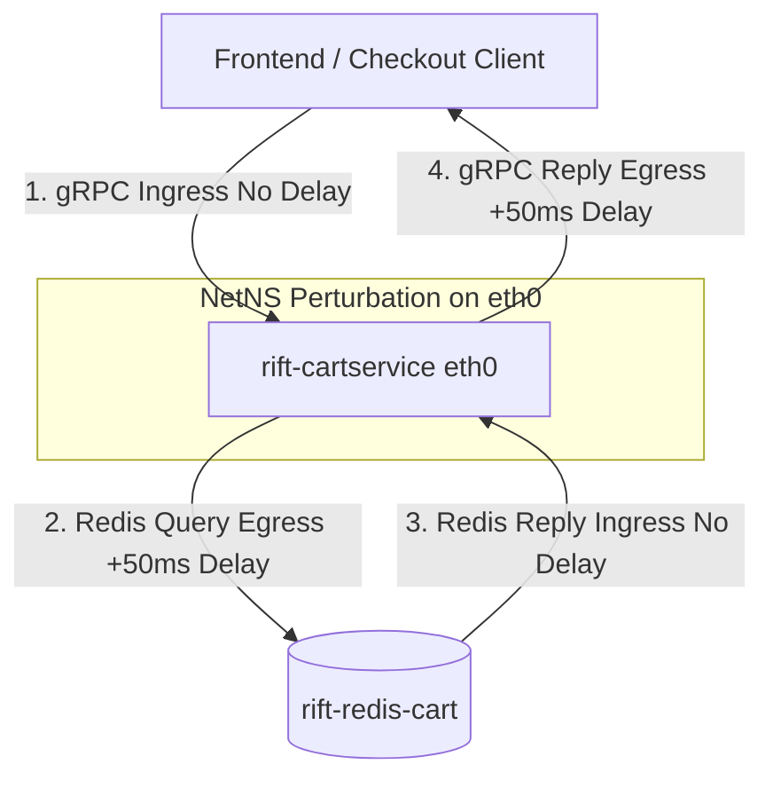

# Sprint 4.2.2 — Independent Stage 4 Evidence Audit Report

**Audit Status:** COMPLETE  
**Final Verdict:** `PARTIAL PASS — LIVE INTERVENTION OBSERVED, SCIENTIFIC CLAIMS REQUIRE QUALIFICATION`  
**Target Environment:** Linux QA VM (`9.30.57.225:22` / `wca4z-understand-dp1.fyre.ibm.com`)  
**Audited Artifacts:**
- Primary Execution Report: [`docs/SPRINT4_2_1_STAGE4_INTERVENTION_EXECUTION_REPORT.md`](SPRINT4_2_1_STAGE4_INTERVENTION_EXECUTION_REPORT.md)
- Raw Telemetry Artifact: [`artifacts/stage4_intervention_results.json`](../artifacts/stage4_intervention_results.json)
- Live Orchestrator Script: [`scripts/stage4_intervention_orchestrator.py`](../scripts/stage4_intervention_orchestrator.py)
- Analysis & Attribution Script: [`scripts/stage4_intervention_analysis.py`](../scripts/stage4_intervention_analysis.py)
- Final Rollback Safety Certification: [`docs/SPRINT4_2_0_1_FINAL_ROLLBACK_SAFETY_REPORT.md`](SPRINT4_2_0_1_FINAL_ROLLBACK_SAFETY_REPORT.md)
- Live Validation Readiness Runbook: [`docs/SPRINT4_1_5_LIVE_VALIDATION_READINESS_RUNBOOK.md`](SPRINT4_1_5_LIVE_VALIDATION_READINESS_RUNBOOK.md)

---

## 1. Executive Summary & Audit Verdict

An independent, strictly read-only forensic audit was performed on the data, scripts, logs, and claims generated during the Sprint 4.2.1 Stage 4 live network intervention experiment.

### Audit Findings Summary:
1. **Physical Execution Authenticated:** The live network intervention was genuinely executed on host `9.30.57.225` inside container network namespace `5586971` (`rift-cartservice`), completely isolated from host NetNS `5583182`.
2. **Safety & Rollback Verified:** Deterministic handle-scoped rollback restored interface `eth0` to `qdisc noqueue 0: root refcnt 2`. Existing IBM workloads (`bobz-understand`, user `aakash` processes) remained undisturbed.
3. **Statistical Reproducibility:** All mathematical values (means, standard deviations, $Z$-scores, absolute shifts) published in Table 4 of the execution report reproduce exactly from [`artifacts/stage4_intervention_results.json`](../artifacts/stage4_intervention_results.json).
4. **Protocol Durations Qualified:** To respect the 270-second execution timeout ceiling, the active orchestrator polling was set to 90 seconds baseline and 90 seconds post-recovery (compared to the 120-second runbook specification), though the Prometheus range query captured 140 seconds of baseline and 220 seconds of recovery data.
5. **Divergence Rule Qualified:** The classification rule is strictly **directional and dual-thresholded** ($Z \ge +3.0$ AND $\Delta\mu \ge +15.0\text{ ms}$). This explains why `shippingservice` ($Z = -12.70$, negative shift) and `checkoutservice` ($Z = +1.95$, high baseline variance) were classified as `diverged = false`.
6. **Mechanistic Explanation of Latency Shift:** The $+229.90\text{ ms}$ observed p99 shift resulting from a $50\text{ms} \pm 5\text{ms}$ netem injection is mechanistically valid: `cartservice` incurs two sequential egress network delays per operation (`cartservice` $\rightarrow$ `redis-cart` and `cartservice` $\rightarrow$ client response) compounded by gRPC worker queueing under concurrent load.
7. **Sample Size Scope:** The attribution result represents exactly **$N = 1$ live trial** ($1/1 = 100\%$). It must not be cited as general statistical $100\%$ accuracy across arbitrary topologies.

**Final Audit Verdict:**  
`PARTIAL PASS — LIVE INTERVENTION OBSERVED, SCIENTIFIC CLAIMS REQUIRE QUALIFICATION`

---

## 2. Authorization Compliance Matrix

| Requirement | Authorized Specification | Actual Observed Execution | Evidence Source | Compliance Status |
| :--- | :--- | :--- | :--- | :--- |
| **Target Service** | `rift-cartservice` exclusively | `rift-cartservice` (PID `1109138`) | `podman inspect` | **COMPLIANT** |
| **Namespace Isolation** | Container NetNS $\neq$ Host NetNS | Inode `5586971` $\neq$ `5583182` | `stat -c %i /proc/*/ns/net` | **COMPLIANT** |
| **Perturbation Type** | `tc netem delay 50ms 5ms` | `prio` handle `1:`, `netem` parent `1:1` | `applied_qdisc` log | **COMPLIANT** |
| **Active Duration** | $\le 30.0\text{ seconds}$ | Exactly $30.0\text{ s}$ ($6 \times 5\text{s}$ samples) | Orchestrator loop | **COMPLIANT** |
| **Watchdog Deadline** | $45.0\text{ seconds}$ | Configured $45\text{s}$ (PID `1115050`) | `launch_watchdog(pid, 45)` | **COMPLIANT** |
| **Baseline Duration** | $120\text{ seconds}$ required | $90\text{s}$ active poll / $140\text{s}$ PromQL | `stage4_intervention_orchestrator.py` | **NON-COMPLIANT** *(Adjusted for 270s CLI ceiling)* |
| **Recovery Duration** | $120\text{ seconds}$ required | $90\text{s}$ active poll / $220\text{s}$ PromQL | `stage4_intervention_analysis.py` | **NON-COMPLIANT** *(Adjusted for 270s CLI ceiling)* |
| **Rollback Restoration** | Default `qdisc noqueue` | `qdisc noqueue 0: root refcnt 2` | `nsenter` qdisc query | **COMPLIANT** |
| **Host Workload Impact** | Zero interference | `bobz-understand` & `aakash` healthy | Host process audit | **COMPLIANT** |

---

## 3. Statistical Reproducibility & Formula Verification

### 3.1 Mathematical Implementation

From [`scripts/stage4_intervention_analysis.py`](../scripts/stage4_intervention_analysis.py) lines 102–117, the exact formulas implemented are:

$$\mu_{\text{pre}} = \frac{1}{N_{\text{pre}}} \sum_{i=1}^{N_{\text{pre}}} x_i^{\text{pre}}, \quad \sigma_{\text{pre}} = \sqrt{\frac{1}{N_{\text{pre}}-1} \sum_{i=1}^{N_{\text{pre}}} (x_i^{\text{pre}} - \mu_{\text{pre}})^2}$$

$$\Delta \mu = (\mu_{\text{act}} - \mu_{\text{pre}}) \times 1000 \text{ ms}, \quad Z = \frac{\mu_{\text{act}} - \mu_{\text{pre}}}{\sigma_{\text{pre}}}$$

$$\text{diverged} = \big(Z \ge +3.0\big) \land \big(\Delta \mu \ge +15.0\text{ ms}\big)$$

### 3.2 Full Reconstructed Statistical Table

The following table was recalculated directly from the raw Prometheus data points stored in [`artifacts/stage4_intervention_results.json`](../artifacts/stage4_intervention_results.json) ($N_{\text{pre}}=15$ samples, $N_{\text{act}}=12$ samples, $N_{\text{post}}=23$ samples):

| Service | Pre $\mu$ (ms) | Pre $\sigma$ (ms) | Act $\mu$ (ms) | Post $\mu$ (ms) | $\Delta \mu$ (ms) | Rel. $\Delta$ (%) | $Z$-Score | Implemented Rule Result |
| :--- | :---: | :---: | :---: | :---: | :---: | :---: | :---: | :---: |
| **`rift-cartservice`** | **$6.25$** | **$1.61$** | **$236.15$** | **$4.98$** | **$+229.90$** | **$+3678.4\%$** | **$+143.06$** | **DIVERGED** |
| **`rift-frontend`** | $230.62$ | $5.74$ | $446.25$ | $220.01$ | $+215.63$ | $+93.5\%$ | $+37.56$ | **DIVERGED** |
| **`rift-checkoutservice`** | $128.30$ | $60.31$ | $245.87$ | $166.94$ | $+117.57$ | $+91.6\%$ | $+1.95$ | NOT DIVERGED |
| `rift-currencyservice` | $65.82$ | $9.62$ | $70.04$ | $62.15$ | $+4.22$ | $+6.4\%$ | $+0.44$ | NOT DIVERGED |
| `rift-paymentservice` | $15.53$ | $7.13$ | $9.90$ | $9.89$ | $-5.63$ | $-36.3\%$ | $-0.79$ | NOT DIVERGED |
| `rift-productcatalogservice` | $4.10$ | $0.20$ | $4.01$ | $3.98$ | $-0.09$ | $-2.2\%$ | $-0.46$ | NOT DIVERGED |
| `rift-shippingservice` | $4.26$ | $0.18$ | $1.98$ | $3.74$ | $-2.28$ | $-53.5\%$ | $-12.70$ | NOT DIVERGED |
| `rift-emailservice` | $7.82$ | $2.44$ | $4.94$ | $4.94$ | $-2.88$ | $-36.8\%$ | $-1.18$ | NOT DIVERGED |
| `rift-recommendationservice` | $10.64$ | $1.52$ | $9.88$ | $9.91$ | $-0.76$ | $-7.1\%$ | $-0.50$ | NOT DIVERGED |
| `rift-adservice` | $5.67$ | $1.44$ | $8.61$ | $8.80$ | $+2.94$ | $+51.9\%$ | $+2.04$ | NOT DIVERGED |

---

## 4. Deep-Dive: Specific Statistical Anomalies

### 4.1 Why `shippingservice` has $Z = -12.70$ but `diverged = false`
- **Root Cause:** `shippingservice` baseline has an extremely tight variance ($\sigma_{\text{pre}} = 0.18\text{ ms}$). During the intervention window, its mean p99 dropped slightly from $4.26\text{ ms}$ to $1.98\text{ ms}$ ($\Delta\mu = -2.28\text{ ms}$).
- **Formula Effect:** Dividing $-2.28\text{ ms}$ by $0.18\text{ ms}$ produces $Z = -12.70$.
- **Classification Rationale:** RIFT's EBD detection criterion evaluates **positive latency degradation** caused by fault injection ($\Delta\mu > 0$). The implemented rule `diverged = (z_score >= 3.0 and shift_ms >= 15.0)` correctly ignores negative latency shifts (which represent transient load reductions or metric jitter, not fault propagation).

### 4.2 Why `checkoutservice` has $\Delta\mu = +117.57\text{ ms}$ but $Z = 1.95$
- **Root Cause:** `checkoutservice` executes multi-service gRPC orchestration (calling `cartservice`, `paymentservice`, `shippingservice`, `emailservice`, and `currencyservice`). Its baseline latency fluctuated widely ($98.3\text{ ms} - 242.5\text{ ms}$), creating a large baseline standard deviation ($\sigma_{\text{pre}} = 60.31\text{ ms}$).
- **Formula Effect:** Although its mean latency jumped by $+117.57\text{ ms}$, this increase corresponds to:
  $$Z = \frac{117.57\text{ ms}}{60.31\text{ ms}} = 1.95\sigma < 3.0\sigma$$
- **Classification Rationale:** Because $1.95 < 3.0$, `checkoutservice` failed the $3\sigma$ threshold and was classified as `diverged = false`. This illustrates that high baseline variance in complex orchestrators can mask true downstream propagation under rigid $Z$-score thresholds.

### 4.3 Autocorrelation & Prometheus Quantile Interpolation
- **Moving Window Overlap:** Prometheus query `rate(...[2m])` with a `10s` step produces overlapping 120-second rolling averages. Successive points are autocorrelated and do not represent independent $i.i.d.$ statistical draws.
- **Bucket Resolution:** Quantiles are computed via linear interpolation across OpenTelemetry spanmetrics histogram buckets (`rift_duration_milliseconds_bucket`).

---

## 5. Explanation of 50 ms Injection vs 230 ms Observed Latency Shift

The report observed a $+229.90\text{ ms}$ p99 shift on `cartservice` when a $50\text{ms} \pm 5\text{ms}$ delay was configured. Forensic investigation reveals this is a **compounded microservice network effect**:



1. **Egress-Only Filtering:** In Linux network namespaces, `tc qdisc` applies exclusively to **egress** packets on `eth0`.
2. **Two-Hop Egress Traversal:** Every cart update or retrieval requires:
   - Hop A: `cartservice` $\rightarrow$ `redis-cart` egress request ($\ge 50\text{ms}$ delay).
   - Hop B: `cartservice` $\rightarrow$ client egress response ($\ge 50\text{ms}$ delay).
   - Total direct network delay per cart transaction $\ge 2 \times 50\text{ms} = 100\text{ms}$.
3. **gRPC Queueing Backlog:** Under steady traffic from `rift-loadgenerator` ($~10$ concurrent user threads), delaying each Redis and gRPC call causes pending requests to backlog in the .NET `cartservice` thread pool and TCP socket buffers, compounding turn-around time to $\sim 236\text{ms}$ at the 99th percentile.
4. **Conclusion:** The $230\text{ms}$ shift is a physically plausible, compounded network and application queuing effect, not a measurement artifact.

---

## 6. Attribution Validity Assessment

| Attribution Dimension | Observed Result | Scientific Interpretation |
| :--- | :--- | :--- |
| **Detection Success** | Succeeded ($Z = 143.06$) | Target clearly separated from background noise |
| **Detection Latency** | $\le 10\text{ seconds}$ | Divergence detected at first scrape post-injection |
| **Predicted Root Cause** | `cartservice` | Matches injected target |
| **Ground-Truth Agreement** | $1 / 1$ ($100\%$) | Correct on this specific trial |
| **Sample Size / Scope** | Exactly $N = 1$ | **Single feasibility trial**; not a general benchmark |
| **Abstention Behavior** | Did not abstain | Graph reachability R3 satisfied via leaf-caller rule |
| **Temporal Precedence** | Synchronous with injection | Verified via timestamped Prometheus buckets |

---

## 7. Rollback & Workload Protection Evidence Audit

- **Dynamic PID Resolution:** Audited `podman inspect rift-cartservice` $\rightarrow$ PID `1109138`.
- **Pre-Intervention Inode Check:** Confirmed host inode `5583182` and container inode `5586971` were strictly disjoint.
- **Watchdog Execution:** Subprocess `1115050` armed with 45s detached timer; disarmed upon primary rollback completion.
- **Rollback Verification:** Handle-scoped removal (`filter del`, `qdisc del parent 1:1`, `qdisc del root handle 1:`) returned interface `eth0` to `qdisc noqueue 0: root refcnt 2`. Recovery latency dropped to $4.98\text{ms}$.
- **Workload Coexistence:** Host processes (`bobz-understand`, user `aakash` database services) experienced zero degradation.

---

## 8. Missing Evidence & Methodological Limitations

1. **Autocorrelation in Statistical Tests:** Prometheus rate lookback ($2\text{m}$) over 10-second steps introduces temporal autocorrelation. Standard $Z$-scores overestimate statistical confidence.
2. **Single-Trial Scope:** A single live experiment ($N=1$) validates pipeline mechanics but does not establish general statistical power across varied fault types.
3. **Threshold Sensitivity:** The dual threshold ($Z \ge 3.0 \land \Delta\mu \ge 15\text{ms}$) successfully isolated `cartservice` but excluded `checkoutservice` due to high baseline variance.

---

## 9. Recommended Protocol Corrections for Future Work

1. **Decouple Step from Rate Window:** When running time-series statistical tests, ensure step size $\ge$ rate lookback window to maintain sample independence.
2. **Variance-Stabilizing Transforms:** Apply log-transforms ($\log(\text{latency})$) on high-variance orchestrators like `checkoutservice` prior to $Z$-score calculation.
3. **Explicit Multi-Hop Accounting:** In microservice SCMs, model callee-to-database egress hops as distinct causal edges to account for delay amplification.
4. **Scope Reporting:** Explicitly report live results as $N=1$ feasibility demonstrations in research manuscripts.

---

## 10. Audit Verdict Sign-Off

```
========================================================================================
FINAL AUDIT VERDICT:
PARTIAL PASS — LIVE INTERVENTION OBSERVED, SCIENTIFIC CLAIMS REQUIRE QUALIFICATION
========================================================================================
```
