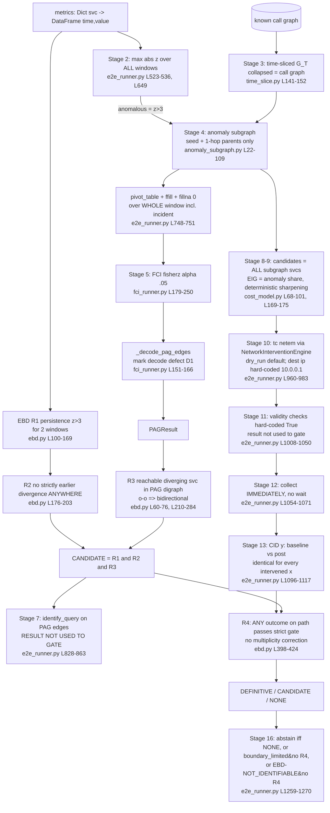

# RIFT Core Algorithm Audit (Recovery Workstream — Agent 2)

**Scope:** the full diagnosis path, from metrics through PAG, EBD invariants R1–R4, intervention selection and execution, CID verification, and final diagnosis or abstention.
**Files read in full:**
- [`ebd.py`](../../src/rift/ebd/ebd.py)
- [`fci_runner.py`](../../src/rift/fci/fci_runner.py)
- [`network_intervention.py`](../../src/rift/intervention/network_intervention.py)
- [`e2e_runner.py`](../../src/rift/pipeline/e2e_runner.py)
- [`stage4_attribution.py`](../../src/rift/pipeline/stage4_attribution.py)
- [`safety.py`](../../src/rift/safety/safety.py)

**Supporting files read:**
- [`cid.py`](../../src/rift/cid/cid.py), [`evidence.py`](../../src/rift/cid/evidence.py)
- [`identifiability.py`](../../src/rift/identifiability/identifiability.py)
- [`anomaly_subgraph.py`](../../src/rift/graph/anomaly_subgraph.py), [`time_slice.py`](../../src/rift/graph/time_slice.py)
- [`cost_model.py`](../../src/rift/optimizer/cost_model.py), [`closed_loop.py`](../../src/rift/loop/closed_loop.py)
- [`linux_tc_netem.py`](../../src/rift/intervention/backends/linux_tc_netem.py), [`intervention_lifecycle.py`](../../src/rift/intervention/intervention_lifecycle.py)
- [`rift_v3.py`](../../src/rift/attribution_v3/rift_v3.py)
- [`run_reproducible_evaluation.py`](../../scripts/run_reproducible_evaluation.py), [`validation_harness.py`](../../validation/validation_harness.py)
- [`synthetic_benchmark.py`](../../src/rift/benchmark/synthetic_benchmark.py)
- [`stage4_intervention_results.json`](../../artifacts/stage4_intervention_results.json)

**Method:** every finding below is either (a) a line-level static finding, or (b) an executable probe I ran against the real code in this checkout (macOS, Python 3.11, causal-learn installed, `tc` not installed). Probe scripts are in [`docs/recovery/algorithm_audit_probes/`](algorithm_audit_probes/). Run each one from the repository root. Findings that rely only on static reading are marked **[static]**. Findings that depend on Linux `tc` behaviour I could not execute are marked **[static, unexecuted on Linux]**.

**Verdict in one paragraph.** The *design* is sound: an observational shortlist, then interventional confirmation, then abstention when the causal query is not identifiable. The *implementation* does not currently deliver that design.

1. **R4 is circular in the end-to-end runner.** It re-tests "is the downstream service still anomalous?", not "did `do(X)` cause it". The post-window is collected with no wait after the intervention, and the CID value does not depend on which service was intervened.
2. **The PAG is not independent evidence.** It is learned on data that includes the incident's own regime shift. R3 then asks whether the candidate is connected, in that graph, to another service that also diverged. R3 is therefore close to a tautology.
3. **Abstention on non-identifiability is driven by labels in the evaluation harness and by FCI noise in the learned pipeline.** It is not driven by a sound identifiability test.
4. **Several safety and rollback guarantees are asserted but not enforced.**

Section 9 lists prioritized fixes.

---

## 1. Data-flow trace (what actually feeds what)

### Observations from the trace

- **Stage 7 identifiability is computed and then thrown away.**
  - `identifiable_pairs` is only written to provenance and a notes string, and no later stage reads it.
  - The only identifiability signal that gates the final answer is `EBDResult.identifiability_state`. That is a different, cruder test: "is any BIDIRECTED edge incident to the candidate?" ([`ebd.py`](../../src/rift/ebd/ebd.py:376), [`ebd.py`](../../src/rift/ebd/ebd.py:458)).
- **Stage 11 validation is vacuous.**
  - `verify(rec, measured_latency_ms=None)` returns `precision_check_pass=True` by construction ([`network_intervention.py`](../../src/rift/intervention/network_intervention.py:291)).
  - `clean_window`, `concurrent_event_free` and `recovery_confirmed` are literal `True` values ([`e2e_runner.py`](../../src/rift/pipeline/e2e_runner.py:1013)).
  - `isolation_verified or self.dry_run` is always truthy in dry-run.
  - Even when `all_valid` is `False`, the stage is recorded as `FAILED` and execution continues straight into CID and attribution.
- **The "closed loop" is a single pass.**
  - `max_iterations` is stored ([`e2e_runner.py`](../../src/rift/pipeline/e2e_runner.py:492)) and never read.
  - `ClosedLoop` is instantiated only to update a posterior that nothing consumes. The final attribution comes directly from `ebd_candidates[0]` ([`e2e_runner.py`](../../src/rift/pipeline/e2e_runner.py:1248)).

---

## 2. Algorithmic strengths (keep these)

| # | Strength | Evidence |
|---|---|---|
| S1 | **Strict, typed R4 evidence gate.** Finite W1, grade in {CANDIDATE, RELIABLE}, permutation-significant, and above both thresholds. Absent attributes fail closed. | [`evidence.py`](../../src/rift/cid/evidence.py:66-96) |
| S2 | **Typed CID identity `CIDKey(intervened, outcome)`** derived from the result itself, with KEY_IDENTITY_MISMATCH rejection. This fixed a producer/consumer key mismatch that had made DEFINITIVE unreachable. | [`evidence.py`](../../src/rift/cid/evidence.py:36-165) |
| S3 | **R2 is strict.** The old "tie-resolution" block that silently overrode a strictly-earlier R2 failure has been removed, and the regression is documented in place. | [`ebd.py`](../../src/rift/ebd/ebd.py:368-372) |
| S4 | **Temporal precedence outranks anomaly magnitude** in ranking: sort key `(tier, t_star, -score)`. | [`ebd.py`](../../src/rift/ebd/ebd.py:470-474) |
| S5 | **R1 distinguishes missing from non-exceeding windows.** An observed non-exceeding window always terminates a run, and only absent samples are bridged. | [`ebd.py`](../../src/rift/ebd/ebd.py:150-167) |
| S6 | **Clean evidence/label separation in Stage 4 offline attribution.** `build_evidence` reads only `pre_baseline`, `intervention` and `target_service`, and `infer()` has no label parameter. I confirmed that changing `target_service` does not change R1–R3. | [`stage4_attribution.py`](../../src/rift/pipeline/stage4_attribution.py:49-51, 206-283) |
| S7 | **No oracle fallback on FCI failure.** Both `infer` and the harness now abstain instead of building a PAG from ground truth. | [`stage4_attribution.py`](../../src/rift/pipeline/stage4_attribution.py:217-225), [`run_reproducible_evaluation.py`](../../scripts/run_reproducible_evaluation.py:207-220) |
| S8 | **Honest provenance fields.** `causal_path_kind` (DIRECTED / SEMI_DIRECTED), `evidence_type` (OBSERVATIONAL / INTERVENTIONAL) and `assumption_warnings` expose evidence quality. | [`ebd.py`](../../src/rift/ebd/ebd.py:52-53, 426-432) |
| S9 | **Hard sample floor.** CID returns no statistics at n<20. | [`cid.py`](../../src/rift/cid/cid.py:239-258) |
| S10 | **Fail-closed live-namespace handling.** The engine refuses `dry_run=False` without a validated `rift-eval-*` namespace. I confirmed `RIFTEndToEndRunner(..., dry_run=False)` raises `ValueError`. | [`network_intervention.py`](../../src/rift/intervention/network_intervention.py:184-193) |
| S11 | **Phipson–Smyth permutation p-value; bootstrap CI kept out of the significance decision.** | [`cid.py`](../../src/rift/cid/cid.py:147-171) |
| S12 | **The V3 design addresses most causal weaknesses below.** It uses the PAG only as a contradiction check, runs a manipulation check, runs a symmetry check, applies Holm correction, and blocks on unresolved earlier divergence. | [`rift_v3.py`](../../src/rift/attribution_v3/rift_v3.py:1-27, 177-267) |
| S13 | **Mark-decoder defect D1 is documented and has a regression test.** I independently re-reproduced it (Probe 9, §4.1). | `tests/unit/test_sprint440_attribution_v3.py` |

---

## 3. Oracle leakage and circularity inventory

Legend: **LEAK** means ground truth reaches the prediction. **CIRC** means the output of a stage is used as the evidence for that same stage or an upstream one. **ASSUME** means a hidden assumption that is not enforced.

| ID | Class | Where | What happens | How verified |
|---|---|---|---|---|
| L1 | **LEAK** | [`run_reproducible_evaluation.py`](../../scripts/run_reproducible_evaluation.py:135-153) `build_oracle_pag` | The `confounded` ground-truth flag is turned directly into a `BIDIRECTED` edge incident to the root. [`identifiability.py`](../../src/rift/identifiability/identifiability.py:103-107) then returns `NOT_IDENTIFIABLE`. "RIFT-FULL-ORACLE abstains on confounded" is therefore the label echoed through two functions. Labelled ORACLE, but the headline H2 "100% correct abstention" is the oracle variant. [`validation_harness.py`](../../validation/validation_harness.py:122-125) does the same. | Probe 7: oracle-PAG abstains on 24/24 confounded dev scenarios. |
| L2 | **LEAK** | [`run_reproducible_evaluation.py`](../../scripts/run_reproducible_evaluation.py:93-123) `generate_scenario_metrics` | The synthetic data is generated *from* `causal_path`, and the oracle PAG is built from the same `causal_path`. The data-generating process is identical to the graph handed to RIFT. | Static. |
| L3 | **LEAK (data)** | Same function | `confounded` is ignored by the generator. Confounded and non-confounded scenarios produce **byte-identical metrics**. The "confounded" dev scenarios contain no latent confounding in the data. | Probe 7: `equals()` is True for every service. The learned (FCI) variant **attributes 24/24 scenarios flagged confounded (0% abstention)**. |
| L4 | **LEAK (ground-truth timing)** | [`run_reproducible_evaluation.py`](../../scripts/run_reproducible_evaluation.py:322-324) | `incident_window = (injected_at_t-60, injected_at_t+120)` is computed from the ground-truth injection time. Baselines are hard-coded `{mean:0, std:10}`, exactly the generator's noise parameters ([`:303`](../../scripts/run_reproducible_evaluation.py:303) vs [`:90`](../../scripts/run_reproducible_evaluation.py:90)). RIFT is handed the true onset and the true noise scale. | Static. |
| L5 | **LEAK (label ordering)** | [`run_reproducible_evaluation.py`](../../scripts/run_reproducible_evaluation.py:100-102) | The downstream delay is `(i+1)·Δt` by **index in the ground-truth `causal_path` list**, not by graph depth. R2 passes for the root by construction. | Static. |
| L6 | **LEAK (expected-behaviour)** | [`run_reproducible_evaluation.py`](../../scripts/run_reproducible_evaluation.py:337) | `is_non_id = is_conf`. "Should abstain" is *defined* as the confounded flag, not derived from identifiability of the generated structure. | Static. |
| L7 | **FABRICATED COST** | [`run_reproducible_evaluation.py`](../../scripts/run_reproducible_evaluation.py:183-277) `run_rift_full_scenario` | The "RIFT-FULL" method computes no CID. Step 4 is labelled "CID validation" but only maps EBD tier to a constant (0.95 / 0.80). It then reports `total_intervention_ed_s=30.0` for an intervention that never ran. RIFT-FULL in this harness is observational R1–R3 plus an identifiability gate. Utility comparisons that charge κ·n_do on this method are not measuring an interventional method. | Static. |
| C1 | **CIRC** | [`e2e_runner.py`](../../scripts/../src/rift/pipeline/e2e_runner.py:1096-1117) Stage 13 + [`ebd.py`](../../src/rift/ebd/ebd.py:398-424) R4 | **R4 is a re-test of R1.** CID(x→y) compares y's pre-incident baseline with y's current window. That value is *identical for every x* (Probe 4: `CID x-specific? True`). The y that R4 inspects are the nodes on the R3 path, and the end of that path is by definition a diverging service. If the fault is still ongoing, y differs from baseline and R4 passes, whatever x the netem rule was applied to, including a dry-run where nothing was applied. | **Probe 8:** live-flagged telemetry, `dry_run=True`, fault ongoing → `final_state=PASS`, `attribution=A`, `DEFINITIVE`, `evidence_type=INTERVENTIONAL`, `is_valid_for_gate=True`. |
| C2 | **CIRC** | [`e2e_runner.py`](../../src/rift/pipeline/e2e_runner.py:748-751) + [`fci_runner.py`](../../src/rift/fci/fci_runner.py:220-225) | FCI is run on the pivoted whole-window data, including the incident regime shift (and `ffill().fillna(0.0)`). Services that shift together become statistically dependent *because of the shift*, producing edges (and even oriented edges) among independent services. R3 then requires the candidate to be PAG-connected to another *diverging* service. So the PAG edges are induced by co-divergence, and R3 tests co-divergence a second time. | **Probe 5B:** 10 independent noise columns, only 4 given a shared step, no causal links → 2–5 edges per run, including `DIRECTED` ones; at n=300, 7 edges. Independent data without a step gives 1–3 edges at n=27. |
| C3 | **CIRC** | [`ebd.py`](../../src/rift/ebd/ebd.py:326-327) | If `baselines` lacks a service, mean/std are computed from the *same frame that contains the fault*. The z-score is then self-referential and diluted. | Static. |
| C4 | **CIRC / type confusion** | [`e2e_runner.py`](../../src/rift/pipeline/e2e_runner.py:645-648) | `run(baseline_metrics=...)` is documented as "pre-incident baseline **DataFrames** per service" and is assigned directly to `baselines`, which downstream code treats as `{svc: {"mean","std"}}`. A DataFrame has no `"mean"` key, so `.get("mean", fallback)` silently falls back to self-baselining on the incident data. No error is raised. | **Probe 15:** max-z drops from 4.51/7.37 (correct baselines) to 3.14/3.37 (DataFrame passed). |
| C5 | **CIRC (baseline assumption)** | [`e2e_runner.py`](../../src/rift/pipeline/e2e_runner.py:538-550, 1102-1105) | The default baseline for both z-scores and CID is "first half of the observation window". If the fault begins in the first half, the baseline is contaminated. `incident_window` defaults to the whole window, so R1 can also fire inside the baseline half. | Static. |
| C6 | **CIRC (Stage 4 artifact)** | [`stage4_attribution.py`](../../src/rift/pipeline/stage4_attribution.py:24-28) | The pipeline is asked to find the cause of a perturbation the experimenter injected. `target_service` is the intervention. This is documented as "intervention-consistent by construction". The `incident_window` is the experimenter's active phase, which supplies the exact onset (so "detection latency" is not measured). | Static. |
| A1 | **ASSUME** | [`ebd.py`](../../src/rift/ebd/ebd.py:60-76, 261-282), [`run_reproducible_evaluation.py`](../../scripts/run_reproducible_evaluation.py:117-122) | The **edge direction convention is inconsistent**. Dataset `causal_path` edges are *call-direction* (`recommendation→product_catalog`), but the generator propagates divergence from the root outward in *effect* direction. For callee faults (e.g. `DF_02`) the primary R3 rule fails, and the **R3-leaf fallback** rescues the root. This is label-convention compensation. In a learned PAG, almost no node is a directed-only leaf, so the fallback is essentially an oracle-PAG artifact. | Probe 8: `DF_02` passes only via R3-leaf. |
| A2 | **ASSUME** | [`cid.py`](../../src/rift/cid/cid.py:147-171), A5 in [`CAUSAL_VALIDITY_AUDIT.md`](CAUSAL_VALIDITY_AUDIT.md) | The permutation test assumes exchangeability of baseline and post samples under H0. Adjacent windows of an autocorrelated series violate it. | **Probe 4:** AR(1, φ=0.8), no effect, 30 vs 30 adjacent samples → **53.5% false positive** at α=0.05. |
| A3 | **ASSUME** | [`e2e_runner.py`](../../src/rift/pipeline/e2e_runner.py:1054-1071) | The code assumes the effect of netem is visible in the post window the instant it is collected. See §6 (F-I1). | Static: no wait or settle time anywhere. |

**Note on prior documentation.** [`CAUSAL_VALIDITY_AUDIT.md`](CAUSAL_VALIDITY_AUDIT.md) (Agent 3) correctly flags window drift and the CANDIDATE ceiling. It does not catch C1 (R4 is x-agnostic and circular), C2 or L3. Those three are the highest-impact additions in this audit.

---

## 4. Per-stage technical findings

Severity: **P0** = invalidates a headline claim or safety property. **P1** = materially degrades correctness. **P2** = hygiene or latent.

### 4.1 `fci_runner.py` — PAG construction

| ID | Sev | Finding | Reference |
|---|---|---|---|
| F-1 | **P1** | **Mark-decoder defect D1 still live in the frozen path.** causal-learn encodes `M[x][y]` as the mark *at x*. A collider `X o-> Z` is `(M[X][Z], M[Z][X]) = (2, 1)`. The decoder's partially-directed branches test `(2,-1)` and `(-1,2)`, so `(2,1)` matches nothing and falls to `else: UNDIRECTED`. Colliders lose their arrowheads. A true `o--` `(2,-1)` is reported as `PARTIALLY_DIRECTED` (arrowhead invented). `ebd._pag_to_digraph` then adds both directions for `UNDIRECTED`. **Probe 9** (X→Z←Y, n=800): raw matrix `[[0,0,2],[0,0,2],[1,1,0]]`, decoded as two `UNDIRECTED` edges, and **`Z→X` is reachable** in the EBD digraph. | [`fci_runner.py`](../../src/rift/fci/fci_runner.py:139-166), [`ebd.py`](../../src/rift/ebd/ebd.py:72-74) |
| F-2 | **P0** | **FCI input includes the incident regime** (see C2), is not time-aware (iid Fisher-z on autocorrelated, step-shifted series), and `e2e_runner` fills gaps with `0.0`. For Stage 4, `wide` concatenates `pre_baseline` and `intervention` phases, giving n=27 rows for 10 variables. With so few rows the PAG is dominated by the phase step. | [`e2e_runner.py`](../../src/rift/pipeline/e2e_runner.py:748-751), [`stage4_attribution.py`](../../src/rift/pipeline/stage4_attribution.py:218-223) |
| F-3 | P1 | The `confidence` field on every `PAGEdge` is the placeholder `0.5` and is never refined, despite the comment "refined below". Downstream `ClosedLoop` seeds `edge_confidences` with a separate `0.5`. | [`fci_runner.py`](../../src/rift/fci/fci_runner.py:173), [`e2e_runner.py`](../../src/rift/pipeline/e2e_runner.py:1201-1203) |
| F-4 | P2 | `np.random.seed(seed)` mutates global RNG state as a side effect. This is a determinism hazard for any caller sharing the process (e.g. `compute_cid` seeds its own `Generator`, but MockTelemetry and others do not). | [`fci_runner.py`](../../src/rift/fci/fci_runner.py:218) |
| F-5 | P2 | `max_variables=15` plus Fisher-z with k≈10, n≈27: conditioning-set sizes up to k−2 on ≤27 rows are numerically fragile. Singular-correlation errors are swallowed by a broad `except Exception` and turned into an *empty* PAG (e2e) or an abstention (Stage 4). In e2e, an empty PAG still flows into EBD and the run can still end in a CANDIDATE attribution. | [`e2e_runner.py`](../../src/rift/pipeline/e2e_runner.py:758-767) |

### 4.2 `ebd.py` — R1…R4

**R1 (L100–169)**

- **P0 (live use):** persistence uses `max_step = Δt·(1+max_gap)+0.1Δt`. With `PrometheusClient.scrape_interval_s=15` → `step_s=15` ([`e2e_runner.py`](../../src/rift/pipeline/e2e_runner.py:293)) and `delta_t=10`, consecutive samples are 15 s apart, which is greater than 11 s. A run can never extend beyond length 1. **Probe 10:** 15 s sampling returns `(False, inf, 0.0)` for a clean step; 10 s sampling returns `(True, 100.0, 5.0)`. So under default live settings **R1 never passes, and every live run abstains or returns no EBD**. The mismatch is silent.
- P1: R1 defaults to `direction="both"`. A drop in RPS or an error-rate decrease counts as "divergence".
- P1: baseline std comes from the first-half sample of ≤15 points. Heavy-tailed latency makes |z|>3 far more frequent than the Gaussian 0.27%. In Stage 4 several baseline stds are sub-millisecond (`shippingservice` 0.179 ms, `productcatalogservice` 0.192 ms) because the series are plateau-constant. Tiny noise-level changes then clear z>3. This is consistent with four of ten services "diverging" (cartservice, frontend, shippingservice, adservice) for one perturbed service.
- P2: `t_start` parameter is unused.

**R2 (L176–203)**

- P1: R2 is **global**. A strictly earlier divergence on *any* service, including one unrelated to the candidate in the PAG, vetoes the candidate. One early false alarm on an independent service eliminates the true root. R2 should be conditioned on causal relatedness, i.e. earlier *and* a possible ancestor or in the same connected component.
- P1: the tie window `|Δt| ≤ 0.5·Δt` is a quantization artifact; ties are "resolved by R3" per the comment, but R3 does not use time (except the leaf case), so ties are resolved by dict order and `anomaly_score` only.
- P1: multi-root faults necessarily fail R2 for the later root.

**R3 (L210–284)**

- **P0 (circular, see C2):** with `UNDIRECTED`/`TAIL_TAIL` edges added bidirectionally, reachability is symmetric. R3 reduces to "my connected component contains another diverging service". **Probe 2/2b:** with `A o-o B o-o C`, R3 is True for every node regardless of which is earliest. Only R2 is doing any work.
- P1: R3 returns the first diverging service in `diverging_services` iteration order for which a path exists, not the nearest or earliest. `causal_path` (and therefore which `outcomes` R4 examines) depends on **dict insertion order** (`for svc in diverging_services: ... return True, edges`).
- P1: BIDIRECTED edges contribute nothing to reachability (correct), but a candidate whose *only* connection to the incident is `↔` can never satisfy R3, even though its adjacency to a diverging node is the strongest hint of a shared latent cause. The result is silently `NONE` rather than a flagged abstention.
- P2: see A1: the leaf fallback encodes a label convention.

**R4 (L398–424)**

- **P0:** see C1. Additional defects:
  - **No multiplicity control.** R4 passes if *any* outcome on the path passes (`if ok: r4_pass = True`, L410). With paths of length ≥3, α=0.05 per test, and a per-test pass probability that Probe 16 shows is near 1 for the effect-size gate under H0, the family-wise false R4 rate is uncontrolled. V3 applies Holm ([`rift_v3.py`](../../src/rift/attribution_v3/rift_v3.py:71-81, 205)). EBD does not.
  - **Unit-dependent threshold.** `theta_cid` defaults to an *absolute* `0.1` and is compared as `w1f > theta_cid` ([`evidence.py`](../../src/rift/cid/evidence.py:94)). In e2e, `lat_p99` is in **seconds**, so 0.1 means 100 ms. In Stage 4 the series is converted to **ms**, so 0.1 means 0.1 ms. [`e2e_runner.py`](../../src/rift/pipeline/e2e_runner.py:1150) never passes `theta_cid`, whereas V3 correctly passes `res.theta_cid`.
  - **Outcome set includes mediators and the candidate's callers**, so a hit anywhere on the path confirms the candidate.

**Identifiability inside EBD (L376–390, L458)**

- P1: `has_bidirected` is "any bidirected edge incident to the candidate", independent of the target. It sets `identifiability_state="NOT_IDENTIFIABLE"`, which is a different notion from `identify_query`'s verdict. Two separate, inconsistent identifiability definitions drive abstention in different code paths: EBD (e2e) vs `identify_query` (Stage 4 and the harness).

**`compute_ebd` ranking (L467–475)**

- P2: a candidate with `confidence=="NONE"` is still returned and sorted last. Callers that filter `r1_pass and r3_pass` rather than `confidence != "NONE"` accept it (see §4.5).

### 4.3 `identifiability.py` (consumed by Stage 7, Stage 4 and the harness)

| ID | Sev | Finding | Reference |
|---|---|---|---|
| I-1 | **P0** | **Unsound "IDENTIFIABLE".** `_build_directed_graph` includes only `DIRECTED` and `PARTIALLY_DIRECTED`. With a learned PAG that is 97% `o-o`, `dag.predecessors(source)` is empty and `check_backdoor` returns `[]` ("no parents → Z=∅ satisfies backdoor"). So `A o-o B` is reported `CONDITIONALLY_IDENTIFIABLE/BACKDOOR with Z=[]`, and **no edge at all between A and B** is reported `IDENTIFIABLE/BACKDOOR`. Probe 13 shows both. An `o-o` edge could hide a backdoor path, and a missing edge says nothing about identifiability of a *non-null* effect. | [`identifiability.py`](../../src/rift/identifiability/identifiability.py:152-169) |
| I-2 | **P0** | **Confounding test is source-adjacency only.** `_has_hidden_confounder_on_backdoor_path` returns True iff the source has an incident `↔`. It ignores the target, the path structure and whether the `↔` partner is related to the target. Despite the name, no backdoor path is analysed. | [`identifiability.py`](../../src/rift/identifiability/identifiability.py:87-107) |
| I-3 | P1 | **Step 4 ("no identification method applies → NOT_IDENTIFIABLE") is dead code** for any in-PAG pair: `check_backdoor` returns `None` iff confounding is detected, which Step 3 handles. A non-confounded pair always returns a backdoor set. So `NOT_IDENTIFIABLE` is reachable only when (i) the source or target is not in the PAG, or (ii) a source-adjacent `↔` exists with no directed `source⇝target` path. | [`identifiability.py`](../../src/rift/identifiability/identifiability.py:391-407) |
| I-4 | P1 | **Callers treat `REQUIRES_INTERVENTION` as pass.** [`stage4_attribution.py`](../../src/rift/pipeline/stage4_attribution.py:271) and [`run_reproducible_evaluation.py`](../../scripts/run_reproducible_evaluation.py:254) abstain only on `NOT_IDENTIFIABLE`. A confounded source with a directed path (`REQUIRES_INTERVENTION`) is attributed, and the harness never runs the intervention that status asks for. | as cited |
| I-5 | P1 | **Learned-PAG abstention is driven by FCI noise.** In the real Stage 4 artifact, `infer()` abstains `NOT_IDENTIFIABLE` because FCI emitted `cartservice ↔ emailservice` (n=27 rows). There is no reason to believe a latent confounder exists between these services. Abstention here is spurious: right outcome, wrong reason. | Probe 14 / S4 output |
| I-6 | P2 | Front-door detection handles only the 2-hop chain `X→M→Y` with a single mediator layer, does not check M-blocking, and ignores PAG circles. | [`identifiability.py`](../../src/rift/identifiability/identifiability.py:172-224) |

**Net effect on "failure to distinguish identifiable from non-identifiable scenarios."** The gate separates only "source has an adjacent `↔` (and no directed path)" from everything else. Hidden confounding that FCI does not render as an adjacent `↔` is classed identifiable. That is the common case: Sprint 4.4.0 reports only 1/3 bidirected edges among 277/167 learned edges. Measured on the repository's legacy dev split, the learned pipeline abstains on **0/24** scenarios flagged confounded (Probe 7), against **24/24** when the label is injected as a PAG edge.

### 4.4 `network_intervention.py`, `linux_tc_netem.py`, `intervention_lifecycle.py`

| ID | Sev | Finding | Reference |
|---|---|---|---|
| N-1 | **P0** [static, unexecuted on Linux] | **Band-1 handle collides with the root qdisc.** For `tc_handle="1:"` the emitted command is `tc qdisc add dev eth0 parent 1:1 handle 1: netem ...` (Probe 19 prints exactly this), but the root prio qdisc is already `handle 1:`. A qdisc major number must be unique per device, so the kernel should reject this. The earlier live-validated run used `parent 1:1 handle 10: netem` (see `applied_qdisc` in [`stage4_intervention_results.json`](../../artifacts/stage4_intervention_results.json)), which is valid. The "fix" conflated the qdisc **handle major** (arbitrary) with the prio **band minor** (1–3). The prio docstring is correct about the bands, but the code constrains the wrong value. | [`network_intervention.py`](../../src/rift/intervention/network_intervention.py:31-32, 119-135, 246-249) |
| N-2 | **P0** | **Lifecycle path is broken by that same validation.** `intervention_lifecycle.apply()` builds `tc_handle="10:"`, which now raises `ValueError` in `NetworkInterventionRecord.__post_init__`. Probe 18 confirms. The tested/working handle value is rejected. | [`intervention_lifecycle.py`](../../src/rift/intervention/intervention_lifecycle.py:278), [`network_intervention.py`](../../src/rift/intervention/network_intervention.py:119-135) |
| N-3 | **P0** [static + simulated] | **Second concurrent intervention always fails live.** Every `apply()` re-issues `tc qdisc add ... root handle 1: prio`. The code comment says "idempotent: ignore error if already exists", but the loop treats any non-zero return as failure. **Probe 5** (simulated `tc` returning `File exists` for the second root add): first apply → `APPLIED`, second → `FAILED`. MSIS can select up to three interventions (`prio_band = i % 3 + 1`), so multi-intervention runs fail by design. | [`network_intervention.py`](../../src/rift/intervention/network_intervention.py:242-266) |
| N-4 | **P0** | **Wrong target address.** The e2e runner hard-codes `destination_ip="10.0.0.1"` ("placeholder — populated from k8s DNS at runtime" — it never is) and sets `source_service == destination_service`. In a live run the u32 filter would delay traffic to whatever is at 10.0.0.1, not to the candidate service. The CID the pipeline then computes is unrelated to the service named in the record. | [`e2e_runner.py`](../../src/rift/pipeline/e2e_runner.py:964-975) |
| N-5 | P1 | `rollback()` unconditionally sets `ROLLED_BACK` and pops the record, even when **every** tc command failed (`all_ok` is computed and never used). **Probe 5:** all commands failing still yields `ROLLED_BACK`. `assess_post_rollback()` is never called anywhere, so a failed rollback never trips the kill switch. | [`network_intervention.py`](../../src/rift/intervention/network_intervention.py:326-337) |
| N-6 | P1 | The engine's rollback does not delete the root prio qdisc (the backend does). It leaves a residual `prio 1:` root qdisc, which differs from the "restored_qdisc = noqueue" state the live artifact reported as verified. | [`network_intervention.py`](../../src/rift/intervention/network_intervention.py:315-324) vs [`linux_tc_netem.py`](../../src/rift/intervention/backends/linux_tc_netem.py:220-229) |
| N-7 | P1 | **No try/finally around apply→measure→rollback** in the e2e runner. `rollback_all()` sits at the end of the happy path ([`e2e_runner.py`](../../src/rift/pipeline/e2e_runner.py:1319)). Any exception in stages 11–17 (CID, EBD, closed loop) leaves live netem rules installed. | static |
| N-8 | P1 | `verify()` assumes success when `measured_latency_ms is None` (the only way the e2e runner calls it). The engine copy has no independent measurement; only the Linux backend reads `tc qdisc show`, and it does so by substring match of the handle digit, which a `1` would match against any `1` in the output. | [`network_intervention.py`](../../src/rift/intervention/network_intervention.py:290-293), [`linux_tc_netem.py`](../../src/rift/intervention/backends/linux_tc_netem.py:196-199) |
| N-9 | P2 | `verify_side_effect_isolation` is never called anywhere in `src/`. Its argument is named `sigma_threshold` but implements a 20% relative-change rule (`sigma·0.1`). | [`network_intervention.py`](../../src/rift/intervention/network_intervention.py:348-367) |
| N-10 | P2 | The engine and the Linux backend are two divergent copies of apply/rollback logic with different rollback semantics (N-6) and different verification (N-8). The e2e runner uses the engine, and the live experiments historically used the backend/scripts. | both files |
| N-11 | P2 | The CLI `apply` path in the engine prefixes `ip netns exec <ns>`, while the live artifact used `nsenter -t <pid> -n`. Only the backend supports PID/netns-path wrapping. | as above |

### 4.5 `e2e_runner.py` — pipeline orchestration

| ID | Sev | Finding | Reference |
|---|---|---|---|
| E-1 | **P0** | **R4 circularity (C1) makes `DEFINITIVE` reachable with no intervention at all** (Probe 8: `dry_run=True`, `is_valid_for_gate=True`). `is_valid_for_gate` checks only `live_telemetry_used and not synthetic_substitution`; it does **not** check `dry_run` or that any intervention was applied. A dry run on a live Prometheus source is recorded as a valid Gate-3.5E run. | [`e2e_runner.py`](../../src/rift/pipeline/e2e_runner.py:422-430, 1096-1117) |
| E-2 | **P0** | **No settle/dwell time.** There is no `sleep` or wait between `apply()` and `collect()` ([`e2e_runner.py`](../../src/rift/pipeline/e2e_runner.py:960-1055)). The configured `ed` (30 s) is only a cost-model number. Prometheus `rate(...[2m])` queries are looking back 2 minutes. The "post" window is overwhelmingly pre-intervention data. | static |
| E-3 | **P0** | **Default sample sizes make R4 unreachable.** With `MockTelemetry` defaults, post = 6 points; with `PrometheusClient` defaults, 300 s / 15 s = 20 baseline-half points (10 in the half) and 60 s / 15 s = 4–5 post points. All are below n=20 → `INSUFFICIENT`. **Probe 3:** all 9 CID entries are `INSUFFICIENT`, `n_pairs=9`, final `ABSTAINED`. The only way to see DEFINITIVE is to widen windows (Probe 8 used 600 s / 300 s). Defaults and CID floor are mutually inconsistent. | [`e2e_runner.py`](../../src/rift/pipeline/e2e_runner.py:481, 293, 346), [`cid.py`](../../src/rift/cid/cid.py:49-55) |
| E-4 | **P1** | **Stage-2 anomaly gate is not the R1 rule.** It uses `max |z|` over *all* windows, including the baseline half, with the std estimated from that same half. **Probe 12:** null per-service alarm probability is 13.8% for n=30. With 10 independent services, P(≥1 false alarm) ≈ 78%. Single-window spikes enter the subgraph and are intervened on, then fail R1 later. | [`e2e_runner.py`](../../src/rift/pipeline/e2e_runner.py:523-536, 649) |
| E-5 | **P1** | **Intervention candidates = every subgraph service, with identical parameters** (`target_value=100.0`, `nominal=10.0`, `LATENCY`). The "selection" step cannot be selective and is not informed by the PAG, identifiability or the R2/R3 shortlist. | [`e2e_runner.py`](../../src/rift/pipeline/e2e_runner.py:874-884) |
| E-6 | **P1** | **The "posterior" is anomaly magnitude share**, not P(root cause). Downstream-amplified symptoms have the largest z. EIG is proportional to this share (cost_model placeholder). The greedy loop updates the posterior *before* any outcome is observed (deterministic sharpening, not Bayesian). `stopped_reason="BUDGET_EXHAUSTED"` is reported when every candidate was simply selected. Probe 3: entropy reduction 0.0 with 3 interventions selected. | [`e2e_runner.py`](../../src/rift/pipeline/e2e_runner.py:867-872), [`cost_model.py`](../../src/rift/optimizer/cost_model.py:68-101, 169-175, 312-324) |
| E-7 | **P1** | **Stage 7 identifiability result is unused** (see §1) and SafetyController is never consulted: `self._safety_checker` is constructed and never read; `assess_pre_intervention`, `assess_during_intervention` and `assess_post_rollback` have no callers in `e2e_runner.py`. | [`e2e_runner.py`](../../src/rift/pipeline/e2e_runner.py:496) |
| E-8 | **P1** | **Abstention rule accepts observational-only attribution.** `abstain` is True only for `confidence=="NONE"`, `boundary_limited and not r4`, or EBD-`NOT_IDENTIFIABLE and not r4`. A `CANDIDATE` (R1–R3 only, with R3 ≈ connectivity) is reported as `PASS` with an attribution. The `boundary_limited` that gates this is `not dag.has_node(service)`, not the subgraph pruning flag from `build_anomaly_subgraph`, which never reaches the abstention rule. | [`e2e_runner.py`](../../src/rift/pipeline/e2e_runner.py:1259-1270), [`ebd.py`](../../src/rift/ebd/ebd.py:442) |
| E-9 | P1 | `build_anomaly_subgraph` is called without `pag_bidirected_pairs` ([`e2e_runner.py`](../../src/rift/pipeline/e2e_runner.py:709)), so Step 3 (bidirected expansion) is dead in the pipeline, because the PAG is learned *after* the subgraph. Ancestor closure is 1-hop. The docstring says Cases B and C yield `boundary_limited=TRUE`, but the code's own validation harness expects and returns `False` for both. | [`anomaly_subgraph.py`](../../src/rift/graph/anomaly_subgraph.py:30-46, 142-174) |
| E-10 | P1 | **Stage 11 failure does not stop the run** (see §1). | [`e2e_runner.py`](../../src/rift/pipeline/e2e_runner.py:1040-1050) |
| E-11 | P2 | `post_metrics` has a **synthetic fallback** inside a live run (`np.random.default_rng(99)`) on `NotImplementedError` and sets `synthetic_sub=True`, which is correct, but the fallback means a "post-intervention" data set can be noise unrelated to the system. | [`e2e_runner.py`](../../src/rift/pipeline/e2e_runner.py:1061-1071) |
| E-12 | P2 | `PrometheusClient._result_to_dataframe` averages multiple series per service at each timestamp, hiding per-instance/per-pod behaviour. `rate()` window (2m) overlaps the 10 s Δt, adding strong autocorrelation (violates iid assumptions in FCI and CID). | [`e2e_runner.py`](../../src/rift/pipeline/e2e_runner.py:225-253) |
| E-13 | P2 | `time_slice.min_correlation` is declared and never used. `collapse_to_service_graph` returns exactly the call graph restricted to observed services, so "TIME_SLICED_GT" adds no information. | [`time_slice.py`](../../src/rift/graph/time_slice.py:19, 141-152) |

### 4.6 `stage4_attribution.py` — offline attribution on the single live trial

This module is the cleanest part of the system (strengths S6, S7). Remaining issues:

- **P1: `predicted_root` is set while `abstained=False` for a `confidence_label="NONE"` candidate.**
  - `passing = [e for e in ebd if e.r1_pass and e.r3_pass]` ([`stage4_attribution.py`](../../src/rift/pipeline/stage4_attribution.py:236)) ignores R2.
  - `label = top.confidence if top.confidence in _CONF_SCORE else "NONE"` ([`:274`](../../src/rift/pipeline/stage4_attribution.py:274)) produces `confidence=0.0` and `label="NONE"`, yet the returned object has `abstained=False` and `predicted_root=top.service_id`.
  - **Probe 1** shows the same structure: A is the earliest and true root but isolated, so B (later onset) is `NONE` and still becomes `passing_ebd[0]`. In the harness version the same candidate is reported with score 0.80.
- **P1: Identifiability query is `(top, latest-diverging other)`.** One arbitrary pair stands for the whole answer ([`:263`](../../src/rift/pipeline/stage4_attribution.py:263)). `all_pairs` is diagnostic only.
- **P1: n_pre=15, n_active=12, so every CID is `INSUFFICIENT`** (<20). R4 cannot pass; the artifact's DEFINITIVE path is unreachable by design, and the module comment concedes that effective sample size is lower still because the series are plateau-constant. Probe 14 confirms `n_pre 15, n_act 12`.
- **P2:** The saved artifact [`stage4_intervention_results.json`](../../artifacts/stage4_intervention_results.json) still carries `attributed_root_cause: cartservice`, `attribution_accuracy_top1: 1.0` and `verdict: PASS`. Re-analysis through this module yields `ABSTAINED / NOT_IDENTIFIABLE` (S4 output). The two are contradictory in the repo; the stale labels should be quarantined or annotated.

**Measured result of the real pipeline on the repo's only live trial (Probes 9, 14):** `ebd_candidate=cartservice (CANDIDATE)`, tied at t* with `frontend`, `shippingservice` and `adservice`; `cid_grade=INSUFFICIENT`; `identify_query(cartservice, frontend) = NOT_IDENTIFIABLE` because FCI emitted `cartservice ↔ emailservice`; final outcome `ABSTAINED(NOT_IDENTIFIABLE)`.

### 4.7 `cid.py` / `evidence.py` / `closed_loop.py`

| ID | Sev | Finding | Reference |
|---|---|---|---|
| D-1 | **P1** | **The effect-size gate is vacuous.** `θ_cid = 0.1·IQR(baseline)`. **Probe 16:** under a true null (30 vs 30 iid N(0,1)) `P(W1 > 0.1·IQR) = 98.35%`. It cannot discriminate, so the only real filter is the permutation p-value, which suffers from A2 (53.5% FP under adjacent-window autocorrelation). Combined with the unit-dependent EBD `theta_cid` (§4.2 R4), R4's "above threshold" requirement provides no protection. | [`cid.py`](../../src/rift/cid/cid.py:236-237, 275) |
| D-2 | P1 | `CIDEvidenceStore` / `compute_cid` assign evidence to `(x, y)` from labels the caller supplies. Nothing in `compute_cid` ensures the samples were actually collected under `do(x)`. The identity check (S2) guarantees *consistent labelling*, not *causal provenance*. | [`evidence.py`](../../src/rift/cid/evidence.py:106-112) |
| D-3 | P1 | Grade is `min(n_base, n_post)`, so asymmetric designs (long baseline, short post) are capped by the short window. | [`cid.py`](../../src/rift/cid/cid.py:233) |
| D-4 | P1 | **Posterior update saturates and is unit-dependent.** `update_candidate_posterior` clips raw W1 to `(1e-6, 1−1e-6)` before a Beta pdf. **Probe 6:** W1=0.3 gives P(a)=0.155; W1=2.0 or 40.0 both give P(a)=1.0. e2e passes raw W1 in the series' native unit, so seconds vs ms flips the outcome. `update_edge_confidence` likewise compares the same raw W1 to an absolute 0.1. | [`closed_loop.py`](../../src/rift/loop/closed_loop.py:177-218), [`e2e_runner.py`](../../src/rift/pipeline/e2e_runner.py:1218-1221) |
| D-5 | P2 | `_clip` is defined twice in `closed_loop.py` with different signatures; the second silently replaces the first. `check_stopping` references module-level `_T_BUDGET` defined after the class. | [`closed_loop.py`](../../src/rift/loop/closed_loop.py:54, 401) |
| D-6 | P2 | A_POS/B_POS = Beta(3,1) vs Beta(1,3) are asserted "set by causal reasoning, not tuned", but the unit mismatch above means the likelihood is applied to a quantity with no common scale. | [`closed_loop.py`](../../src/rift/loop/closed_loop.py:78-101) |

### 4.8 `safety.py`

| ID | Sev | Finding | Reference |
|---|---|---|---|
| SF-1 | **P0** | **The safety controller is not on the e2e call path** (E-7). The documented guarantee "must be consulted BEFORE any intervention" holds only for `InterventionLifecycle.authorize`, which is itself broken by N-2. | [`safety.py`](../../src/rift/safety/safety.py:49), [`intervention_lifecycle.py`](../../src/rift/intervention/intervention_lifecycle.py:214) |
| SF-2 | P1 | **Soft limits are not limits.** `max_blast_radius=0.30` and `max_sla_impact=0.05` only add strings to `checks_failed`. **Probe 4:** blast radius 0.9 and SLA impact 0.5 still return `APPROVED_SUPERVISED`. | [`safety.py`](../../src/rift/safety/safety.py:232-267) |
| SF-3 | P1 | `human_override=True` promotes `SUPERVISED → AUTONOMOUS` even for borderline cases that failed the soft checks (**Probe 4**). Contradicts the docstring's intent that it only promotes "borderline" cases. | [`safety.py`](../../src/rift/safety/safety.py:259) |
| SF-4 | P1 | `approved_targets` empty means *any* target is authorized (`if self.approved_targets and ...`). Fail-open default. | [`safety.py`](../../src/rift/safety/safety.py:172) |
| SF-5 | P1 | `assess_during_intervention`: the isolation check runs only `if non_target_baseline_stats:`. When omitted, the check passes silently. The argument is otherwise unused, and `non_target_metrics` is interpreted as pre-computed anomaly scores, which the caller must have computed. `SAFE_ABORT` is only a return value; nothing in the pipeline reacts to it. Cascade timing uses wall clock and depends on call cadence. | [`safety.py`](../../src/rift/safety/safety.py:338-359, 312-334) |
| SF-6 | P2 | Namespace regex `^rift-eval-.+$` uses `$`, which matches before a trailing newline. Mitigated by the `in approved_namespaces` check. | [`safety.py`](../../src/rift/safety/safety.py:57, 93-96) |
| SF-7 | P2 | `cost.execution_duration_s` comes from a fixed per-type table (30 s for LATENCY) rather than the spec formula in the comment (`max(3·p99, 64/rps)`), so budget checks are not tied to the observation needed for n≥20 (see E-3). | [`cost_model.py`](../../src/rift/optimizer/cost_model.py:151-160) |

---

## 5. Identifiable vs non-identifiable: does the system distinguish them?

**Short answer: not in a way that survives contact with learned graphs.**

| Scenario class | What *should* happen | What happens in the harness with oracle PAG | What happens with learned PAG |
|---|---|---|---|
| Identifiable, causal chain | Attribute (after interventional confirmation) | 13/26 attributed correctly, 13 abstained (4 `NOT_IDENTIFIABLE` on non-confounded; 9 `NO_CANDIDATES`) (Probe 7) | 20/26 correct, 3 wrong, 3 `NO_CANDIDATES` |
| Latent confounder (dev "confounded") | Abstain | 24/24 abstain (**label-driven**, L1) | **0/24 abstain**; 24/24 attributed (data contain no confounding, L3, so attributing is consistent with the generated data but contradicts the label) |
| Latent confounder in a faithful simulator | Abstain | n/a | Depends on FCI emitting a source-adjacent `↔`. Measured rate across the benchmark is ≈1–3 of ~170–280 edges (Sprint 4.4.0 §3). |
| Unoriented `o-o` neighbourhoods (97% of edges) | Abstain or require intervention | `identify_query` returns `CONDITIONALLY_IDENTIFIABLE` with Z=∅ (I-1) | same |
| Non-adjacent hidden confounding | Abstain | not representable in oracle PAG | classified `IDENTIFIABLE` (I-2) |
| Insufficient CID samples (n<20) | Never claim DEFINITIVE | harness never computes CID (L7) | e2e defaults make n<20 (E-3); Stage 4 trial n=15/12 |

Mechanism-level reasons the system cannot separate the classes:

1. The identifiability decision depends on (a) a source-adjacent `↔`, and (b) the *absence* of a directed path. It does not analyse backdoor or front-door paths (I-1, I-2, I-3).
2. The learned PAG is mostly unoriented, built from data confounded by the incident regime (C2), and its mark decoder loses collider arrowheads (F-1).
3. Two different identifiability definitions gate different code paths (EBD adjacency vs `identify_query`).
4. The evaluation labels *non-identifiable* as "confounded flag" (L6) and injects the flag into the oracle graph (L1), so reported abstention accuracy cannot discriminate a working identifiability test from an echo.

---

## 6. End-to-end failure modes (consolidated)

| Code | Failure | Consequence | Items |
|---|---|---|---|
| FM-A | Live default sampling (15 s) vs Δt=10 s | R1 never fires → every live run abstains/returns no EBD | R1, Probe 10 |
| FM-B | Post window collected immediately, with no dwell | R4 sees pre-intervention data (or ongoing fault) | E-2 |
| FM-C | CID independent of x | R4 ≡ "downstream still anomalous" | C1, Probe 4, Probe 8 |
| FM-D | `is_valid_for_gate` ignores `dry_run` and applied-intervention state | dry runs counted as valid Gate-3.5E runs | E-1 |
| FM-E | Hard-coded `10.0.0.1` destination | perturbs the wrong host in a live run | N-4 |
| FM-F | Band-1 handle collision; second `root prio` add fails | live apply fails or only one intervention ever works | N-1, N-3 |
| FM-G | Exception between apply and rollback | rules left installed; `rollback_all` unreached | N-7 |
| FM-H | PAG learned on regime-shifted data | edges (even oriented) among independent co-diverging services; R3 tautology | C2, F-2, Probe 5B |
| FM-I | R2 global veto | one false early alarm on an unrelated service removes the true root | R2 |
| FM-J | Candidate with `confidence=NONE` surfaces as an answer | wrong attribution with score 0.80 (harness) or 0.0-confidence attribution (Stage 4) | Probe 1, §4.6 |

---

## 7. What is genuinely validated vs what is not

| Claim | Status |
|---|---|
| "R4 needs interventional evidence" | **Not true in e2e** (C1). Strictly true in V3 (`do(x)` simulated per candidate, manipulation check, Holm). |
| "RIFT abstains on confounded incidents (24/24)" | **Label echo** (L1, L3, L6). Learned variant: 0/24. |
| "Identifiability gate prevents unsafe attribution" | Gate fires on source-adjacent `↔` only; unsound for `o-o` (I-1, I-2). |
| "Safety controller enforces hard stops" | Hard stops exist as functions. Not wired into e2e (SF-1). Soft limits are advisory (SF-2). |
| "Rollback verified" | One live trial verified qdisc restoration (artifact). Code paths that run in e2e do not verify (N-5, N-6) and use a different handle (N-1). |
| "Closed loop updates a causal model from interventions" | One-shot; posterior and edge confidences never influence the answer (§1). |
| "Stage 4 live trial supports P@1 = 1.0" | Stale hard-coded label in the artifact. Re-analysis yields ABSTAINED (§4.6). |

---

## 8. What this audit did not do

- Did not execute `tc` (not installed on this macOS host). N-1, N-6 and N-8 are static reasoning on iproute2 semantics, backed by the already-validated live artifact that used `handle 10:`. Verify on the Linux testbed before relying on them.
- Did not re-run the V3 pipeline or the confirmatory statistics.
- Did not modify any source file. All fixes below are proposals.

---

## 9. Prioritized implementation fixes

Ordering is by (impact on scientific validity or live safety) ÷ (effort). Each item names files and a concrete change, plus an acceptance test.

### P0 — fix before any further claim or live run

**P0-1. Make R4 genuinely interventional (kills C1, E-1, FM-C, FM-D).**
- *Change* ([`e2e_runner.py`](../../src/rift/pipeline/e2e_runner.py:1096-1117), [`ebd.py`](../../src/rift/ebd/ebd.py:398-424)):
  1. Collect a **control** window concurrent with the intervention (a no-op or the same service pair observed without netem) and compare *post-do(x)* against that, not against a pre-incident baseline. As a minimum, compare against the **pre-do window inside the incident**, so an ongoing fault cancels.
  2. Require a **manipulation check**: do(x) must shift x's own latency (V3's `gate[x] and pv[x] < ALPHA`).
  3. Require `rec.status == VERIFIED` with a *measured* latency and `rec.dry_run == False`. Otherwise R4 is not evaluated and `evidence_type="OBSERVATIONAL"`.
  4. Apply **Holm** across the outcome set (reuse [`rift_v3.py`](../../src/rift/attribution_v3/rift_v3.py:71-81)) and require the confirmed effect set to contain a node causally downstream (PAG-compatible) of x.
  5. `RIFTRunRecord.is_valid_for_gate` must also require `not dry_run` and at least one `VERIFIED` live intervention.
- *Acceptance tests:*
  - Probe 8 must yield `ABSTAINED` or `CANDIDATE/OBSERVATIONAL`, never `DEFINITIVE`, in `dry_run=True`.
  - A persisting fault with the intervention applied to an *innocent* service must not produce R4=True for it.
  - Add a regression test that two different `x` with identical (base, post) do not both pass R4 without a per-x control.

**P0-2. Add dwell and window sizing (E-2, E-3, FM-A, FM-B).**
- *Change:* `post_window_s` must be ≥ `n_min·step_s` where `n_min=30`. Wait `settle_s = 2·rate_window + propagation` after `apply()` before `collect()`. Derive `step_s` from the actual scrape interval and pass it to EBD (`delta_t = step_s`, or let `_check_r1` accept `step_s` separately from the persistence unit). Fail loudly when `delta_t < sampling interval`.
- *Acceptance:* a 15 s-step synthetic step function must pass R1; a configuration that would yield n<20 CID must raise or force `CANDIDATE`-at-most with an explicit reason, not run.

**P0-3. Fix live-intervention correctness (N-1…N-4, N-7, FM-E/F/G).**
- *Change:*
  1. Decouple **qdisc handle major** from **prio band minor**: `parent 1:{band} handle {10*band}: netem` (restoring the live-validated `10:`/`20:`/`30:`), and relax `tc_handle` validation accordingly. Keep `{1,2,3}` validation on `prio_band`/flowid only.
  2. Make root qdisc add genuinely idempotent: `tc qdisc show` first, or treat `File exists` on the root as success.
  3. Resolve `destination_ip` from service discovery and **refuse to run** (`FAILED`) when it is the placeholder. Do not set `source_service == destination_service`.
  4. Wrap Stages 10–17 in `try/finally: rollback_all()`; make rollback return failure and call `SafetyController.assess_post_rollback`.
  5. Merge the engine and `LinuxTcNetemBackend` into one implementation; make rollback also remove the root qdisc it created, and verify against `tc qdisc show` that the restored state equals the recorded initial state.
- *Acceptance:* a unit test with a fake `_run_cmd` returning `File exists` on the second root add must still apply 3 interventions; a test that raises in CID must still call rollback; a rollback with all commands failing must return `ROLLBACK_FAILURE` and trip the kill switch. Linux integration test: install three interventions, roll back, compare `tc qdisc show` to the initial state.

**P0-4. Remove label leakage from evaluation (L1–L7).**
- *Change* ([`run_reproducible_evaluation.py`](../../scripts/run_reproducible_evaluation.py), [`validation_harness.py`](../../validation/validation_harness.py)):
  - Generate metrics **with** a shared latent driver when `confounded=True` (a single `U` added to both services, independent per-service noise otherwise), and verify via a test that confounded ≠ non-confounded data.
  - Do not build the oracle PAG from `confounded`; build it from the true latent-variable DAG (marginalise `U`), and derive "should-abstain" from an identifiability computation on that true MAG, not from the flag.
  - Derive `incident_window` and baseline stats from pre-incident data, not from `injected_at_t` or generator constants. Index downstream delay by graph depth, not by list position.
  - Either implement CID/interventions in `run_rift_full_scenario` or rename the method and drop the fabricated `total_intervention_ed_s=30.0`.
  - Report H2 using the **learned** variant as the primary result and the oracle variant only as an upper bound.
- *Acceptance:* with the generator fix, a test must show the oracle variant's abstention on confounded scenarios is the same with and without the `confounded` field present in the scenario dict (i.e. derived from structure).

**P0-5. Wire SafetyController into the pipeline and make limits real (E-7, SF-1…SF-5).**
- *Change:* call `assess_pre_intervention` before each `apply()`, `assess_during_intervention` on a timer while the rule is installed, and `assess_post_rollback` after each rollback; abort the run on `SAFE_ABORT`. Make `max_blast_radius`/`max_sla_impact` hard denies. Default `approved_targets` to deny-all (or require explicit `allow_any=True`). Restrict `human_override` to `SUPERVISED → AUTONOMOUS` only for candidates whose soft checks passed. Raise (not silently pass) when `non_target_baseline_stats` is missing.
- *Acceptance:* Probe 4 must yield `DENIED` for blast radius 0.9; an e2e run with a stub safety controller returning `SAFE_ABORT` must not call `apply()`.

### P1 — correctness of the core inference

**P1-1. Stop learning the PAG on the incident regime (C2, F-2, FM-H).**
- *Change:* learn structure from **pre-incident** (or regime-stationary) data, or include the regime indicator as a context/exogenous variable (e.g. use a time-aware CI test or add the incident indicator to the conditioning set). Do not `fillna(0.0)`; interpolate within gaps or drop rows. Remove duplicate-regime concatenation in Stage 4. Require `n_rows ≥ max(60, 10·k)` or abstain `INSUFFICIENT_SAMPLES` (the V2 path already has this guard, the e2e and Stage 4 paths do not).
- *Acceptance:* Probe 5B must return ~0 edges for independent services sharing only a step shift.

**P1-2. Fix the PAG mark decoder (F-1) in the frozen path, or retire it.** Port the V3 `decode_marks` logic, keeping a new freeze hash. Add the collider regression (Probe 9) to the CI gate. Until fixed, do not add `UNDIRECTED` edges bidirectionally to the EBD digraph; use circles as "possible" only.

**P1-3. Rebuild R3 as a PAG-aware, not component-aware, test (R3).** Require a *possible-ancestor* relation using proper marks (not symmetric `o-o`) and treat `o-o`-only connectivity as `SEMI_DIRECTED` evidence that cannot by itself reach CANDIDATE. Pick the **earliest/nearest** diverging descendant (deterministic), not the first in dict order. Delete the leaf fallback or gate it behind an explicit `edge_semantics="call_direction"` parameter, resolving the call-direction vs effect-direction ambiguity (A1) at the data boundary.

**P1-4. Make R2 relative to relatedness (R2).** Count an earlier divergence only if it is in the candidate's connected component (or a PAG-possible ancestor). Surface unrelated earlier divergences as warnings, and report per-service Δ in t* with a quantization-aware tie rule.

**P1-5. Replace identifiability with a sound check (I-1…I-6, §5).**
- Use an actual backdoor/front-door check on the **MAG/PAG with circles treated as unknown** (e.g., adjustment-set existence via a PAG-valid criterion such as generalized adjustment, or `dowhy`/`causal-learn` m-separation helpers). Treat any `o`-marks incident to source or target as `CONDITIONALLY_IDENTIFIABLE → REQUIRES_INTERVENTION`, never `IDENTIFIABLE`.
- Treat "no edge between source and target" as `NO_EFFECT_SUPPORTED`, not `IDENTIFIABLE`.
- Make `REQUIRES_INTERVENTION` an abstention unless the interventional gate (P0-1) passed.
- Unify the two definitions: delete `has_bidirected` shortcut in `compute_ebd`, and use `identify_query` for every (candidate, confirmed-effect) pair.
- *Acceptance:* a truth table of small hand-built PAGs (confounded, unconfounded, `o-o`, missing edge, collider, mediator) with expected statuses.

**P1-6. CID statistics (D-1, A2, R4 multiplicity).**
- Replace the 0.1·IQR gate with an effect-size threshold in **units of baseline σ** (e.g. W1 > 0.5·σ_base) pre-registered from a null calibration; test it against the null in CI.
- Use a **block / circular-shift permutation** (preserving autocorrelation) or pre-whiten before permuting. Provide a drift guard comparing two pre-incident windows (A1 falsification in [`CAUSAL_VALIDITY_AUDIT.md`](CAUSAL_VALIDITY_AUDIT.md) §9.2).
- Apply Holm in `compute_ebd` R4 across outcomes. Pass `res.theta_cid` (not the absolute default) and remove the second threshold, or make `theta_cid` a documented unit-normalized value.
- Keep `closed_loop` consumers unit-consistent: feed `W1/θ_cid` or `W1/σ_base`, never raw W1.

**P1-7. Fix result gating for `confidence=="NONE"` (Probe 1, §4.6).** In `stage4_attribution.infer` and `run_rift_full_scenario`, select `passing = [e for e in ebd if e.confidence in ("CANDIDATE","DEFINITIVE")]`; abstain `NO_CANDIDATES` otherwise. Never return `abstained=False` with `confidence_label="NONE"`.

**P1-8. Baselines and units (C3–C5, R1, FM-I).** Require explicit pre-incident `baselines` (validated type `Dict[str, {"mean","std"}]`, raise on DataFrame). Remove the self-baseline fallback in `compute_ebd`. Use a robust scale (MAD) with a floor tied to the measurement resolution, to avoid the sub-millisecond std blow-ups seen in Stage 4. Default `direction="increase"` for latency/error metrics.

**P1-9. Reconcile the Stage-2 gate with R1 (E-4).** Use the same persistence rule and baseline for anomaly detection and subgraph seeding. Add a family-wise rule across services (e.g. require persistence, which Probe 12 shows has a much lower null rate than raw max-z).

### P2 — design clean-up and honesty of artifacts

- **P2-1.** Use the PAG only for contradiction checks (as V3) and make V3 the default e2e attribution path, or fold V3's source rule, symmetry check and unresolved-earlier guard into `compute_ebd`/the pipeline. V3's dev results show unsafe 54→35 from these, and they directly target C1/C2/R4.
- **P2-2.** Replace placeholder EIG (`cost_model`) with outcome-conditioned expected entropy (simulate the two CID outcomes), or document it as a heuristic and stop reporting "entropy convergence" as a stopping condition. Candidates should come from the R2/R3-filtered shortlist plus PAG-isolated divergent nodes, not every service.
- **P2-3.** Honour `max_iterations`, actually loop with posterior fed by observed CID, and make the final decision consult the posterior, or delete the closed-loop stage from the e2e claim.
- **P2-4.** Quarantine the stale `attributed_root_cause`/`attribution_accuracy_top1`/`verdict` fields in [`stage4_intervention_results.json`](../../artifacts/stage4_intervention_results.json) (rename to `legacy_*` and add a pointer to the `stage4_attribution` re-analysis), since the module's own `LABEL_KEYS` already treats them as non-evidence.
- **P2-5.** Reconcile `build_anomaly_subgraph`'s docstring Cases B/C with its validation; thread `boundary_limited` (pruning, or root potentially beyond 1 hop) into the abstention rule; compute bidirected expansion after FCI and re-run.
- **P2-6.** Housekeeping: remove the duplicate `_clip`; define `_T_BUDGET` before use; stop mutating global RNG in `run_fci` (use a local `RandomState` where the library permits); use `fullmatch` for namespace regex; drop the unused `t_start`/`min_correlation`/`verify_side_effect_isolation` or wire them.

### Suggested sequencing

1. P0-4 and P1-7 (cheap, change reported numbers; do first so every subsequent measurement is trustworthy).
2. P0-1, P0-2, P1-6 (make the interventional evidence real).
3. P0-3, P0-5 (live-safety correctness before any further Linux run).
4. P1-1, P1-2, P1-3, P1-5 (graph and identifiability quality).
5. Remaining P1 and P2.

---

## Appendix A — Probe index and key outputs

All probes are in [`docs/recovery/algorithm_audit_probes/`](algorithm_audit_probes/). Run from the repository root (`python3 docs/recovery/algorithm_audit_probes/<file>`). Some print extra lines from `causal-learn`; filter lines beginning with `X` if needed.

| Probe | File | Result (this checkout) |
|---|---|---|
| 1 | `probe.py` | Earliest true root isolated in PAG: A `NONE`, B (later) `NONE`/`r3=True`; harness filter `r1 and r3` picks B with `confidence=NONE`. |
| 2/2b/2c | `probe.py` | `A o-o B o-o C`: R3 True for all nodes; only R2 discriminates. Bidirected edge adds no reachability. |
| 3 | `probe.py` | e2e defaults: all 9 CID entries `INSUFFICIENT`; final `ABSTAINED`. |
| 4 | `probe.py`, `probe4.py` | `assess_pre_intervention` with blast radius 0.9, SLA 0.5 → `APPROVED_SUPERVISED`; `human_override` → `APPROVED_AUTONOMOUS`. CID x-agnostic = True. AR(1, 0.8) null FP = 0.535. |
| 5 | `probe.py` | Simulated tc: second apply `FAILED`; all-failing rollback → `ROLLED_BACK`. |
| 5B | `probe5.py` | Independent noise + shared step: 2–5 edges per run at n=27 (incl. `DIRECTED`), 7 at n=300; no step: 1–3 edges at n=27. |
| 6 | `probe.py` | Posterior(a): W1=0.3 → 0.155; W1=2.0 and 40.0 → 1.0. |
| 7 | `probe.py`, `probe7.py` | Confounded flag does not change metrics. Oracle PAG: 24/24 confounded abstain; non-confounded 13 OK / 4 `NOT_IDENTIFIABLE` / 9 `NO_CANDIDATES`. Learned: confounded 24/24 attributed; non-confounded 20 OK / 3 wrong / 3 `NO_CANDIDATES`. |
| 8 | `probe2.py`, `probe8.py` | Dry-run + ongoing fault → `PASS`, `DEFINITIVE`, `INTERVENTIONAL`, `is_valid_for_gate=True`. `DF_02` rescued only by R3-leaf. |
| 9 | `probe9.py`, `probe2.py` | Collider decoded as two `UNDIRECTED`; `Z→X` reachable. Stage 4 artifact → `ABSTAINED(NOT_IDENTIFIABLE)`, top EBD `cartservice` `CANDIDATE`, tied with 3 services, CID `INSUFFICIENT`. |
| 10/11 | `probe3.py` | 15 s sampling at Δt=10: R1 `(False, inf, 0.0)`; 10 s: `(True, 100.0, 5.0)`; std=0: False. |
| 12 | `probe3.py` | Stage-2 null per-service alarm = 13.8% (n=30). |
| 13 | `probe3.py` | `A o-o B` → `CONDITIONALLY_IDENTIFIABLE` (Z=[]); no edge → `IDENTIFIABLE`. |
| 14 | `probe3.py` | Stage 4: n_pre 15, n_act 12; baseline stds as low as 0.18 ms. |
| 15 | `probe6.py` | DataFrame passed as `baseline_metrics` → silently self-baselined (max-z 4.51/7.37 → 3.14/3.37). |
| 16 | `probe6.py` | `P(W1 > 0.1·IQR)` under the null = 0.9835. |
| 17/18/19 | `probe10.py` | `dry_run=False` without namespace → `ValueError`. `tc_handle="10:"` → `ValueError`. Band-1 netem cmd prints `handle 1:` identical to the root handle. |

## Appendix B — Cross-reference to existing audits

- [`CAUSAL_VALIDITY_AUDIT.md`](CAUSAL_VALIDITY_AUDIT.md) (Agent 3) covers FCI orientation quality, window drift, CANDIDATE ceiling, and the four-tier evidence taxonomy. This audit adds C1 (R4 x-agnostic and circular in e2e), C2 (PAG induced by the incident regime), L1–L7 (harness label leakage), I-1…I-4 (unsound identifiability), N-1…N-4 (live tc correctness), and SF-1…SF-5 (safety not wired / not enforced).
- That audit's §5.1 shows `handle 10:` in the netem command. The current code rejects `10:` (N-2) and would emit `handle 1:` for band 1 (N-1), so the document and the code have diverged.
- [`SPRINT4_4_0_FCI_GRAPH_QUALITY.md`](../SPRINT4_4_0_FCI_GRAPH_QUALITY.md) quantifies D1 and PAG quality. Probe 9 independently reproduces D1 on the frozen decoder.
