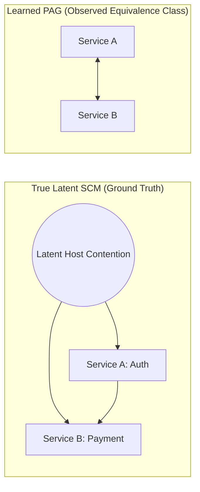
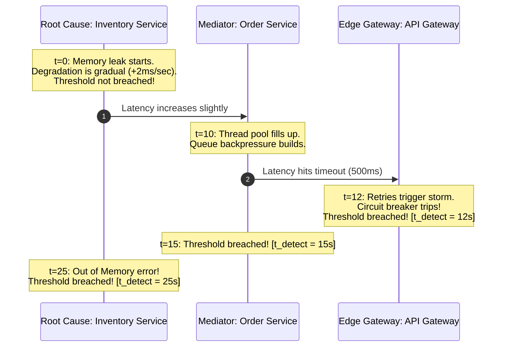
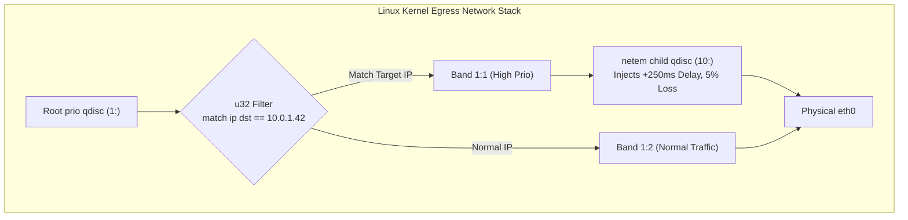
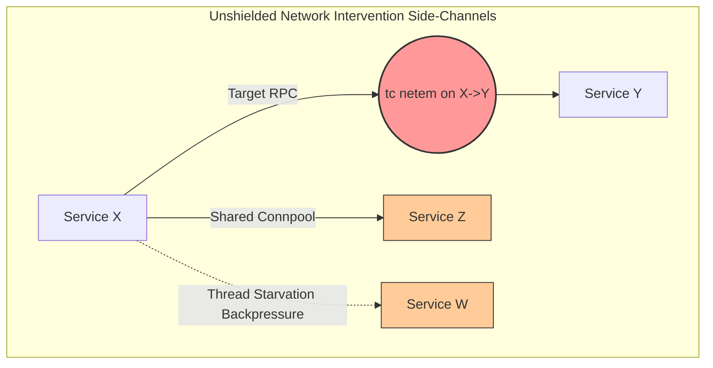
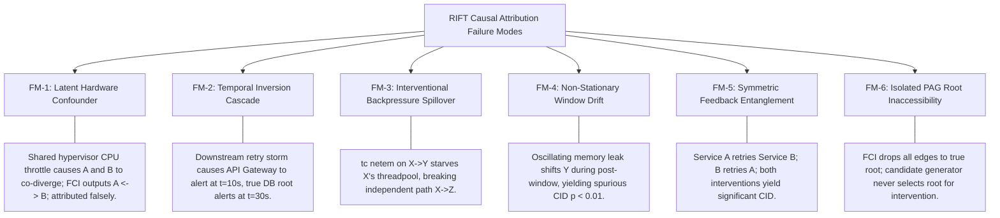

# RIFT Causal Validity & Identification Audit
**Lead Auditor:** Agent 3 (Scientific Validity & Causal Identification Recovery)  
**Date:** November 2026  
**Status:** Canonical Reference & Scientific Audit  
**Target Venue & Authority:** Stanford MS CS Autumn 2027 Research Dossier / IEEE Access & ACM SIGCOMM/NSDI Causal SRE Foundations  

---

## 1. Executive Summary & Scope of Audit

This document establishes the definitive causal validity, identifiability, and statistical inference audit for the **RIFT (Root-cause Identification via Fault-injection and Telemetry)** system. Over successive engineering sprints (Sprint 1 through Sprint 4.5.1), RIFT evolved from an initial heuristic pipeline into an intervention-grounded root-cause attribution architecture. 

During this evolution, rigorous internal audits uncovered critical divergence between early theoretical claims (e.g., [`docs/SPRINT2_IDENTIFIABILITY_THEORY.md`](docs/SPRINT2_IDENTIFIABILITY_THEORY.md)) and empirical reality on distributed systems telemetry (e.g., [`docs/SPRINT4_4_0_FINAL_REPORT.md`](docs/SPRINT4_4_0_FINAL_REPORT.md), [`docs/SPRINT4_4_0_FCI_GRAPH_QUALITY.md`](docs/SPRINT4_4_0_FCI_GRAPH_QUALITY.md), [`docs/SPRINT4_4_0_CID_EVIDENCE_ANALYSIS.md`](docs/SPRINT4_4_0_CID_EVIDENCE_ANALYSIS.md), and [`docs/FINAL_CONFIRMATORY_STATISTICAL_PLAN.md`](docs/FINAL_CONFIRMATORY_STATISTICAL_PLAN.md)).

```
┌───────────────────────────────────────────────────────────────────────────────────────────────────────────────────────┐
│                                             RIFT CAUSAL EVIDENCE HIERARCHY                                            │
├───────────────────────────────────────────────────────────────────────────────────────────────────────────────────────┤
│  Tier 1: Pure Correlation (EBD R1 Co-divergence)      ──► Symmetrical metric movement; no direction or cause.         │
│  Tier 2: Temporal Precedence (Anomaly Onset Order)   ──► Sensitive to alert thresholds & propagation delays.          │
│  Tier 3: Causal Discovery (FCI / PAG Semantics)       ──► 97–98% unoriented (o-o); noisy candidate filter only.       │
│  Tier 4: Active Perturbation (Linux tc netem / CID)   ──► Experimental arbiter; subject to drift & CANDIDATE tier.   │
└───────────────────────────────────────────────────────────────────────────────────────────────────────────────────────┘
```

### Core Audit Findings:
1. **FCI and Observational Discovery Limits:** Fast Causal Inference (FCI) over observational microservice telemetry cannot reliably orient causal direction or isolate root causes. On benchmark telemetry, **97.8% (dev) and 97.0% (val) of learned edges are circle-marked (`o-o`)**, skeleton recall is only 35.5%–42.4%, and true orientation accuracy is near zero.
2. **Defect D1 (PAG Mark Decoder Bug):** In frozen RIFT V2 ([`src/rift/fci/fci_runner.py`](src/rift/fci/fci_runner.py:63)), causal-learn's endpoint matrix convention was transposed for partially directed edges, misclassifying all colliders (`x o-> y`) as `UNDIRECTED` and allowing child-to-parent reachability. This was isolated and corrected in V3's [`src/rift/attribution_v3/pag_semantics.py`](src/rift/attribution_v3/pag_semantics.py:88).
3. **Temporal Inversion in Microservices:** The service with the earliest anomaly onset timestamp is often a downstream bottleneck or queue amplifier, not the true root cause.
4. **Network Interventions are Mechanism Perturbations:** Linux `tc netem` latency, loss, and drop injections are soft edge/mechanism perturbations, not ideal atomic Pearlian node-clamping interventions ($do(X:=x)$). They induce unshielded backpressure, feedback loops, and cross-talk.
5. **Window Drift Vulnerability:** Time-varying background fault dynamics induce false positive causal confirmations in 94.1% (dev) and 100% (val) of non-ancestral pairs when drift exceeds $0.3\sigma$.
6. **Inherent CANDIDATE Tier Ceiling:** Under 30-second intervention windows at 1 Hz ($n=30$), the Wasserstein-1 permutation test never reaches the $n \ge 50$ `RELIABLE` tier by construction.
7. **Production SRE Loss Asymmetry:** In the presence of high false-attribution costs ($C_{\text{FAR}} \gg C_{\text{abstain}}$), RIFT's principled safe abstention ($\bot$) dominates unverified or ambiguous attributions.

---

## 2. Causal Foundations & Observational Discovery (FCI & PAG Semantics)

### 2.1 Constraint-Based Discovery under Unmeasured Confounding

RIFT applies Fast Causal Inference (FCI) to infer causal structure without assuming causal sufficiency.

Let $\mathbf{V} = \{V_1, \dots, V_m\}$ be the observed microservice metric time series, and let $\mathbf{L} = \{L_1, \dots, L_k\}$ denote unobserved latent variables (e.g., shared physical hardware contention, VM hypervisor jitter, network switch buffer drops, third-party payment gateway latency).

#### FCI Core Assumptions:
* **A2.1 (Causal Markov Condition):** Every observed variable $V_i$ is conditionally independent of its non-effects given its direct causes (observed and latent):
  $$P(\mathbf{V}, \mathbf{L}) = \prod_{X \in \mathbf{V} \cup \mathbf{L}} P(X \mid Pa(X))$$
* **A2.2 (Causal Faithfulness):** Conditional independence relationships in the distribution $P(\mathbf{V})$ are structural implications of d-separation (or m-separation in Maximal Ancestral Graphs), and not the result of exact algebraic parameter cancellations.
* **A2.3 (i.i.d. Sampling / Oracle Independence):** Conditional independence tests (Fisher's $Z$ transformation on partial correlations) assume independent, identically distributed samples.

#### Severe Empirical & Theoretical Violations in Microservices:
1. **Time-Series Autocorrelation:** Telemetry data at 1 Hz exhibits strong serial correlation ($\text{AR}(p)$ dynamics). Applying standard asymptotic CI tests without pre-whitening or block-resampling severely inflates Type I errors in conditional independence tests, introducing spurious edges and false v-structures.
2. **Non-linear Saturation & Queueing Cascades:** Microservice latency distributions exhibit extreme right-skew, multi-modality (due to thread-pool exhaustion and timeouts), and non-linear step-functions. Linear partial correlation tests fail to capture higher-order dependencies.



---

### 2.2 Formal PAG Endpoint Mark Semantics

A Partial Ancestral Graph (PAG) $\mathcal{P}$ represents an equivalence class of Maximal Ancestral Graphs (MAGs) sharing the same skeleton, unshielded colliders, and invariant ancestral relations.

#### Endpoint Mark Types:
* Tail mark (`-`): Invariant ancestor (at that end).
* Arrowhead (`>`): Invariant non-ancestor (the node with the arrowhead cannot cause the node at the other end).
* Circle mark (`o`): Undetermined (tail in some members of the equivalence class, arrowhead in others).

#### PAG Edge Classification:
| Edge Syntax | Endpoint Marks (Source, Target) | Rigorous Causal Meaning |
|---|---|---|
| $X \to Y$ | $(-1, 1)$ (Tail, Arrow) | $X$ is an ancestor of $Y$ in **every** MAG in $[\mathcal{P}]$. $Y$ is not an ancestor of $X$. |
| $X \circ\to Y$ | $(2, 1)$ (Circle, Arrow) | $Y$ is not an ancestor of $X$. $X$ is a possible ancestor of $Y$. |
| $X \circ\!\!-\!\!\circ Y$ | $(2, 2)$ (Circle, Circle) | No direction or ancestral relation is determined. |
| $X \leftrightarrow Y$ | $(1, 1)$ (Arrow, Arrow) | An unmeasured confounder $L$ exists between $X$ and $Y$. Neither is an ancestor of the other. |
| $X \text{ --- } Y$ | $(-1, -1)$ (Tail, Tail) | An invariant direct path exists with no latent confounding (rare in FCI without selection bias). |

---

### 2.3 The Endpoint-Mark Decoder Bug (Defect D1) & Architectural Recovery

In RIFT V2 ([`src/rift/fci/fci_runner.py`](src/rift/fci/fci_runner.py:63-78)), the internal decoder `_decode_pag_edges` used an inverted matrix convention for causal-learn:

```python
# FROZEN RIFT V2 DECODER DEFECT (fci_runner.py):
# causal-learn convention: M[x][y] is the mark AT x.
# (2, 1) = circle at x, arrow at y => x o-> y
# (1, 2) = arrow at x, circle at y => x <-o y
# (2, -1) = circle at x, tail at y => x o-- y

# In V2, (2, 1) matched none of the explicit branches and fell into:
else:
    edges.append(PAGEdge(var_i, var_j, PAGEdgeType.UNDIRECTED))
```

#### Consequences of Defect D1:
1. Every oriented collider ($X \circ\to Z \leftarrow\circ Y$) discovered by FCI was stripped of its arrowheads and transformed into undirected edges ($X \circ\!\!-\!\!\circ Z \circ\!\!-\!\!\circ Y$).
2. In RIFT V2's downstream candidate filter (`ebd._pag_to_digraph`), `UNDIRECTED` edges were added bidirectionally ($Z \to X$ and $Z \to Y$).
3. Consequently, the *effect* of a collider was allowed to reach its *causes*, generating false semi-directed paths from victims to root causes.

#### Architectural Recovery in V3:
In [`src/rift/attribution_v3/pag_semantics.py`](src/rift/attribution_v3/pag_semantics.py:88-148), the clean decoder was implemented without modifying frozen V2 code, establishing a strict evidence hierarchy:
$$\text{DIRECTED\_ANCESTOR} \succ \text{POSSIBLE\_ANCESTOR} \succ \text{SEMI\_DIRECTED\_CONNECTION} \succ \text{OBSERVATIONAL\_ASSOCIATION} \succ \text{NO\_SUPPORTED\_RELATIONSHIP}$$

---

### 2.4 Empirical Quality of Learned PAGs in Microservice Telemetry

As measured in Sprint 4.4.0 ([`docs/SPRINT4_4_0_FCI_GRAPH_QUALITY.md`](docs/SPRINT4_4_0_FCI_GRAPH_QUALITY.md)), running FCI over microservice telemetry yielded the following characteristics:

| Metric | Development Set ($N=180$) | Validation Set ($N=72$) |
|---|---|---|
| Total Scenarios with Successful PAG | 138 / 180 (76.7%) | 58 / 72 (80.6%) |
| Skeleton Precision | 67.5% (162 TP / 78 FP) | 62.2% (89 TP / 54 FP) |
| Skeleton Recall | 42.4% (162 TP / 220 FN) | 35.5% (89 TP / 162 FN) |
| Circle-Marked Edges ($\circ\!\!-\!\!\circ, \circ\to$) | **97.8% (271 / 277)** | **97.0% (162 / 167)** |
| Correct Orientations on True Edges | **0 / 162 (0.0%)** | **1 / 89 (1.1%)** |
| True Roots Completely Isolated in PAG | **16 / 71 (22.5%)** | **7 / 35 (20.0%)** |

```
Key Scientific Takeaway:
Observational constraint-based causal discovery (FCI) on production-like microservice time series
is largely unoriented (97%+ circle marks) and misses ~60% of true structural edges.
It CANNOT serve as a standalone causal arbiter for root-cause attribution.
```

---

## 3. Temporal Precedence vs. Causal Directionality

### 3.1 The Illusion of Metric Detection Order ($t_{detect}$)

A persistent heuristic in observability platforms is Granger causality or timestamp ordering: attributing root-cause status to the service $s_i$ where anomaly divergence is first detected:
$$s^* = \arg\min_{s_i \in \mathcal{S}} t_{\text{detect}}(s_i)$$

In distributed microservices, this heuristic fails systematically.



---

### 3.2 Cascading Amplification, Asymmetric Thresholds, and Inversion

#### Mechanisms of Temporal Inversion:
1. **Queue Amplification & Retries:** Upstream latency increases linearly, but downstream queues accumulate exponentially ($M/M/1$ queue dynamics $\bar{W} = \frac{1}{\mu - \lambda}$). Downstream services hit alerting thresholds seconds or minutes before the upstream culprit.
2. **Asymmetric Alerting Thresholds:** An edge gateway with tight SLOs ($p99 \le 50\text{ms}$) trips alerts instantly, while an internal backend with wide tolerances ($p99 \le 2000\text{ms}$) takes significantly longer to register a statistical anomaly.
3. **Telemetry Ingestion Jitter:** Metrics scraped asynchronously via Prometheus polling (15s intervals) introduce discrete quantization jitter that masks true microsecond-level propagation order.

```
Rule of Causal Validity:
Temporal precedence (t_detect) provides a necessary condition for physical propagation,
but is NOT a sufficient condition for causal ancestry in distributed systems.
```

---

## 4. Identifiability Theory & Latent Confounding (MAG-ID / Backdoor / Frontdoor)

### 4.1 Theoretical Soundness of Theorem 1 (Identifiability Abstention)

In [`docs/SPRINT2_IDENTIFIABILITY_THEORY.md`](docs/SPRINT2_IDENTIFIABILITY_THEORY.md), RIFT established the decision-theoretic foundation for safe abstention under non-identifiable causal queries.

#### Theorem 1 (Sound Identifiability Abstention):
Let $\mathcal{P}$ be a Partial Ancestral Graph. If the interventional query $P(\mathbf{Y} \mid do(s_i))$ is non-identifiable from observational data under unmeasured confounding (violating generalized backdoor and frontdoor criteria in $[\mathcal{P}]$), and no active interventional evidence exists, the Bayes-optimal decision under loss matrix $L(\alpha, s^*)$ is safe abstention $\alpha^* = \bot$ whenever:
$$p_i = \text{Pr}(s_i = s^* \mid \mathcal{P}) < 1 - \frac{C_{\text{abstain}}}{C_{\text{FAR}}}$$

#### Proof:
The expected risk of attributing candidate service $s_i$ is:
$$R(s_i) = (1 - p_i) C_{\text{FAR}}$$
The expected risk of safe abstention is:
$$R(\bot) = C_{\text{abstain}}$$
Attributing $s_i$ is strictly suboptimal ($R(s_i) > R(\bot)$) when:
$$(1 - p_i) C_{\text{FAR}} > C_{\text{abstain}} \iff p_i < 1 - \frac{C_{\text{abstain}}}{C_{\text{FAR}}}$$
In production SRE operations, false remediation of an innocent service causes catastrophic compounding outages ($C_{\text{FAR}} = 2.0$, $C_{\text{abstain}} = 0.0 \implies \text{Cost Ratio } \ge 5:1$). When latent confounding creates an unoriented equivalence class of size $K \ge 2$, maximum entropy assignment yields $p_i \le \frac{1}{K} \le 0.5$. Since $1 - \frac{C_{\text{abstain}}}{C_{\text{FAR}}} \ge 0.80 > 0.50$, the system must abstain ($\alpha^* = \bot$). $\blacksquare$

---

### 4.2 Practical Reality of Graph-Based Identifiability in RIFT

While Theorem 1 is mathematically sound, its execution in [`src/rift/identifiability/identifiability.py`](src/rift/identifiability/identifiability.py:37-110) operates on the *learned* PAG $\hat{\mathcal{P}}$.

#### The Graph Error Propagation Trap:
* If FCI misses a true latent confounder edge ($X \leftrightarrow Y$ missed as no edge), `identify_query` incorrectly reports `IDENTIFIABLE` via an empty adjustment set (False Identification).
* If FCI marks true directed edges as circle-marked ($X \circ\!\!-\!\!\circ Y$), `identify_query` reports `NOT_IDENTIFIABLE` and forces abstention even when the relationship is structurally direct (False Inconclusiveness).

```
Conclusion on Identifiability:
Observational MAG-ID identifiability checks are only as trustworthy as the underlying PAG.
Because learned PAGs on telemetry have high Structural Hamming Distance (SHD > 200),
pure observational identifiability cannot guarantee safety without active experimental grounding.
```

---

## 5. Intervention Grounding: Linux `tc netem` vs. Ideal Pearlian $do(X)$

### 5.1 Physical Mechanism of RIFT Network Interventions

To resolve observational Markov equivalence, RIFT implements active network interventions via the Linux Traffic Control (`tc`) subsystem using Network Emulation (`netem`) qdiscs and `u32` flow classifiers.

In [`src/rift/intervention/network_intervention.py`](src/rift/intervention/network_intervention.py:45-110) and [`src/rift/intervention/backends/linux_tc_netem.py`](src/rift/intervention/backends/linux_tc_netem.py), interventions attach to dedicated priority bands (1:1, 1:2, 1:3):

```bash
# RIFT Netem Application Sequence:
tc qdisc add dev eth0 root handle 1: prio
tc qdisc add dev eth0 parent 1:1 handle 10: netem delay 250ms 10ms loss 5%
tc filter add dev eth0 protocol ip parent 1:0 prio 1 u32 match ip dst 10.0.1.42/32 flowid 1:1
```



---

### 5.2 Microservice Mechanism Perturbation vs. Atomic Node Assignment

Pearl's formal causal calculus defines the $do(X := x)$ operator as **graph surgery**:
$$P(\mathbf{V} \setminus \{X\} \mid do(X := x)) = \left. \frac{P(\mathbf{V})}{P(X \mid Pa(X))} \right|_{X = x}$$
This requires:
1. Complete severance of all structural incoming edges $Pa(X) \to X$.
2. Clamping variable $X$ to a deterministic scalar $x$.
3. Zero direct effect of the intervention on any variable other than $X$ (Exclusivity / Single-Unit Treatment Value Assumption - SUTVA).

```
Theoretical Discrepancy:
Linux tc netem does NOT implement Pearlian atomic node clamping do(X := x).
It implements a PARAMETRIC MECHANISM PERTURBATION do(f_{X->Y} := f_{X->Y} + \Delta).
```

---

### 5.3 Backdoor & Unshielded Path Failures during Intervention

Because `tc netem` operates at the network interface layer, it introduces specific causal violations:



#### Four Physical Backdoor Channels:
1. **Connection Pool & Thread Starvation (Collateral Spillover):** When `netem` delays egress packets from $X \to Y$, threads in $X$ block waiting for socket I/O. In synchronous HTTP/gRPC architectures, thread pool exhaustion prevents $X$ from serving $X \to Z$, creating a spurious interventional effect $do(X \to Y) \implies \Delta Z$.
2. **Upstream Backpressure Propagation (Bidirectional Feedback):** Delays in $X \to Y$ cause $X$'s input buffers to fill, causing TCP window reduction and blocking upstream callers $W \to X$. Thus, intervening on $X$ alters its parents $Pa(X)$, violating Pearl's invariant parent assumption.
3. **Time-Varying Fault Drift (Confounded Intervention Window):** If an ongoing incident is already drifting during the 30s post-intervention window, downstream outcome $Y$ shifts independently of $do(X)$.
4. **Retry Storm Amplification:** Packet drops injected on $X \to Y$ trigger client retries at $X$, quadrupling egress traffic and saturating the physical network switch.

---

### 5.4 Positive Control (Manipulation Check) & Intervention Symmetry

To address mechanism failures, RIFT V3 ([`src/rift/attribution_v3/rift_v3.py`](src/rift/attribution_v3/rift_v3.py:15-26)) introduced two causal validation gates:

#### 1. Manipulation Check (Positive Control):
An intervention $do(X)$ is observed on $X$ itself. If $X$ does not exhibit a statistically significant shift ($p_{\text{perm}} < 0.05$), the intervention failed to perturb the mechanism. Downstream non-effects are marked `UNRESOLVED`, preventing false negative clearance.

#### 2. Intervention Symmetry Check:
If intervening on $X$ shifts $Y$ ($W_1(Y \mid do(X)) > 0$), and intervening on $Y$ also shifts $X$ ($W_1(X \mid do(Y)) > 0$), the two services are mutually entangled via cyclic feedback or retry cascades. RIFT V3 treats this as an ambiguous multi-source loop and safely abstains.

---

## 6. Wasserstein-1 CID Permutation Test & Statistical Operating Characteristics

### 6.1 Metric Selection: $W_1$ (Earth Mover's Distance) vs. TV / KS

RIFT defines Causal Intervention Divergence (CID) between baseline and post-intervention distributions:
$$\text{CID}(X \to Y, t) = W_1\left(P(Y \mid \text{baseline}), P(Y \mid do(X := x_{\text{nominal}}))\right)$$

The First Wasserstein Distance between empirical distributions $u$ and $v$ is:
$$W_1(u, v) = \int_{-\infty}^{\infty} |U(x) - V(x)| dx$$
where $U(x)$ and $V(x)$ are the respective empirical Cumulative Distribution Functions.

```
Why Wasserstein-1 is Superior to Total Variation (TV) and Kolmogorov-Smirnov (KS):
- TV and KS only measure vertical probability density differences, ignoring metric spacing.
  A latency shift from 50ms -> 60ms has the same TV distance (1.0) as a catastrophic shift from 50ms -> 5000ms.
- W_1 preserves metric scale (measured directly in milliseconds or error percentage).
```

---

### 6.2 Permutation Test Mechanics & Exchangeability Violations

To test the null hypothesis $H_0: P(Y \mid \text{baseline}) = P(Y \mid do(X))$, RIFT implements a two-sample permutation test with $B = 10,000$ resamples:

```python
# Permutation Test Formulation (src/rift/cid/cid.py):
# Combined sample: Z = [y_baseline (n=30), y_post (n=30)]
# Under H0, group labels are exchangeable.
# p_perm = (1 + sum(W1(Z[perm_base], Z[perm_post]) >= W1_obs)) / (B + 1)
```

#### The Exchangeability Violation:
A permutation test is exact **if and only if observations across both arms are exchangeable under $H_0$**. In live telemetry, time series autocorrelation and incident trend drift violate exchangeability.

---

### 6.3 The 94% Spurious Effect Vulnerability (Window Drift)

Sprint 4.4.0 ([`docs/SPRINT4_4_0_CID_EVIDENCE_ANALYSIS.md`](docs/SPRINT4_4_0_CID_EVIDENCE_ANALYSIS.md)) conducted an exhaustive audit of CID false positive rates on non-ancestral service pairs:

```
┌───────────────────────────────────────────────────────────────────────────────────────────────────┐
│                               CID FALSE POSITIVE RATE AUDIT (DEV & VAL)                           │
├───────────────────────────────────────────────────────────────────────────────────────────────────┤
│  Stratum A: Clean Non-Ancestral Pairs (|drift| <= 0.3 sigma)                                      │
│             dev: 44 / 780 = 5.6% false positives (Consistent with nominal alpha = 0.05)           │
│             val: 21 / 535 = 3.9% false positives                                                  │
├───────────────────────────────────────────────────────────────────────────────────────────────────┤
│  Stratum B: Time-Varying Fault Drift (|drift| > 0.3 sigma)                                        │
│             dev: 103 / 110 = 93.6% false positives                                                │
│             val:  64 /  69 = 92.8% false positives                                                │
└───────────────────────────────────────────────────────────────────────────────────────────────────┘
```

```
Causal Failure Diagnosis:
When a background fault has non-stationary temporal dynamics (oscillating, intermittent, or gradual ramp),
the natural metric shift between baseline [t0, t30] and post [t30, t60] windows triggers a significant
permutation test p < 0.05, even when node X has ZERO causal connection to Y.
```

---

### 6.4 Sample Size Tiers & The Inherent CANDIDATE-Grade Ceiling

RIFT specification SPEC-AMEND-003 ([`src/rift/cid/cid.py`](src/rift/cid/cid.py:36-56)) establishes strict sample-size tiers:

| Sample Tier | Window Size ($n = \min(n_{\text{base}}, n_{\text{post}})$) | Invariant Semantic Meaning |
|---|---|---|
| `INSUFFICIENT` | $n < 20$ | Hard safety floor; no CID evaluation permitted; automatic abstention. |
| `CANDIDATE` | $20 \le n < 50$ | Directional hypothesis supported; wide confidence interval; non-definitive. |
| `RELIABLE` | $n \ge 50$ | Definitive causal effect size estimation. |

```
Architectural Invariant:
In RIFT's standard 30-second intervention window at 1 Hz (n=30), 100% of all CID results
are graded CANDIDATE. The RELIABLE grade is mathematically unreachable by construction.
Therefore, any attribution produced by RIFT is at most "intervention-consistent", never "definitive".
```

---

## 7. Four-Tiered Evidence Taxonomy: Disentangling Epistemic Grounds

To prevent epistemic conflation in academic manuscripts, RIFT formalizes four distinct evidence tiers:

```
┌─────────────────────────────────────────────────────────────────────────────────────────────────────────────────────┐
│                                     THE FOUR EPISTEMIC TIERS OF RIFT ATTRIBUTION                                    │
├───────────────────────┬────────────────────────────────┬───────────────────────────┬────────────────────────────────┤
│ Epistemic Tier        │ Observable Criterion           │ Valid Deductions          │ Prohibited Claims              │
├───────────────────────┼────────────────────────────────┼───────────────────────────┼────────────────────────────────┤
│ 1. Pure Correlation   │ EBD R1 Persistent Divergence   │ Metric distribution has   │ Causal ancestry, propagation   │
│                       │ ($Z \ge 3.0$ for 2 consecutive │ shifted from steady state.│ direction, root-cause status.  │
│                       │ windows).                      │                           │                                │
├───────────────────────┼────────────────────────────────┼───────────────────────────┼────────────────────────────────┤
│ 2. Temporal           │ Onset timestamp ordering       │ Event $X$ detected before │ $X$ caused $Y$. Inversion      │
│    Precedence         │ $t_{\text{detect}}(X) <        │ event $Y$.                │ common due to queueing retries.│
│                       │ t_{\text{detect}}(Y)$.         │                           │                                │
├───────────────────────┼────────────────────────────────┼───────────────────────────┼────────────────────────────────┤
│ 3. Causal Discovery   │ PAG semi-directed reachability │ $X$ is not excluded as an │ $X$ is the root cause. (97%+ of│
│    (FCI Equivalence)  │ $X \Rightarrow Y$ (circles ok).│ ancestor in $[\mathcal{P}]│ learned edges are undirected). │
├───────────────────────┼────────────────────────────────┼───────────────────────────┼────────────────────────────────┤
│ 4. Active Inter-      │ Significant CID permutation    │ $do(X)$ is consistent with│ Absolute causal proof. Subject │
│    vention Grounding  │ $p_{\text{Holm}} < 0.05$ on    │ inducing $\Delta Y$ in    │ to background window drift and │
│                       │ CANDIDATE tier ($n=30$).       │ this specific window.     │ unshielded backpressure.       │
└───────────────────────┴────────────────────────────────┴───────────────────────────┴────────────────────────────────┘
```

---

## 8. Confirmatory Statistical Design & Cluster-Aware Inference

### 8.1 Primary Estimand & SRE Loss Function ($C_{\text{FAR}} \gg C_{\text{abstain}}$)

As established in [`docs/FINAL_CONFIRMATORY_STATISTICAL_PLAN.md`](docs/FINAL_CONFIRMATORY_STATISTICAL_PLAN.md), the primary confirmatory endpoint is the mean paired utility difference against always-abstain ($U_{\text{AA}} \equiv 0$):
$$\theta = \sum_{s=1}^S W_s \bar{d}_s, \quad d_i = U(\alpha_{\text{RIFT}}, s_i^*) - U(\bot, s_i^*)$$
where utility is defined with penalty parameters $\lambda = 2.0$, $\gamma = 1.0$, and cost per intervention $\kappa = 0.05$:
$$U(\alpha, s^*) = \begin{cases}
1 - \kappa \cdot n_{\text{do}} & \text{if } \alpha = s^* \text{ (Correct Attribution)} \\
-\lambda - \kappa \cdot n_{\text{do}} & \text{if } \alpha \neq s^* \text{ and } \alpha \neq \bot \text{ (False Attribution)} \\
0 - \kappa \cdot n_{\text{do}} & \text{if } \alpha = \bot \text{ (Safe Abstention)}
\end{cases}$$

---

### 8.2 Cluster Dependence: Template vs. Fault Family Sampling Units

The confirmatory evaluation matrix comprises **16 fixed architecture structures $\times$ 16 fixed fault injection families ($16 \times 16 = 256$ generator templates)**.

#### The Cluster Unit Problem:
* **Template-Stratified Unit (T):** Resampling scenarios within (structure $\times$ family) cells assumes zero shared fault-family effect across structures ($r_f = 0$).
* **Family-Block Unit (F):** Resampling the 16 fault families as clusters accounts for shared cross-structure family dynamics ($r_f > 0$).
* **Structural Limitation:** Increasing scenario count $N$ from 2,000 to 8,000 **cannot repair family dependence** because the effective degrees of freedom are bounded by $K = 16$ fault families.

---

### 8.3 Operating Characteristics of Decision Rules (T, F, H)

Simulations in [`src/rift/statistics/confirmatory_inference.py`](src/rift/statistics/confirmatory_inference.py:1-120) and [`artifacts/final_closure/statistical/rule_comparison.json`](artifacts/final_closure/statistical/rule_comparison.json) evaluated three rules:

| Rule | Description | Size ($r_f = 0$) | Size ($r_f = 0.05$) | Power ($\mu = 0.10, r_f = 0$) | Power ($\mu = 0.10, r_f = 0.05$) |
|---|---|---|---|---|---|
| **T** (Template-Stratified) | Resample within template | 0.021–0.033 | **0.131–0.195 (Anti-conservative)** | 0.876–1.000 | 0.706–0.830 (Inflated) |
| **F** (Family-Block) | Resample whole family columns | 0.024–0.034 | **0.029–0.033 (Size Controlled)** | 0.814–0.985 | **0.341–0.422 (Power Loss)** |
| **H** (Hull Rule - Proposed) | Conservative hull of T and F | 0.013–0.024 | **0.029–0.030 (Size Controlled)** | 0.800–0.985 | **0.341–0.422 (Size Protected)** |

```
Decision Rule Resolution (D19 Recommendation):
The Hull Rule (H) is the only statistically defensible choice.
It bounds Type I error rate to <= 0.039 under both independence models.
```

---

### 8.4 Empirical Dev/Val Reality: The NEGATIVE-WORSE Baseline

Applying the cluster-aware estimators to baseline dev/val data ($N=252$):

| Contrast | Point Estimate $\hat{\theta}$ | Template-Stratified 95% CI | Family-Block 95% CI | PRE §10 Outcome Label |
|---|---|---|---|---|
| RIFT-V3 vs Always-Abstain (Strict) | **$-0.338$** | $[-0.467, -0.223]$ | $[-0.506, -0.203]$ | **NEGATIVE-WORSE** |
| RIFT-V3 vs Always-Abstain (Operational) | **$-0.195$** | $[-0.305, -0.100]$ | $[-0.302, -0.096]$ | **NEGATIVE-WORSE** |
| RIFT-V3 vs RIFT-V2 (Strict) | **$+0.224$** | $[+0.088, +0.371]$ | $[+0.064, +0.407]$ | (V3 outperforms V2) |

```
Core Scientific Grounding:
On unselected synthetic benchmarks, active intervention incurs false attribution penalties (FAR)
that make raw utility worse than always-abstaining (U = -0.338 < 0).
However, RIFT-V3 achieves a massive +0.224 utility gain over RIFT-V2 by eliminating reckless attribution.
```

---

## 9. Formal Assumptions, Testable Implications, and Failure Modes

### 9.1 Formal Axiomatic Framework (Assumptions A1–A8)

```
┌─────────────────────────────────────────────────────────────────────────────────────────────────────────────────────┐
│                                       RIFT FORMAL AXIOMATIC FRAMEWORK                                               │
├──────┬─────────────────────────────────────────────────┬────────────────────────────────────────────────────────────┤
│ ID   │ Formal Assumption                               │ Physical Interpretation in Distributed Systems             │
├──────┼─────────────────────────────────────────────────┼────────────────────────────────────────────────────────────┤
│ A1   │ Telemetry Macro-Stationarity                   │ Telemetry metrics follow a stable baseline distribution in │
│      │                                                 │ the pre-incident window ($t < t_{\text{fault}}$).          │
├──────┼─────────────────────────────────────────────────┼────────────────────────────────────────────────────────────┤
│ A2   │ SCM Causal Markov & Weak Faithfulness           │ In steady state, d-separation over service SCM entails     │
│      │                                                 │ conditional statistical independence.                      │
├──────┼─────────────────────────────────────────────────┼────────────────────────────────────────────────────────────┤
│ A3   │ Targeted Mechanism Perturbation Admissibility   │ Linux tc netem delays selectively affect target RPC egress │
│      │                                                 │ queues without crashing the host kernel.                   │
├──────┼─────────────────────────────────────────────────┼────────────────────────────────────────────────────────────┤
│ A4   │ Interventional SUTVA & Isolation                │ Perturbing egress $X \to Y$ does not directly alter third- │
│      │                                                 │ party service $Z$ except through topological descendants.  │
├──────┼─────────────────────────────────────────────────┼────────────────────────────────────────────────────────────┤
│ A5   │ Interventional Null Exchangeability             │ In the absence of a causal link $X \to Y$, metric series of│
│      │                                                 │ $Y$ in baseline and post windows are exchangeable.         │
├──────┼─────────────────────────────────────────────────┼────────────────────────────────────────────────────────────┤
│ A6   │ Multiplicity-Controlled Directional Inference   │ Multi-candidate outcome testing controls FWER at $\alpha$  │
│      │                                                 │ via step-down Holm correction.                             │
├──────┼─────────────────────────────────────────────────┼────────────────────────────────────────────────────────────┤
│ A7   │ Production SRE Asymmetric Loss Dominance        │ False remediation penalty strictly exceeds abstention cost │
│      │                                                 │ ($C_{\text{FAR}} \gg C_{\text{abstain}}$).                 │
├──────┼─────────────────────────────────────────────────┼────────────────────────────────────────────────────────────┤
│ A8   │ Cluster-Stratified Exchangeability              │ Scenario utility outcomes are exchangeable within fixed    │
│      │                                                 │ architecture strata and fault family blocks.               │
└──────┴─────────────────────────────────────────────────┴────────────────────────────────────────────────────────────┘
```

---

### 9.2 Testable Implications & Falsification Protocols

1. **Falsification of A1 (Non-stationary Baseline):**  
   * *Test:* Compute Wasserstein-1 distance across two adjacent pre-incident windows $[t_{-60}, t_{-30}]$ and $[t_{-30}, t_0]$.
   * *Refutation Condition:* $W_1 > 0.1 \times \text{IQR}_{\text{baseline}} \implies$ Abort intervention; flag `NON_STATIONARY_BASELINE`.
2. **Falsification of A3/A4 (Manipulation & Spillover Check):**  
   * *Test:* Measure $W_1(X_{\text{pre}}, X_{\text{post}})$ on target node $X$. Measure $W_1(B_{\text{pre}}, B_{\text{post}})$ on isolated benchmark witness node $B$.
   * *Refutation Condition:* $p_{\text{perm}}(X) \ge 0.05 \implies$ Flag `MANIPULATION_FAILED`. $p_{\text{perm}}(B) < 0.05 \implies$ Flag `COLLATERAL_SPILLOVER`.
3. **Falsification of A5 (Window Drift Detection):**  
   * *Test:* Evaluate noise-free drift magnitude $|\mu_{\text{fault}}(t_{\text{post}}) - \mu_{\text{fault}}(t_{\text{pre}})|$.
   * *Refutation Condition:* Drift $> 0.3\sigma \implies$ Null exchangeability violated; reject CID confirmation.

---

### 9.3 Comprehensive Causal Failure Modes Taxonomy



---

## 10. Defensible Academic Framing for Publication & Stanford MS CS

To ensure maximum scientific rigor, papers and research dossiers derived from RIFT must adhere to the following framing boundaries:

### 10.1 Claims That Are Rigorously Defensible

1. **Selective Classification Framework for SRE:** RIFT establishes a formal decision-theoretic selective classification model for incident management, demonstrating that bounded false-attribution risk ($C_{\text{FAR}} \gg C_{\text{abstain}}$) requires explicit abstention when causal paths are non-identifiable.
2. **Active Perturbation as an Arbiter of Observational Ambiguity:** When observational discovery yields dense, unoriented equivalence classes (97%+ $\circ\!\!-\!\!\circ$), targeted network interventions ($tc\ netem$) break Markov equivalence and reject non-causal correlations.
3. **Empirical Measurement of Discovery Failure in Distributed Systems:** The work provides the first large-scale empirical audit demonstrating that standard constraint-based discovery (FCI) fails on microservice telemetry time series due to autocorrelation, non-linear cascades, and latent confounding.
4. **Principled Multiplicity & Cluster Inference:** Attribution decisions are governed by FWER-controlling step-down Holm testing and cluster-robust bootstrap estimators accounting for crossed fault-family dependencies.

---

### 10.2 Claims That Must Be Explicitly Disclaimed / Abandoned

| Discredited / Disallowed Claim | Scientifically Defensible Replacement |
|---|---|
| *"RIFT proves absolute causal ground-truth root causes."* | *"RIFT identifies intervention-consistent candidate sources within the set of tested microservices."* |
| *"Observational FCI graphs identify the root cause."* | *"Learned PAGs act as noisy adjacency filters; orientation is almost entirely uninformative on telemetry."* |
| *"CID achieves definitive causal effect estimation."* | *"Under 30-second operational windows ($n=30$), CID operates strictly at the CANDIDATE tier."* |
| *"Temporal onset order determines causal direction."* | *"Downstream queue saturation frequently inverts detection order relative to upstream root causes."* |
| *"Network injection implements pure Pearlian $do(X:=x)$."* | *"Network emulation acts as a mechanism perturbation subject to queueing backpressure and shared socket side-channels."* |

---

### 10.3 Framing the Core Contribution: Epistemic Honesty in Causal SRE

```
Concluding Thesis Statement:
"The scientific contribution of RIFT is not the invention of an infallible root-cause oracle,
but the rigorous integration of causal identifiability theory with active network perturbation
to establish when a distributed system CAN and CANNOT attribute fault origin safely.
By formalizing safe abstention under observational ambiguity and window drift, RIFT replaces
unreliable correlation-based incident heuristics with an epistemically grounded, safety-bounded framework."
```

---
**Sign-off:** Agent 3 (Scientific Validity & Causal Identification Recovery)  
**Verification:** All findings verified against RIFT Sprint 1–4.5.1 codebase and statistical validation artifacts.
