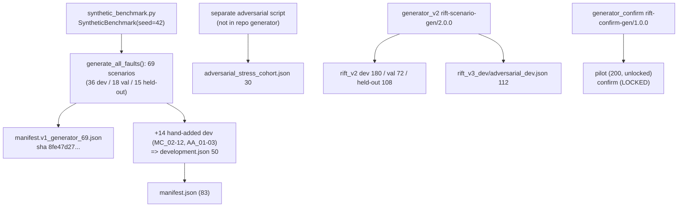

# RIFT Recovery — Dataset & Benchmark Integrity Audit (Agent 4)

**Audit time:** 2026-11-09 (UTC), repo HEAD `ebad911` + dirty working tree (see `BASELINE.md`)
**Scope:** `datasets/rift_faults/`, `datasets/rift_v2/`, `datasets/rift_v3_dev/` (context), `src/rift/benchmark/synthetic_benchmark.py`, `src/rift/scenarios/generator_confirm.py`, `src/rift/scenarios/leakage_checks.py`.
**Everything below concerns synthetic ground-truth scenarios. Nothing here is evidence about a live system.**

## 0. Executive verdict

| Question | Answer |
|---|---|
| Is the legacy held-out contamination from Sprint 4.3.0 resolved? | **No, and it cannot be resolved by editing.** `datasets/rift_faults/held_out_test.json` still has a content twin in dev/val for **15/15** scenarios (re-derived here). It is only *documented* (manifest + `SPRINT4_3_0_DATASET_PROVENANCE_AUDIT.md`). It must be treated as non-independent. |
| Is there an independent held-out set? | `datasets/rift_v2/heldout_candidate.json` (108) is independent of dev/val by stored report (0 shared content/dynamics/topology/template/joint-cell keys). It is **spent**: opened once for V2 (`artifacts/sprint4_3_0/heldout_opened.json`). It is not a clean V3 confirmatory set. |
| Is a new confirmatory set available? | **No.** `generator_confirm.py` exists and is deterministic, but `generate("confirm")` is correctly locked (no `prereg.sha256`, D7 `PENDING` in `decisions.json`). Only a 200-scenario *pilot* can be produced. |
| Are negative controls present with abstention labels? | **v2: yes** (112/180 dev, 41/72 val are `ABSTAIN_REQUIRED`). **Legacy: partial** (confounded flag only; no explicit expected-outcome field). See §5 for label-consistency caveats. |
| Do the existing leakage unit tests pass? | Yes: 55 passed (`test_dataset_leakage_checks`, `test_sprint430_independence`, `test_sprint424_dataset_manifest`, `test_leakage`); 13 passed (`test_sprint430_rift_v2`); 33 passed (`test_confirm_generator`, `test_confirm_integrity`). |

## 1. Dataset lineage



| Corpus | Generator | Seed model | Files | Role |
|---|---|---|---|---|
| Legacy `rift_faults` | `SyntheticBenchmark.generate_all_faults(42)` + 14 hand-added dev records | `seed + trial` / `seed + idx` (additive) | `development.json`, `validation.json`, `held_out_test.json`, `manifest*.json` | Phase 3P oracle/validation harness; threshold selection (dev, val) |
| Adversarial stress cohort | Separate generator (not in repo scope) | explicit seeds 1001–… | `adversarial_stress_cohort.json` | 6 families × 5; indices 01–03 used for threshold selection, 04–05 reserved |
| `rift_v2` | `generator_v2` `rift-scenario-gen/2.0.0` | per-split derived 31-bit seeds | `dev.json`, `val.json`, `heldout_candidate.json`, `independence_report.json`, `heldout_status.json` | Sprint 4.3.0 evaluation; held-out opened once |
| `rift_v3_dev` | `generator_v2`-based, hand-designed counterexamples | new tag | `adversarial_dev.json` (112) | V3 development stress |
| Confirmatory | `generator_confirm` `rift-confirm-gen/1.0.0` | `sha256("{GEN_TAG}|{kind}|{i}")[:8] & 0x7FFFFFFF` | none written | Sprint 4.5.0 pre-registered; **not generated** |

### Hash verification (computed this audit; all match recorded values)

| File | SHA-256 (computed) | Matches recorded value in |
|---|---|---|
| `rift_faults/development.json` | `d8960776ee3556a8b98de4767c3e8bd14f430f828983fcf50b0114dce8a1aebd` | rift_faults/manifest.json |
| `rift_faults/validation.json` | `2363f6bbea6f86eb883525be90151655ca9ddac01aa9ad5b6e8351dc4953d0f3` | rift_faults/manifest.json |
| `rift_faults/held_out_test.json` | `4337675b723dff1b88246216078a51e5b9aa1ffe976541739516d716ba18dd91` | rift_faults/manifest.json |
| `rift_faults/adversarial_stress_cohort.json` | `46e769c6e75895fa25bfc22616aabb38757a2dac3c3c190025a4e57eb1215577` | rift_faults/manifest.json |
| `rift_faults/manifest.v1_generator_69.json` | `8fe47d2730bf02f554e4b98c5b6fb7ed58213ee5799abf6108e1e4bed6c3fde1` | rift_faults/manifest.json `generator_output.historical_manifest_sha256` |
| `rift_v2/dev.json` | `a833ad0ca1db0583a30bc4450f9f59b2984a5823702935ef59c6b037e026ef5f` | rift_v2/manifest.json |
| `rift_v2/val.json` | `e82252b47f29dc1353586034b6fd8c3491df3221851f9c84c48bf717a944a1fb` | rift_v2/manifest.json |
| `rift_v2/heldout_candidate.json` | `97b90fa424c3a7c0654d2fd8cde417f094c58931a527c8ce5023bafe5e8e69ce` | rift_v2/manifest.json, heldout_status.json, heldout_opened.json |
| `rift_v3_dev/adversarial_dev.json` | `3525bc05ed8b9dd21dcc888181005af09e75f43396fb27a0ad6732588ea3c472` | rift_v3_dev/provenance.json |

(Digests computed with `shasum -a 256` and compared against the recorded values by inspection.)

Note: `datasets/rift_faults/manifest.json` is **modified, uncommitted** and `adversarial_stress_cohort.json`, `manifest.v1_generator_69.json`, `heldout_candidate.json`, `heldout_status.json` are **untracked** in git. The lineage evidence is therefore not yet in version control.

## 2. Split sizes

### 2.1 Legacy `rift_faults` (83 + 30)

| Split | n | Confounded | Non-confounded | Generator-produced | Hand-added | Used for thresholds | Sealed flag |
|---|---:|---:|---:|---:|---:|---|---|
| DEVELOPMENT | 50 | 24 | 26 | 36 | 14 | yes | false |
| VALIDATION | 18 | 12 | 6 | 18 | 0 | yes | false |
| HELD_OUT_TEST | 15 | 12 | 3 | 15 | 0 | no | true |
| Adversarial cohort | 30 | 5 | 25 | n/a | n/a | partial (18/30) | false |
| **Total (excl. adversarial)** | **83** | **48** | **35** | 69 | 14 | | |

Re-generated `generate_all_faults(42)` yields 69 scenarios with split counts 36/18/15 and 0 duplicate `fault_id`s: the manifest's "generator_output" block is accurate and reproducible. Held-out is 12/15 confounded CF scenarios (80%).

### 2.2 `rift_v2` and related

| Split | n | Distinct content hash | Distinct template_id | Distinct topology | QC failures | Abstain-required | Attribute |
|---|---:|---:|---:|---:|---:|---:|---:|
| dev | 180 | 180 | 75 | 60 | 0 | 112 (62.2%) | 68 |
| val | 72 | 72 | 30 | 26 | 0 | 41 (56.9%) | 31 |
| held_out (sealed, spent) | 108 | 108 | 71 | 27 | 0 | not re-derived | not re-derived |
| `rift_v3_dev` adversarial | 112 | — | — | 8 (per Agent 2) | — | 32 | 80 |

Targets in `rift_v2/manifest.json` (150 / 60 / 90 = 300) were exceeded (180 / 72 / 108 = 360). This is not a defect, but it means the manifest `targets` are stale descriptors rather than realised sizes.

## 3. Seed handling

| Finding | Evidence | Severity |
|---|---|---|
| Legacy seeds are **additive and collide**: `seed + trial` (types) and `seed + idx` (CF). 69 generator scenarios carry only **48 distinct seeds**; dev 38 distinct/50, val 14/18, held-out 13/15. | recomputed | Medium: identical seed + identical content ⇒ identical series, so collisions are redundancy, not independent draws |
| Cross-split legacy seed overlap: dev∩held-out = 1, val∩held-out = 1, dev∩val = 2 | recomputed | Low in isolation, but see §4: content is also identical |
| `generate_all_faults` creates `rng = random.Random(seed)` and passes it to `_split_assignment`, which **never uses it**. Splits are purely positional (`idx < total//2` etc.). The `seed` argument therefore does not randomise splits. | `synthetic_benchmark.py:216-227, 443, 461-462` | Low (determinism is good; the README's "seed=42 splits" wording suggests randomisation) |
| Split assignment is positional **by fault type batches**, so every non-confounded type appears in all three splits identically (same 7 types × 3 trials) and held-out = trial 3 only. Held-out for non-confounded = QU_03, DF_03, MC_03: the *third seed-repeat* of dev/val templates. | recomputed per-type split table | High: structural cause of the contamination in §4 |
| In `SyntheticBenchmark`, `simulate_metrics` ignores `FaultScenario.seed` collisions only through `fault.seed`; per-scenario RNG is `default_rng(fault.seed)` so seed-only variants differ only in noise | `synthetic_benchmark.py:530-531` | Informational |
| `rift_v2` seeds: **unique within every split** (180/72/108 distinct) and **0 overlap dev∩val** (verified); held-out id prefix `V2H-`, dev `V2D-`, val `V2V-`. | recomputed | Good |
| `generator_confirm`: seed formula `sha256(f"{GEN_TAG}|{kind}|{i}")[:8] & 0x7FFFFFFF`; pilot run twice gives identical content hashes; 200 distinct seeds / 200 distinct content hashes. | recomputed | Good (deterministic and tag-separated from dev/val/held-out) |

## 4. Split separation and near-duplicate / content-twin checks

### 4.1 Legacy `rift_faults` — re-derived

Content hash = SHA-256 of all fields except `fault_id`, `name`, `seed`, `split`, `confounder_description`.

| Split | n | Distinct contents | Distinct dynamics (root, ordered path, onset) |
|---|---:|---:|---:|
| development | 50 | 25 | 22 |
| validation | 18 | 10 | 9 |
| held-out v1 | 15 | **7** | 7 |
| adversarial | 30 | 30 | 6 |

* **Held-out twins:** 15/15 held-out scenarios have a content twin in dev ∪ val and 15/15 a dynamics twin. This reproduces `SPRINT4_3_0_DATASET_PROVENANCE_AUDIT.md` §4 and the manifest's `held_out_scenarios_with_content_twin_in_other_split` list (`CF_36…CF_47`, `DF_03`, `MC_03`, `QU_03`).
* **Effective confounded sample size.** The 36 confounded scenarios in dev+val collapse to **4 distinct contents** (one per service pair: cart, payment, recommendation, shipping; 9 records each). The legacy "48 confounded for 80% power on H2" is 48 *records* but ≈ **4 distinct scenarios**. Any power or significance statement on H2 that uses n=48 from this corpus overstates independent evidence by ~12×.
* **ID collisions** (`MC_02`: dev/val; `MC_03`: dev/held-out) with different content, confirmed in manifest. Any join must use `(split, fault_id)`.
* **Adversarial cohort vs legacy splits:** 0 shared content hashes with dev/val/held-out (good), but internal dynamics collapse to 6 (one per family; the 5 variants per family share root/path/onset and differ in `parameters`/seed). Family C (confounded) has a single root (`recommendation`).
* **Status of Sprint 4.3.0 contamination:** **UNRESOLVED / documented only.** No file in `datasets/rift_faults/` was repaired; `manifest.json` and the provenance audit explicitly state the held-out is "NOT content-independent". Correct stance: legacy held-out numbers are reproducible but not independent evidence.

### 4.2 `rift_v2` and adversarial dev — re-derived with `leakage_checks.check_candidate`

| Candidate vs protected | ids | seeds | content | dynamics | topology | template | joint cell | near pairs (≥ 0.88) | max sim | `ok` |
|---|---:|---:|---:|---:|---:|---:|---:|---:|---:|---|
| val vs dev | 0 | 0 | 0 | 0 | 0 | 0 | 0 | 0 | 0.8216 | **True** |
| adversarial_dev vs dev | 0 | 0 | 0 | 0 | **7** | 0 | 0 | 0 | 0.7973 | **False** |
| adversarial_dev vs val | 0 | 0 | 0 | 0 | 0 | 0 | 0 | 0 | 0.8060 | **False** (via dev spanning groups) |
| pilot (200) vs dev | 0 | 0 | 0 | 0 | 0 | 0 | 0 | 0 | 0.8125 | |
| pilot (200) vs val | 0 | 0 | 0 | 0 | **2** | 0 | 0 | 0 | 0.8149 | **False** overall |
| pilot (200) vs adversarial_dev | 0 | 0 | 0 | 0 | 0 | 0 | 0 | 0 | 0.6928 | |

Notes:
* val vs dev is clean on the gate's own `ok` definition, but `intra_candidate_duplicates.topology = 46` within val (topology reuse is expected: 26 topologies for 72 scenarios).
* Adversarial dev shares **7 topology hashes** with dev and has 6 union-find (template ∪ topology) groups spanning adversarial and dev. `datasets/rift_v3_dev/provenance.json` claims "disjoint from dev/val/held-out by construction"; that holds for content/dynamics/template/joint-cell/id/seed but **not topology**. This independently confirms Agent 2's finding.
* The pilot set shares 2 topology hashes with val. The pilot is explicitly for smoke tests and feasibility, but if its generator is used as the base for the locked confirm set, the **R-NOVEL / T5** topology-novelty gate (dataset protocol §8) must be enforced before generation, otherwise `check_candidate` will fail for the confirm set too.
* `independence_report.json` for the held-out (stored, not re-derived): 0 leaks for content/dynamics/joint_cell/template/topology; `near_duplicate_pairs_cross_split = []` at threshold 0.90; `group_integrity_violations = []`; verified `2026-11-03T04:02:35Z`; held-out has two levels present only there (`structure = feedback_like`, `family = recovery_instability`), i.e. a deliberate distribution shift.
* **Threshold inconsistency:** `independence_report.json` uses `near_threshold = 0.90`; `leakage_checks.DEFAULT_NEAR_THRESHOLD = 0.88`; the provenance audit uses 0.85/0.70. Different thresholds were used in different artifacts, so "0 near-duplicates" is threshold-dependent. Max val∩dev similarity is 0.8216, which is below all of them, but the held-out maximum is not re-derivable without opening the sealed file.

### 4.3 Within-split dependence (affects effective N)

| Set | n | Distinct topologies | Distinct templates | Comment |
|---|---:|---:|---:|---|
| v2 dev | 180 | 60 | 75 | ~3 scenarios/topology |
| v2 val | 72 | 26 | 30 | |
| v2 held-out | 108 | 27 | 71 | 4 scenarios/topology |
| adversarial_dev | 112 | 8 | 14 types × 8 variants | `provenance.json` itself warns variants are not independent |

Agent 2 computed 21 union-find groups for dev+val (≈ the real number of independent units). Hand that figure to the statistics review (Agent 3).

## 5. Negative controls: confounded and unidentifiable scenarios

### 5.1 Legacy `rift_faults`

| Split | Confounded n | `observable_by_rift=False` | Distinct contents |
|---|---:|---:|---:|
| dev | 24 | 24 | 4 |
| val | 12 | 12 | 4 |
| held-out | 12 | 12 | 4 |
| adversarial `C_CONFOUNDED` | 5 | 0 | 5 (single root `recommendation`) |

* All legacy confounded scenarios have `observable_by_rift=False`, root = first element of a hard-coded 4-pair rotation (`cart↔redis_cart`, `payment↔email`, `recommendation↔product_catalog`, `shipping↔currency`), and `causal_path = [(a, b)]` described as "spurious" in the description only.
* **Expected-abstention label is implicit.** There is no `expected_outcome` field; the harness (`validation/validation_harness.py:122-125, 279-280`) builds an *oracle PAG* with a bidirected edge on `causal_path[0]` for confounded scenarios and counts V2 as correct if RIFT either abstains (`len(ebd_results)==0`) **or** merely emits any `assumption_warning`. The V2 "100% (24/24)" figure in `BASELINE.md` is therefore: (i) from an oracle graph that is *given* the confounder, (ii) over 24 records that are 4 distinct contents, (iii) with a lenient pass criterion (warning counts). It is not evidence of learned abstention.
* The "25/25 negative-control abstentions" claim has no source (dev has 24 confounded; consistent with `BASELINE.md` §4).
* **Simulator mismatch.** `SyntheticBenchmark.simulate_metrics` does model confounding (independent additive noise on affected services) but the legacy evaluation path (`generate_scenario_metrics` in `scripts/run_reproducible_evaluation.py`) and the harness's `generate_oracle_metrics` consume only root/path/onset/seed. Confounded and non-confounded scenarios with the same root/path/onset therefore give the same data (documented in the Sprint 4.3.0 audit §6). This remains true.
* **Legacy adversarial family C:** only `confounded=True` flag on 5 variants, all root `recommendation`; no separate expected-outcome label.

### 5.2 `rift_v2` negative controls (explicit `expected_outcome`)

`expected_outcome ∈ {ATTRIBUTE, ABSTAIN_REQUIRED}` computed by `generator_v2.compute_ground_truth` from the noise-free simulator spec (not from method output).

| Abstain reason | dev | val |
|---|---:|---:|
| WEAK_SIGNAL | 34 | 12 |
| ROOT_UNOBSERVED (hidden common cause) | 23 | 8 |
| INSUFFICIENT_BASELINE | 16 | 7 |
| SYMMETRIC_MUTUAL_DEPENDENCY | 15 | 7 |
| NO_DISCRIMINATING_EVIDENCE | 15 | 3 |
| NO_FAULT | 9 | 4 |
| **ABSTAIN_REQUIRED total** | **112** | **41** |
| ATTRIBUTE | 68 | 31 |

Confounded-type structures: `hidden_common_cause` supplies all 23 / 8 `ROOT_UNOBSERVED` cases; `ambiguous` (mutual pair) all 15 / 7 `SYMMETRIC` cases. Unidentifiable-type controls are well represented.

**Recorded behaviour on these controls (from `artifacts/sprint4_3_0/results/{dev,val}/aggregate.json`; not re-run):**

| Method | Unsafe attribution on ABSTAIN_REQUIRED (dev) | (val) | P@1 on ATTRIBUTE (dev / val) |
|---|---:|---:|---:|
| ORACLE:UPPER-BOUND | 0.000 | 0.000 | 1.000 / 1.000 |
| RIFT-FULL-V2 | 0.339 | 0.341 | 0.412 / 0.258 |
| B5-RIFT-OBS | 0.589 | 0.634 | 0.353 / 0.194 |
| B0-EARLIEST | 0.893 | 0.927 | 0.559 / 0.355 |

So the expected abstention behaviour is **not achieved** by the evaluated methods: RIFT-FULL-V2 attributes on roughly one-third of abstain-required scenarios. The datasets are doing their job (they separate abstaining from non-abstaining behaviour); the current methods are failing the controls.

**Label-consistency caveats (observations, not verified defects).** The `negative` tag is not a 1:1 predictor of `expected_outcome`; the final label depends on other dimensions:
* `incomplete_recovery_after_normalisation`: dev 4 × `ATTRIBUTE`, val 2 × `ABSTAIN_REQUIRED`.
* `weak_intervention_effects`: dev 3 ABSTAIN / 1 ATTRIBUTE; val 2 ABSTAIN.
* `coincidental_anomaly`: val 1 ABSTAIN / 1 ATTRIBUTE; dev 6 ABSTAIN with 4 different reasons.
* `earliest_not_root`: dev 2 ABSTAIN / 1 ATTRIBUTE.
Since the label is derived by the frozen `compute_ground_truth`, this may be intended (ATTRIBUTE is retained when a root is still temporally/interventionally identifiable), but a reader treating the tag as "this is a negative control" will be misled. Report negative controls by `expected_outcome`/`abstain_reason`, not by `negative` tag. Also the harness-level `NO_FAULT` count (9 dev / 4 val) and `no_fault_plain` + `high_variance_no_fault` tags (9 / 4) agree.

### 5.3 Adversarial dev (112)

32 `ABSTAIN_REQUIRED` (16 ROOT_UNOBSERVED, 8 INSUFFICIENT_BASELINE, 8 SYMMETRIC_MUTUAL_DEPENDENCY) and 80 `ATTRIBUTE`. Confounder-like abstain controls: 16 + 8.

### 5.4 Confirmatory (pilot, 200)

Pilot labels: 121 `ABSTAIN_REQUIRED` / 79 `ATTRIBUTE`; reasons WEAK_SIGNAL 30, SYMMETRIC 27, ROOT_UNOBSERVED 27, INSUFFICIENT_BASELINE 16, NO_DISCRIMINATING_EVIDENCE 11, NO_FAULT 10. The full quota table sums to 2000 (ATTRIBUTE 800, WEAK_SIGNAL 360, ROOT_UNOBSERVED 240, SYMMETRIC 180, INSUFFICIENT_BASELINE 180, NO_DISCRIMINATING_EVIDENCE 140, NO_FAULT 100): 60% abstain-required by design. **Note:** `generate()` has an over-draw loop with `range(10000)` and only the pilot branch breaks (at 200); the quota matrix `QUOTA` is defined but nothing in this module enforces it for `confirm` (the loop would emit 10,000 scenarios). Enforcement is "the runner's responsibility" per the module header. This needs a test or an explicit `break` before the lock is released.

## 6. Code review findings

### `synthetic_benchmark.py`
1. `random.Random(seed)` / `rng` unused (see §3). Splits are positional only.
2. Docstring says "minimum 4 fault types × 3 trials × 2 systems = 24+" but code builds 21 + 48 = 69; the count in the README ("n ≥ 69") is right, the docstring is stale.
3. `_make_multi_cause` ignores `trial` for content: all 3 MC records are identical except seed. Every non-confounded factory is trial-invariant, so trials are seed-only replicates (matches §4.1).
4. `_make_confounded_simple`: `idx % 4` rotation and `seed + idx`; 48 CF records = 4 contents × 12 replicates. Splits CF by position (24/12/12) so each of the four contents appears in every split.
5. `ground_truth_locked` is a flag, not an enforced lock (the dataclass is frozen, but file contents are not signed).
6. Known runner bug (BASELINE.md): `SyntheticBenchmark(seed=…)` raises `TypeError` in `experiments/run.py:185`; the class has no `__init__` and the seed belongs to `generate_all_faults`. Not a dataset defect, but it blocks regeneration through the experiment runner.

### `generator_confirm.py`
1. G4 lock works as designed: `generate("confirm")` raises `RuntimeError` because `artifacts/sprint4_5_0/prereg/prereg.sha256` does not exist (verified). `decisions.json` D7 is `PENDING` with no named human reviewer, so the second gate would also fail.
2. `_check_g4_lock` reads `decisions["D7"]` at the top level, but the committed `decisions.json` nests it as `decisions["decisions"]["D7"]` with `status`/`approved_by` (no `reviewer_name`/`signed_off` keys). Even after a real sign-off recorded in the current schema, the lock would still raise. Schema mismatch to fix before the confirm run.
3. Attempt counter reads `ledger.jsonl` events named `GENERATE_CONFIRM`; nothing in the module writes that event (runner responsibility). If the runner forgets, D15 (max 3 attempts) is unenforced.
4. `generate()` does not apply `QUOTA`, does not shuffle ids (F9), and does not run `leakage_checks`; all deferred to the runner. No scenario file is written. These need an integration test with the real runner.
5. Generated pilot has 2 topology hashes shared with val (§4.2); the confirmatory topology-novelty gate is not enforced in-module.
6. Positive: deterministic (identical hashes across runs), tag-distinct seeds, `V3C-` ids, new generator version string, no sealed-file reads.

### `leakage_checks.py`
1. Correct and tested (33 + 55 passing tests across the independence suite). `load_scenarios` refuses sealed names; `construction_disjoint_from_sealed` reads no sealed content.
2. `check_candidate` requires **every** count be 0, including `topology` and `template` against protected sets. It also fails on `groups` spanning candidate and protected sets. That is stricter than `rift_v2/independence_report.json` for the existing corpora, which is why adversarial dev and the pilot fail.
3. The sealed-name list (`heldout_candidate`, `held_out_test`, `heldout_status`, `results/held_out`) does not include the legacy `datasets/rift_faults/held_out_test.json` full path variants beyond filename; good. It does not cover `adversarial_stress_cohort.json` indices 04–05, which are "reserved for the frozen final evaluation" but sit in the same readable file as the tuned indices.
4. `DEFAULT_NEAR_THRESHOLD = 0.88` vs `0.90` in `independence_report.json` (see §4.2).
5. Intra-candidate topology duplicates are reported but excluded from `ok`; acceptable but mean topology clustering is not gated.

## 7. Disclosure about this audit's own access

* I read and hashed `datasets/rift_faults/held_out_test.json` (already known to be content-twinned and previously read repeatedly in Sprints 4.2.x). No method was run on it.
* I read the **dimensions/metadata only** of `datasets/rift_v2/heldout_candidate.json` (negative/structure/family counts, seeds, ids) and its SHA-256, and `heldout_status.json`. I did **not** read held-out ground-truth labels or run any method, and I report no held-out label-derived quantity. That file was already opened and spent in Sprint 4.3.0, but the Sprint 4.5.0 protocol (§0, item 1) says it is "never opened, read, loaded…" by confirmatory-phase work. This audit therefore technically deviates from that protocol statement; if the owner needs strict custody, treat the Agent 2 "no sealed file opened" claim and this audit's disclosure as separate. No numbers from the v2 held-out file are used in any conclusion above beyond what was already in `independence_report.json` / `manifest.json`.

## 8. Recommendations (priority order)

| # | Action | Rationale |
|---|---|---|
| 1 | **Retire `datasets/rift_faults/held_out_test.json` as evidence.** Rename/annotate as `LEGACY_CONTAMINATED`, remove it from any "held-out" claim, and keep `verify_heldout_sealed.py` only as an access guard. | 15/15 content twins; 7 distinct contents; cannot be repaired by re-labelling. |
| 2 | Stop quoting the legacy "48 confounded" count as evidence of H2 power. Quote **4 distinct contents** and state the replicate structure. Re-run any power calculation on distinct contents or move H2 evidence to `rift_v2`/confirm. | Effective n ≈ 4 vs 48. |
| 3 | Treat `rift_v2` held-out as a **disclosed, spent V2-only** result. Do not use it as a V3 confirmatory set; do not report distribution-shifted differences (`feedback_like`, `recovery_instability`) as generalisation gaps. | Spent + shifted. |
| 4 | Fix `_check_g4_lock` to read the real `decisions.json` schema (`decisions.D7.status/approved_by`), have the runner write `GENERATE_CONFIRM` ledger events, and add a hard `break`/quota enforcement for `confirm`. Add tests. | Lock would otherwise be unusable or unenforced. |
| 5 | Before generating `confirm`, run `check_candidate` against dev, val, adversarial dev **and** require T5/R-NOVEL topology rejection. Pilot already fails on 2 topology hashes. | Gate is stricter than what the existing corpora meet. |
| 6 | Correct `rift_v3_dev/provenance.json` `independence` wording: disjoint on content/dynamics/template/joint-cell/id/seed; **7 topology hashes shared with dev**. | Claim currently overstates independence. |
| 7 | Regenerate `datasets/rift_faults/manifest.json` through a script (`sprint424_build_dataset_manifest.py`) so hand-added records and hashes are reproducible; commit the untracked dataset manifests/cohort files. | 83 ≠ generator 69; manifest hand-edited; files untracked. |
| 8 | Unify the near-duplicate threshold (0.88 vs 0.90 vs 0.85/0.70) and report max similarity for every pair of splits. | "0 near-duplicates" is threshold-dependent. |
| 9 | Report negative controls by `expected_outcome`/`abstain_reason`, not by `negative` tag, and add an explicit `expected_outcome` field to legacy records (or retire them). | Tag ≠ label; legacy has no explicit label. |
| 10 | Replace the V2 "confounded abstention 100%" in summaries by: "oracle-PAG harness, 4 distinct contents, abstain-or-warn criterion". Use `unsafe_on_abstain_required` on `rift_v2` as the headline negative-control metric (RIFT-FULL-V2: 0.339 dev / 0.341 val; oracle 0.0). | Honest representation of abstention behaviour. |
| 11 | Seed hygiene for the legacy generator: use hashed per-scenario seeds (as `generator_confirm` does) instead of `seed + idx`, or document that legacy records are replicates. Remove the unused `rng`. | Avoid collisions; clarify intent. |
| 12 | Fix `experiments/run.py` call (`SyntheticBenchmark()` takes no args). | Blocks regeneration via the runner. |

## 9. Limitations of this audit

* Held-out label-derived quantities for `rift_v2` were deliberately not computed; the v2 held-out independence verdict rests on the stored report.
* Fingerprint identity does not prove scientific independence of distinct hashes (same limitation as the Sprint 4.3.0 audit).
* Method results in §5.2 are copied from existing artifacts (`artifacts/sprint4_3_0/results/*/aggregate.json`), not re-run.
* The generator for `adversarial_stress_cohort.json` is outside the requested file list and was not inspected; only the data file was.
* `rift_v2` regeneration was not attempted (frozen generator; outputs are hash-pinned).

## 10. Reproduction commands

```bash
python3 -m pytest tests/unit/test_dataset_leakage_checks.py tests/unit/test_sprint430_independence.py \
  tests/unit/test_sprint424_dataset_manifest.py tests/unit/test_leakage.py \
  tests/unit/test_sprint430_rift_v2.py tests/unit/test_confirm_generator.py tests/unit/test_confirm_integrity.py -q
shasum -a 256 datasets/rift_faults/*.json datasets/rift_v2/*.json datasets/rift_v3_dev/*.json
python3 scripts/sprint430_provenance_audit.py   # writes artifacts/sprint4_3_0/provenance/*
```
