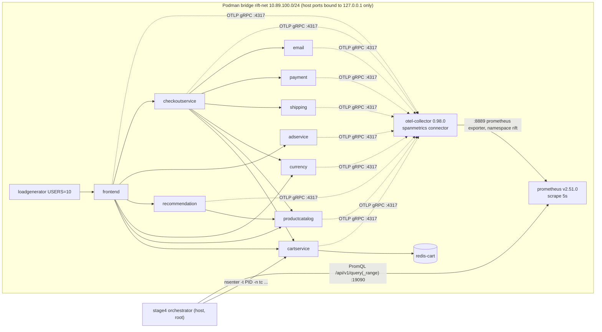

# RIFT Recovery — External Testbed & Generalization Audit (Agent 8)

**Scope:** what the live Linux testbed actually demonstrated, what is still synthetic, whether a local/mock testbed is feasible, and a protocol an outside reviewer can follow.
**Method:** read-only inspection of the files listed in §9, plus three things I executed locally: the offline Stage 4 attribution script, the related unit tests (73 passed), and a `tc`/netem probe inside a Linux container on the local Podman machine (§5.1). I did **not** touch the IBM VM, so every statement about that VM is taken from the committed reports and artifact, not re-observed.
**Repo state at audit:** `deploy/` is **untracked** in git, `configs/live.yaml` is modified, and `artifacts/stage4_intervention_results.json` is untracked (protected material, SHA-256 `e4cf1391c83bcb33070e8bc4ae3f8b792df2e0d1970df14524fc6c8d5d1dcffe`, re-verified unchanged after my run).

---

## 1. Bottom line

| Question | Answer |
|---|---|
| Is there real live evidence? | Yes, but narrow: **one** `tc netem` trial (N=1) on **one** container (`cartservice`) of a real 14-container Online Boutique stack on RHEL 9.6, with real OTel spanmetrics → Prometheus telemetry. |
| Does it support an accuracy / generalization claim? | **No.** N=1, one fault type, one target, one magnitude, no null trial, and the pipeline's own offline re-analysis **abstains** (`NOT_IDENTIFIABLE`; EBD candidate = `cartservice`). The "100% Top-1" in the Sprint 4.2.1 report and in the artifact fields `attributed_root_cause` / `ground_truth` / `attribution_accuracy_top1` was hard-coded and is superseded by [`SPRINT4_2_4_STAGE4_ATTRIBUTION_ANALYSIS.md`](../SPRINT4_2_4_STAGE4_ATTRIBUTION_ANALYSIS.md). |
| Was the hardened backend exercised live? | **No.** The live run used inline `nsenter … tc` commands in [`scripts/stage4_intervention_orchestrator.py`](../../scripts/stage4_intervention_orchestrator.py:63), not `LinuxTcNetemBackend`. Worse, the backend's command sequence **fails on a real Linux kernel** (§4, D-1). |
| Is a reproducible local testbed feasible? | Yes, in tiers (§5): a no-service `tc` mechanism check (I verified it works in a container on the local Podman VM), a Linux-x86_64 full-stack run, and a synthetic "mock Boutique" for repeated trials. A full 14-container run on this Apple-silicon Mac is **not** a good idea (§5.3). |
| Does a `deploy/Dockerfile` exist? | **No.** The request listed it, but only `deploy/{README.md,otel-collector.yaml,podman-compose.yaml,prometheus.yml}` exist. The Dockerfile in the repo is [`docker/Dockerfile`](../../docker/Dockerfile), and it builds the Python **evaluation harness**, not the testbed. Boutique images are pulled prebuilt. |

---

## 2. Testbed architecture (as specified in the repo)



| Element | Source | Notes |
|---|---|---|
| 14 containers = 11 Boutique services (incl. loadgenerator) + `redis-cart` + `otel-collector` + `prometheus` | [`deploy/podman-compose.yaml`](../../deploy/podman-compose.yaml) | Images pinned by **tag** (`v0.8.1`, `0.98.0`, `v2.51.0`, `redis:alpine` — unpinned), not by digest. Memory caps 128–512 MiB, CPU 0.25–0.5; total configured ≈ 2.5 GiB. |
| Telemetry path | [`deploy/otel-collector.yaml`](../../deploy/otel-collector.yaml), [`deploy/prometheus.yml`](../../deploy/prometheus.yml) | OTLP → `spanmetrics` connector (buckets 2 ms…5 s) → Prometheus exporter (`rift_` prefix) → Prometheus keeps only `rift_.*`. |
| RIFT query | [`PrometheusClient._METRIC_QUERIES`](../../src/rift/pipeline/e2e_runner.py:98), orchestrator `query_latency` | `histogram_quantile(0.99, sum by (le)(rate(rift_duration_milliseconds_bucket{span_name=~"(?i).*<svc>.*"}[1m or 2m]))) / 1000` |
| Perturbation | orchestrator `apply_intervention` | `tc qdisc add … root handle 1: prio bands 3 priomap 1×16` → `parent 1:1 handle 10: netem delay 50ms 5ms distribution normal` → `u32 match ip protocol 6 0xff flowid 1:1` (**all TCP egress** of the container's `eth0`, not per-destination). |
| Safety | orchestrator | Container-vs-host netns inode check, detached 45 s watchdog that re-runs the rollback, rollback in `finally`. |
| Host | Stage 2/4 reports | RHEL 9.6 `5.14.0-503.21.1.el9_5.x86_64`, Podman 5.2.2, shared IBM Fyre VM with unrelated workloads. |

Related but **different** specs that a reviewer may confuse with the live testbed:

| | `deploy/` (used for Stage 2–4) | `docker/` + `scripts/start_testbed.sh` (Phase 3.6/4) |
|---|---|---|
| Engine | Podman | Docker Compose |
| Boutique version | v0.8.1 | v0.9.0 |
| Prometheus host port | `19090` | `9090` |
| Jaeger | none | yes |
| `spanmetrics` connector | yes | **none** (`grep spanmetrics docker/otel-collector-config.yaml` → no match) |
| Produces `rift_duration_milliseconds_bucket` | yes | **no** — RIFT's live PromQL would return nothing |
| `configs/live.yaml` matches? | no (ports `9090`/`16686`, Docker, kubectl, namespace `rift-eval-default` all describe this stack) | yes |

`configs/live.yaml` therefore describes a stack that was **not** the one used for the only live trial. The Phase 4 report ([`PHASE_4_LINUX_EXECUTION_REPORT.md`](../PHASE_4_LINUX_EXECUTION_REPORT.md)) also ran on a different VM (`manas1.fyre`, kernel `5.14.0-570`), and its netem tests (NET-1…7) were on loopback `lo` with `ping`, not on Boutique.

---

## 3. Real vs synthetic

Legend: **REAL-LIVE** = produced by a real kernel/containers/telemetry in the one Stage 4 run; **REAL-OFFLINE** = real code on saved real data; **SYNTHETIC** = generated, mocked, or hard-coded; **UNVERIFIED** = claimed but not supported by committed evidence.

| # | Element | Class | Evidence / caveat |
|---|---|---|---|
| 1 | 14-container Boutique + OTel + Prometheus running on RHEL 9.6 | **REAL-LIVE** | Stage 2 report (health matrix, PIDs). Taken on trust: no raw logs/`podman ps` output are committed. |
| 2 | Load traffic | **REAL-LIVE**, but synthetic *workload* | Boutique's own locust generator, `USERS=10`. Not production traffic; no workload-variation experiments. |
| 3 | OTel spanmetrics → Prometheus p99 series | **REAL-LIVE** | Live series in the artifact. Method caveats below (M-1…M-4). |
| 4 | `tc prio` + `netem delay 50ms 5ms` applied inside cartservice's netns | **REAL-LIVE** | Artifact holds `initial_qdisc`, `applied_qdisc`, `restored_qdisc` strings and two distinct netns inodes (`5583182` vs `5586971`). |
| 5 | Rollback to `qdisc noqueue 0: root refcnt 2` | **REAL-LIVE** (N=1) | Same strings; also one run only. |
| 6 | Latency shift on cartservice and frontend | **REAL-LIVE** (N=1) | Reproduces from the artifact: cartservice p99 6.25 → 236.15 ms (Z=143.06), frontend 230.62 → 446.25 ms. I recomputed these three Z-scores from the JSON and they match. |
| 7 | "No spillover" to non-callers | **REAL-LIVE**, weakly supported | Absence of a Z≥3 shift in one trial; no null-trial noise floor. |
| 8 | "100% Top-1 attribution" | **SYNTHETIC (hard-coded literal)** | Sprint 4.2.4 §1.1; superseded. Still present as `attributed_root_cause`, `ground_truth`, `attribution_accuracy_top1` in the protected artifact. |
| 9 | RIFT inference on the saved data (FCI → EBD → identifiability) | **REAL-OFFLINE** | `scripts/sprint424_stage4_offline_attribution.py` — I ran it: `predicted_root=null`, `abstained=true`, `NOT_IDENTIFIABLE`, `ebd_candidate=cartservice`, `cid_grade=INSUFFICIENT`, outcome `ABSTAINED`. Abstain/commit flips with FCI α (0.01/0.10/0.20 → CANDIDATE; 0.02–0.07 → abstain). |
| 10 | R4 (interventional confirmation) on live data | **Not reached** | 15 pre / 12 active samples; CID floor is 20 per side. The labelled "R4 PASS" in the 4.2.1 report is a hand-evaluation, not a pipeline output. |
| 11 | Ground truth / which service was perturbed | **Experimenter-chosen** | The target is an input to RIFT (`InterventionRecord`), so R4-style evidence for it is intervention-consistent by construction (`stage4_attribution.py` docstring). |
| 12 | Dev/val/held-out benchmark (P@1 = 83.33% etc.) | **SYNTHETIC** | `SyntheticBenchmark` scenarios, oracle PAG for the 83.33% figure; held-out is not content-independent (4.2.4 §4.4). None of it touches the live testbed. |
| 13 | E2E runner with `MockTelemetry` (Phase 4G/4L) | **SYNTHETIC** | `live_telemetry_used=False` at the time of Phase 4. |
| 14 | `LinuxTcNetemBackend` correctness | **UNVERIFIED — and defective** | Never run live; unit tests only check guards with `_run_tc` mocked; see D-1. |
| 15 | Multi-testbed / "3 testbeds" claims | **UNVERIFIED** | Only Online Boutique exists (BASELINE.md §4). |
| 16 | Per-destination isolation (A5) on Boutique | **UNVERIFIED** | The live run filtered *all TCP* egress. Per-destination isolation was only tested on loopback (NET-5, Phase 4). |

### Method caveats that limit the real evidence

- **M-1 Series are not independent.** `rate(...[2m])` evaluated at 10 s steps yields overlapping windows; the saved series have only 3 / 2 / 4 distinct values per service in pre / active / post (verified for `cartservice`, `frontend`, `checkoutservice`). Z-scores of 143 reflect plateau steps, not 143σ of independent noise.
- **M-2 The "intervention" window is not the injection window.** The tc rule was active ~30 s; the saved "intervention" series spans 1793642335–1793642445 (110 s) with a 2 m rate lookback, so it mixes injected, rolled-back, and smeared samples. The artifact does not store the apply/removal timestamps (they were only in an unsaved `/root` checkpoint), so `applied_at` is approximated by the first active sample.
- **M-3 Windows were back-filled.** `scripts/stage4_intervention_analysis.py` re-queried Prometheus with hard-coded epoch windows after the run; the orchestrator's own live samples (`/root/...json`) are not what the artifact contains.
- **M-4 Timestamps do not reconcile.** The report states execution `18:02:22Z–18:07:28Z`; the artifact's epochs convert to `17:56:20Z–18:04:40Z` (injection onset sample `1793642337` ≈ `17:58:57Z`). Cause unknown (clock source, report typo, or re-query offset); it cannot be resolved from the repo.
- **M-5 Metric identity is a substring match.** `span_name=~"(?i).*cartservice.*"` can match gRPC *client* spans emitted by callers as well as the callee's *server* spans, and `sum by (le)` discards `service_name`/`span_kind`. Whether "cartservice p99" is server-side only is not established by the committed artifacts. This matters because a client span would include the injected egress delay by construction.
- **M-6 Magnitude not 1:1.** 50 ms ± 5 ms produced +230 ms p99. [`SPRINT4_2_2_STAGE4_EVIDENCE_AUDIT.md`](../SPRINT4_2_2_STAGE4_EVIDENCE_AUDIT.md) §5 explains this with two egress hops plus queueing; that is plausible but is an unmeasured explanation, and (per M-5) may partly be a measurement-identity effect.
- **M-7 Shared host.** The VM also ran unrelated IBM workloads; no CPU pinning, no noise-floor measurement, no repeat to bound environmental variance.

---

## 4. Defects found that block "reproducible external validation"

| ID | Severity | Finding | Evidence |
|---|---|---|---|
| **D-1** | **High** | `LinuxTcNetemBackend.apply()` builds `tc qdisc add … parent 1:{N} handle {N}: netem` with `handle = tc_handle.rstrip(":")`. For band 1 (`tc_handle="1:"`) the netem handle becomes `1:`, **identical to the root prio handle** (bands 2 and 3 yield `2:`/`3:` and were not probed by me). I reproduced the failing sequence on a real Linux kernel: `Error: Cannot move an existing qdisc to a different parent.` (rc=2). `apply()` then returns `FAILED`. The live run only worked because the orchestrator hard-coded `handle 10:`. [`network_intervention.py`](../../src/rift/intervention/network_intervention.py:246) uses the same `{band}:` scheme, so it likely has the same defect (not run by me). | [`linux_tc_netem.py`](../../src/rift/intervention/backends/linux_tc_netem.py:149); my probe in §5.1 |
| **D-2** | High | The hardened backend and the safety layer are not on the executed live path: the Stage 4 trial used inline commands, and the e2e runner builds `NetworkInterventionEngine` without a namespace ([`FINAL_SAFETY_AND_CODE_QUALITY_REPORT.md`](../FINAL_SAFETY_AND_CODE_QUALITY_REPORT.md) S-1, S-3). The safety claims in `configs/live.yaml` are not enforced by the code that touched the VM. | grep: `LinuxTcNetemBackend` is referenced only by its own file and one unit test; the unit test mocks `_run_tc`. |
| D-3 | Medium | The live perturbation (u32 `match ip protocol 6` = all TCP egress, filter `prio 1`) differs from the library's design (per-destination `/32`). Results from the former cannot validate the latter. | orchestrator line 67 vs backend line 154 |
| D-4 | Medium | `deploy/` is untracked; `configs/live.yaml` is modified but describes the `docker/` stack; no config exists for the stack actually used. | `git status`; §2 table |
| D-5 | Medium | Images pinned by tag, not digest; `redis:alpine` floats. | compose file |
| D-6 | Low | `PrometheusClient` queries are tied to the `deploy/` collector (`rift_` prefix, `span_name` regex). Pointing RIFT at the `docker/` stack silently yields empty series. | §2 table |
| D-7 | Low | `rollback_intervention` ignores return codes (`subprocess.call`), so a partial rollback is only caught by the later qdisc string check. | orchestrator lines 72–79, 182 |

---

## 5. Feasibility of a reproducible local / mock testbed

### 5.1 What I verified on this machine

macOS has no `tc`; `docker` is not installed; `podman` 6.0.0 exists with a stopped `applehv` machine (aarch64 Fedora, kernel `7.0.11`, 2 GiB RAM). I started it and ran an Alpine container with `--cap-add NET_ADMIN` (then stopped the machine again; nothing persistent was changed besides the pulled Alpine image and `modprobe sch_netem sch_prio cls_u32` inside the VM).

- The **orchestrator's** command sequence (handle `10:`, `u32` filter, rollback) applied, showed `qdisc netem 10: parent 1:1 … delay 50ms 5ms`, rolled back, and returned to `qdisc noqueue 0: root refcnt 2` — the same end state as the IBM run.
- The **backend's** sequence (handle `1:` under parent `1:1`) failed with `Error: Cannot move an existing qdisc to a different parent.` (D-1).
- The VM kernel needed `modprobe sch_netem` first (module present, not loaded).

This establishes that the *mechanism* (add/show/delete/restore, namespaced) is cheaply reproducible without Boutique, on any Linux kernel with `sch_netem`, `sch_prio`, `cls_u32`. It does **not** establish latency effects (I did not measure ping/RTT) or anything about Boutique.

### 5.2 Tiers

| Tier | What | Needs | Cost | What it can legitimately support |
|---|---|---|---|---|
| **T0** Offline integrity | Hash check, offline attribution replay, unit tests | Any OS, Python 3.11 | minutes | That the committed analysis reproduces from the committed artifact; **not** that the artifact is genuine. |
| **T1** `tc` mechanism | Container or netns with `prio`+`netem`+`u32`, apply → verify → rollback, optionally `ping` between two netns | Linux (or Podman VM), `NET_ADMIN`, `iproute2` | minutes | Backend command correctness (would have caught D-1); rollback fidelity; per-destination isolation. |
| **T2** Full stack | `deploy/podman-compose.yaml` as committed | **x86_64** Linux, ≥ 4 GiB free RAM (config limits sum to ~2.5 GiB + host), Podman ≥ 4.4, root or `nsenter` privilege, ports 18080/19090/18888/14317 free | ~30–60 min per batch | Real telemetry, real kernel perturbation, repeated trials (§6). |
| **T3** Mock Boutique | Same DAG, tiny synthetic services (e.g. 6–10 processes, each in its own netns, exposing a Prometheus histogram named like `rift_duration_milliseconds_bucket`) with known SCM, injectable confounders, real `tc netem` between netns | Linux, Python | 1–2 days to build | Many cheap trials, controlled ground truth, null and confounded cases, α-sensitivity. **Not evidence about Boutique** and must be labelled *semi-synthetic*. |

### 5.3 Running T2 on this Mac: not recommended

- Boutique `v0.8.1` images are **linux/amd64** (I checked the `cartservice` image config via the gcr.io registry API: `architecture: amd64`). The local Podman machine is aarch64, so everything would run under emulation, with distorted latencies and extra CPU contention — unacceptable for a latency-based study.
- The machine has 2 GiB RAM; the compose file alone allots ~2.5 GiB.
- Untested here: whether `qemu-user` binfmt is set up in that VM; I did not try to pull or run any Boutique image.

Use T1 locally, T2 on an x86_64 Linux host (cloud VM or the original Fyre VM class), and T3 anywhere Linux runs.

### 5.4 Recommended order

1. Fix D-1 and add a T1 test that executes the **real** command sequence (skipped off-Linux with an explicit `SKIPPED: requires Linux + CAP_NET_ADMIN` reason, as in `tests/integration/fault_injection/__init__.py`). This is the cheapest way to turn "READY_FOR_LINUX" into evidence. A GitHub-hosted `ubuntu-latest` runner has `tc` and passwordless `sudo`, so T1 can run in [`.github/workflows/test.yml`](../../.github/workflows/test.yml) (not tested by me).
2. Commit `deploy/` and a `configs/live_deploy.yaml` that matches it; pin images by digest.
3. Build T3 only if T2 hardware is unavailable or trial counts need to exceed what T2 can produce.
4. Run T2 per §6.

---

## 6. Execution protocol for reviewers

### 6.0 Claims this protocol can and cannot test

| Claim | Testable with | Status today |
|---|---|---|
| C-A: netem can be applied to and removed from a container netns without touching the host | T1/T2 | N=1 live (IBM VM) |
| C-B: injected latency produces a detectable p99 shift at the target and its callers | T2 | N=1 live |
| C-C: RIFT attributes the injected root (or abstains) across targets/magnitudes | T2 (and T3 for scale) | **Untested** (N=1, abstained offline) |
| C-D: RIFT abstains when evidence is weak/confounded | T2 null/sham, T3 | Only on synthetic benchmark |

### 6.1 T0 — Offline integrity (any OS, ≈ 5 min)

```bash
cd "RIFT FINAL"
shasum -a 256 artifacts/stage4_intervention_results.json
#  expect e4cf1391c83bcb33070e8bc4ae3f8b792df2e0d1970df14524fc6c8d5d1dcffe
python3 scripts/sprint424_stage4_offline_attribution.py
#  expect: predicted_root=null, abstained=true, abstention_reason=NOT_IDENTIFIABLE,
#          ebd_candidate=cartservice, cid_grade=INSUFFICIENT, outcome=ABSTAINED, n_trials=1
python3 -m pytest -q -p no:cacheprovider \
  tests/unit/test_safety_namespace_remediation.py tests/unit/test_network_intervention.py \
  tests/unit/test_sprint424_stage4_attribution.py            # 73 passed when I ran it
```

The artifact contains an internal IBM hostname/IP; treat it as protected material (see `reproducibility/protected_materials.py`).

### 6.2 T1 — `tc` mechanism check (Linux or Podman VM, ≈ 10 min)

Run as verified in §5.1 (on Podman machine: `podman machine start`, then `podman machine ssh 'sudo modprobe sch_netem sch_prio cls_u32'`).

```bash
# PASS = applied qdisc shows netem delay 50ms 5ms and final state is 'qdisc noqueue'
podman run --rm --cap-add NET_ADMIN docker.io/library/alpine:3.20 sh -c '
  apk add -q iproute2-tc iproute2-minimal >/dev/null 2>&1
  tc qdisc add dev eth0 root handle 1: prio priomap 0 0 0 0 0 0 0 0 0 0 0 0 0 0 0 0 &&
  tc qdisc add dev eth0 parent 1:1 handle 10: netem delay 50ms 5ms distribution normal &&
  tc filter add dev eth0 parent 1: protocol ip u32 match ip dst 10.255.255.1/32 flowid 1:1 &&
  tc qdisc show dev eth0
  tc filter del dev eth0 parent 1: protocol ip prio 49152
  tc qdisc del dev eth0 parent 1:1 handle 10:
  tc qdisc del dev eth0 root handle 1:
  echo AFTER; tc qdisc show dev eth0'

# NEGATIVE CONTROL (documents D-1): the library backend's handle scheme.
#   expected today: "Error: Cannot move an existing qdisc to a different parent."
#   expected after the fix: success.
podman run --rm --cap-add NET_ADMIN docker.io/library/alpine:3.20 sh -c '
  apk add -q iproute2-tc iproute2-minimal >/dev/null 2>&1
  tc qdisc add dev eth0 root handle 1: prio priomap 0 0 0 0 0 0 0 0 0 0 0 0 0 0 0 0
  tc qdisc add dev eth0 parent 1:1 handle 1: netem delay 50.0ms 5.0ms distribution normal loss 0.00%; echo rc=$?'
```

Not yet covered by T1 and required before any per-destination claim: `ping`/`iperf` RTT before / during / after, from a second netns, to the filtered and an unfiltered destination.

### 6.3 T2 — Full-stack protocol (x86_64 Linux)

**Pre-flight (abort if any fails)**

1. `uname -m` is `x86_64`; `free -g` ≥ 4 GiB available; ports 18080/19090/18888/14317 free; `modprobe sch_netem sch_prio cls_u32` succeeds.
2. `podman compose -f deploy/podman-compose.yaml up -d`; all 14 containers `Up`; `curl 127.0.0.1:18080` → 200; Prometheus target `rift-otel-spanmetrics` is `up`.
3. Record `uname -r`, `podman --version`, image **digests** (`podman image inspect --format '{{.Digest}}'`), git SHA, and a `podman ps` dump into the run directory (the original run committed none of these).
4. For each trial, check `stat -c %i /proc/<pid>/ns/net` ≠ `stat -c %i /proc/1/ns/net` before touching anything.
5. Verify the metric identity (M-5): in Prometheus run `count by (service_name, span_kind) (rift_duration_milliseconds_bucket)` and confirm the p99 used for a service is server-side (`span_kind="SPAN_KIND_SERVER"`) for that `service_name`. If the labels aren't present, fix the collector first; do not proceed with the `span_name` regex.

**Design (fix this before looking at any result; commit it as `docs/recovery/EXTERNAL_VALIDATION_PREREG.md`)**

| Factor | Levels |
|---|---|
| Target (injected) | `cartservice`, `productcatalogservice`, `currencyservice`, `shippingservice`, `paymentservice` (+ `redis-cart` if its netns can be targeted) |
| Perturbation | delay 25 / 50 / 100 ms (+ optional 1–2 % loss) |
| Scope | per-destination `/32` (library design) **and** all-TCP (the original run) — keep separate |
| Controls | **sham**: apply `prio` with no netem band for the same duration; **null**: no tc at all. ≥ 1 sham + 1 null per target |
| Replicates | ≥ 5 per cell; randomise order; ≥ 120 s idle between trials |

**Per-trial timeline** (the original used 90 s / 30 s / 90 s and was reported as non-compliant with a 120 s spec)

| Phase | Duration | Note |
|---|---|---|
| Baseline | ≥ 180 s | |
| Inject | ≥ 60 s | Record `t_apply` and `t_remove` **in the artifact** (the original did not). Arm the 45 s-style watchdog with a deadline > injection length. |
| Recovery | ≥ 180 s | |

**Telemetry** — to get ≥ 20 independent samples per phase (the CID floor), make step ≥ lookback and query on a stable grid, e.g. `rate(...[15s])` at 15 s steps with scrape interval 5 s, and store **raw histogram bucket counters** for each trial so any later windowing can be re-derived. Keep the injection window and the "active" analysis window identical (M-2).

**Analysis** (run exactly as committed; no tuning on these data)

1. Run `analyze_saved_record` (or its successor) per trial with the target supplied only as the intervention record; ground truth only in the evaluation call. Report `predicted_root`, `abstained`, `ebd_candidate`, `cid_grade`, R1–R4 pass/fail.
2. Report separately: coverage (non-abstain rate), accuracy-on-committed, EBD-candidate hit rate, false-positive rate on sham/null trials, and sensitivity to FCI α ∈ {0.01, 0.05, 0.10}.
3. Aggregate with trial-level (not sample-level) statistics and exact binomial CIs; do not pool plateau samples as i.i.d.
4. State explicitly: one VM, one workload generator, one app, one fault family. This is *external-testbed evidence*, not generalization across topologies.

**Teardown / safety**: `podman compose -f deploy/podman-compose.yaml down -v`; confirm `nsenter -t <pid> -n tc qdisc show dev eth0` is `qdisc noqueue` for every container; confirm host netns inode unchanged. Do not run on a shared production host; the original run shared a VM with unrelated workloads (M-7).

**Acceptance for "externally reproduced"**: (i) cart-delay trials reproduce a statistically separable p99 shift at the target on ≥ 4/5 replicates; (ii) sham/null trials show no such shift; (iii) rollback restores `noqueue` in 100 % of trials; (iv) the RIFT outcome table is reported in full, whatever it is, including abstentions.

### 6.4 T3 — Mock Boutique (if built)

Same analysis pipeline, same acceptance for (ii) and (iii), with: ≥ 200 trials; planted confounders and multi-cause cases; the real `tc netem` between namespaces; telemetry emitted in the exact metric/label schema of §2. Label every result **semi-synthetic**; never combine its counts with T2.

---

## 7. What the repo may and may not claim today

**May claim:** a real, isolated, namespace-scoped `tc netem` perturbation on one container of a real 14-container Boutique stack was applied once and rolled back, with a large, directionally-consistent p99 shift at the target and its callers; offline RIFT analysis of that run flags `cartservice` as the earliest-diverging candidate but abstains (N=1, α-fragile).

**May not claim:** any attribution accuracy from live data; validation of `LinuxTcNetemBackend`; per-destination isolation on Boutique; robustness across topologies, faults, magnitudes or workloads; "3 testbeds"; that Stage 4 exercised the safety stack in `src/rift/safety/`.

---

## 8. Recommended follow-ups (not performed in this audit)

1. Fix D-1 (use a distinct netem handle, e.g. `1{band}:` → `10:/20:/30:`, consistently in `LinuxTcNetemBackend`, `NetworkInterventionEngine`, `DryRunBackend`, and their tests); add a Linux-only T1 test.
2. Track `deploy/`; add a matching live config; pin digests.
3. Extend the orchestrator to persist `t_apply`/`t_remove`, raw bucket counters, and a run manifest; reconcile M-4.
4. Resolve metric identity (M-5) before any further live run.
5. Execute §6.3 on an x86_64 host and publish the full outcome table.

## 9. Files inspected

[`deploy/podman-compose.yaml`](../../deploy/podman-compose.yaml), [`deploy/otel-collector.yaml`](../../deploy/otel-collector.yaml), [`deploy/prometheus.yml`](../../deploy/prometheus.yml), [`deploy/README.md`](../../deploy/README.md), [`docker/Dockerfile`](../../docker/Dockerfile) (`deploy/Dockerfile` does not exist), [`docker/docker-compose.yml`](../../docker/docker-compose.yml), [`docker/otel-collector-config.yaml`](../../docker/otel-collector-config.yaml), [`configs/live.yaml`](../../configs/live.yaml), [`src/rift/intervention/backends/linux_tc_netem.py`](../../src/rift/intervention/backends/linux_tc_netem.py), [`src/rift/intervention/network_intervention.py`](../../src/rift/intervention/network_intervention.py), [`src/rift/pipeline/stage4_attribution.py`](../../src/rift/pipeline/stage4_attribution.py), [`scripts/stage4_intervention_orchestrator.py`](../../scripts/stage4_intervention_orchestrator.py), [`scripts/stage4_intervention_analysis.py`](../../scripts/stage4_intervention_analysis.py), [`artifacts/stage4_intervention_results.json`](../../artifacts/stage4_intervention_results.json), [`SPRINT4_1_8_STAGE2_DEPLOYMENT_REPORT.md`](../SPRINT4_1_8_STAGE2_DEPLOYMENT_REPORT.md), [`SPRINT4_2_1_STAGE4_INTERVENTION_EXECUTION_REPORT.md`](../SPRINT4_2_1_STAGE4_INTERVENTION_EXECUTION_REPORT.md), [`SPRINT4_2_2_STAGE4_EVIDENCE_AUDIT.md`](../SPRINT4_2_2_STAGE4_EVIDENCE_AUDIT.md), [`SPRINT4_2_4_CRITICAL_REPAIR_REPORT.md`](../SPRINT4_2_4_CRITICAL_REPAIR_REPORT.md), [`SPRINT4_2_4_STAGE4_ATTRIBUTION_ANALYSIS.md`](../SPRINT4_2_4_STAGE4_ATTRIBUTION_ANALYSIS.md), [`PHASE_4_LINUX_EXECUTION_REPORT.md`](../PHASE_4_LINUX_EXECUTION_REPORT.md), [`FINAL_SAFETY_AND_CODE_QUALITY_REPORT.md`](../FINAL_SAFETY_AND_CODE_QUALITY_REPORT.md), [`BASELINE.md`](BASELINE.md).
