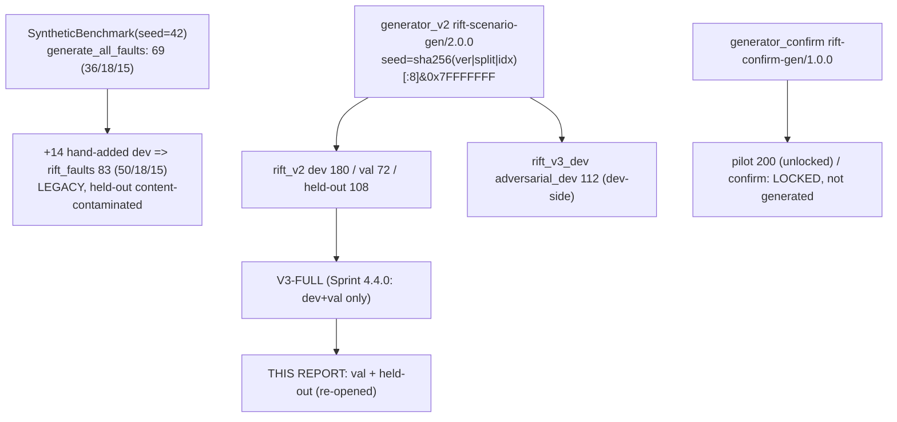

# Sprint 7 / Workstream 1 — Held-Out Evaluation of Frozen RIFT-FULL-V3

**Date:** 2026-11-09 (UTC) · **Repo HEAD:** `ebad911087942f257ba434f69816ed6d692be170` + dirty working tree · **Python:** 3.9.6 (macOS arm64; canonical pins: numpy 2.0.2, scipy 1.13.1, networkx 3.2.1, pandas 2.3.3, causal-learn 0.1.4.8)
**Everything below concerns synthetic ground-truth scenarios from one simulator. Nothing here is evidence about a live system.**

## 0. Verdict (read this first)

| Question | Answer |
|---|---|
| Was an *independent, unspent* held-out set available? | **No.** `generator_confirm` is G4-locked (no `prereg.sha256`, `decisions.json` D7 = `PENDING`); the legacy `rift_faults` held-out is content-contaminated (15/15 twins); the `rift_v2` held-out was **already opened once** (2026-11-03T04:06:00Z). |
| What was actually run? | Frozen **V3-FULL** (config hash-verified), one pass, on `rift_v2` **val** (72) and the **spent** `rift_v2` **held-out candidate** (108). 0 method errors, 0 timeouts. |
| Is the held-out result a valid final claim? | **No.** It is a *re-opening* (`allow_reopen=True`); the registry stamps it `valid_for_final_claims = False`. Val is development data (V3 was developed on dev and "confirmed" on val). **No confirmatory claim is supported by this report.** |
| Headline result | V3-FULL is **worse than always-abstain on the preregistered utility on both splits** (U = −0.340 on val, −0.664 on held-out; all CIs entirely below 0). It beats V2 on val safety only; on held-out it is **not distinguishable from V2** (U −0.664 vs −0.594). |
| Did V3's dev/val gains transfer? | **Partially, and not on the headline.** Val reproduces the Sprint 4.4.0 numbers exactly (regression 72/72 match). On held-out the wrong-root rate is 12/45 = 0.267 vs 3/31 = 0.097 on val (exploratory Fisher p = 0.084; vs dev+val 10/99, p = 0.022, uncorrected, post-hoc). Part of this gap is confounded with a deliberate distribution shift and larger graphs (§6). |

## 1. Dataset lineage



| Corpus | Role in this report | File | n | SHA-256 | Verified this run |
|---|---|---|---:|---|---|
| `rift_v2` dev | development (context only; V3 saved output) | `datasets/rift_v2/dev.json` | 180 | `a833ad0ca1db0583a30bc4450f9f59b2984a5823702935ef59c6b037e026ef5f` | registry pin + freeze |
| `rift_v2` val | **evaluated (validation)** | `datasets/rift_v2/val.json` | 72 | `e82252b47f29dc1353586034b6fd8c3491df3221851f9c84c48bf717a944a1fb` | registry pin + freeze |
| `rift_v2` held-out | **evaluated (spent held-out)** | `datasets/rift_v2/heldout_candidate.json` | 108 | `97b90fa424c3a7c0654d2fd8cde417f094c58931a527c8ce5023bafe5e8e69ce` | `heldout_status`, `freeze.json`, `independence_report.json`, `heldout_opened.json` all name this hash |
| `rift_v3_dev` adversarial | leakage reference only | `datasets/rift_v3_dev/adversarial_dev.json` | 112 | `3525bc05ed8b9dd21dcc888181005af09e75f43396fb27a0ad6732588ea3c472` | matches `provenance.json` |
| legacy `rift_faults` dev/val/held-out | contamination re-derivation only (no V3 run) | `development.json` / `validation.json` / `held_out_test.json` | 50 / 18 / 15 | `d8960776…1aebd` / `2363f6bb…53d0f3` / `4337675b…dd91` | all three equal `manifest.json` values |
| `rift_faults` adversarial cohort | not used | `adversarial_stress_cohort.json` | 30 | `46e769c6…5577` | — |
| Confirmatory | **none exists** | — | — | — | G4 lock |

**Seeds / generation rules (read from code).**
* `generator_v2`: `seed = int(sha256(f"rift-scenario-gen/2.0.0|{split}|{idx}")[:8],16) & 0x7FFFFFFF`; per-split RNG seeds 4301/4302/4303 (dev/val/held-out); ids `V2D-/V2V-/V2H-NNNN`; topology size bands are disjoint by split (`extra` ∈ dev {0,1}, val {2}, held-out {3}); cell assignment `cell_split(structure, family)` is `(si + 2·fi) mod 10 → dev (<5) / val (5,6) / held-out (≥7)`, and **all** `feedback_like` structures and `recovery_instability` families are forced to held-out (deliberate distribution shift). Scenario labels come from the noise-free `compute_ground_truth`, not from any method.
* This run verified: seeds unique within each split (180/72/108 distinct), generator version `rift-scenario-gen/2.0.0` for all three, `split` field = file split for all scenarios.
* `generator_confirm`: `seed = sha256(f"rift-confirm-gen/1.0.0|{kind}|{i}")[:8] & 0x7FFFFFFF`; `generate("confirm")` raises unless `prereg.sha256` exists and `decisions.json` has a signed D7. Neither holds (`D7.status = PENDING`, `approved_by = null`). Known defects already filed in `DATASET_AUDIT.md` §6 (lock reads `decisions["D7"]` at the wrong nesting level; no quota/break enforcement for `confirm`) remain open.
* Legacy: `seed + trial` / `seed + idx` additive seeds collide (dev 38 distinct/50, val 14/18, held-out 13/15 — recomputed here); `_split_assignment` ignores its RNG (positional splits).

## 2. Split tables

### 2.1 `rift_v2` (the corpus V3 is evaluated on)

| Split | n | ATTRIBUTE | ABSTAIN_REQUIRED | WEAK_SIGNAL | ROOT_UNOBS. | SYMMETRIC | INSUFF_BASE | NO_DISCRIM. | NO_FAULT | templates | topologies | union-find groups | mean nodes | status |
|---|---:|---:|---:|---:|---:|---:|---:|---:|---:|---:|---:|---:|---:|---|
| dev | 180 | 68 | 112 | 34 | 23 | 15 | 16 | 15 | 9 | 75 | 60 | — | 4.48 | used to design V3; **not evaluated here** (saved 4.4.0 output) |
| val | 72 | 31 | 41 | 12 | 8 | 7 | 7 | 3 | 4 | 30 | 26 | 11 | 6.13 | development ("confirm") data |
| held-out | 108 | 45 | 63 | 22 | 8 | 13 | 9 | 7 | 4 | 71 | 27 | 14 | 6.89 | **spent** (opened 2026-11-03T04:06:00Z; re-opened here) |

Held-out contains levels absent from dev/val: structure `feedback_like` (24 scenarios) and family `recovery_instability`; **40/108 held-out scenarios** involve one of them (20 ATTRIBUTE / 20 ABSTAIN_REQUIRED). Re-derived `unseen_in_protected_vs_other_splits` = `{structure: [feedback_like], family: [recovery_instability]}`, identical to the stored report.

### 2.2 Legacy `rift_faults` (recomputed from files, not from docs)

| Split | n | distinct contents | distinct seeds | confounded (distinct contents) | status |
|---|---:|---:|---:|---|---|
| development | 50 | 25 | 38 | 24 (4) | threshold selection |
| validation | 18 | 10 | 14 | 12 (4) | threshold selection |
| held-out | 15 | **7** | 13 | 12 (4) | `sealed: true` in manifest, **content-contaminated** |

## 3. Contamination and "was the held-out opened?"

1. **Legacy (Sprint 4.3.0) contamination: confirmed, unresolved.** 15/15 legacy held-out scenarios have a content twin in dev ∪ val (recomputed: content hash = all fields except `fault_id, name, seed, split, confounder_description`). Seed overlap dev∩held-out = 1, val∩held-out = 1, dev∩val = 2. The 36 confounded dev+val records reduce to 4 distinct contents. No file was repaired; it is only documented (`manifest.json`, `SPRINT4_3_0_DATASET_PROVENANCE_AUDIT.md`). V3 was **not** run on it (it has no `rift_v2`-style observables/labels; the legacy generator ignores most fields).
2. **`rift_v2` held-out was opened before this report.** `artifacts/sprint4_3_0/heldout_opened.json` = `{"opened_at_unix": 1793678760.425919 (2026-11-03T04:06:00.4Z), "sha256": 97b90fa4…e69ce}`. Sprint 4.3.0 ran V2/baselines/ablations on it (`artifacts/sprint4_3_0/results/held_out/`, 30.97 s).
3. **This run is a second opening.** `load_v2("held_out", purpose="final", guard=<token>, allow_reopen=True)` was used. Consequences: the registry returned `valid_for_final_claims = False`; `heldout_opened.json` was **not rewritten** (byte-identical SHA-256 `7b1bbb0195395d65f16e0504d9f3d04478b248c8dfc99ebbbef1607e8dfc6091` before/after; the script records `heldout_opened_json_unchanged: true` in `analysis.json`); the guard log shows exactly one authorised access (token `SPRINT7_WS1_V3_FULL_HELDOUT_REEVAL`, `dataset_registry_v2.py:97`). V3-FULL was run **once** on each scenario.
4. **Disclosure vs. other documents.** `docs/SPRINT4_4_0_*` state V3 "was never run on held-out data" and `docs/recovery/SPRINT7_RESULTS_REPRODUCTION.md` states "the held-out file was never opened" — both were true of *those* analyses and are **superseded for held-out custody** by this report. This report also deviates from `SPRINT4_5_0_DATASET_PROTOCOL.md` §0 item 1 ("never opened … by anyone running Phase B"); that preregistration is still `PROPOSED`/non-binding (D7, D12 open), but the deviation is stated here because the file's custody is the project's central safeguard.
5. **Information leak at design level (not a code leak).** The Sprint 4.3.0 final report published V2's held-out failure mechanism (all 14 held-out wrong answers named a *downstream* service; 23/63 unsafe-on-abstain, WEAK_SIGNAL-dominated) *before* V3 was designed. V3's design targets exactly that pattern (source rule + manipulation check), although its evidence base was dev/val only and no Sprint 4.4.0 file references the held-out data (enforced by `test_new_sprint440_code_never_references_heldout_data`). V3 is therefore **not blind** to held-out aggregate findings. This cuts toward *optimism* for V3 on held-out, which makes the poor result below conservative with respect to this particular leak.

## 4. Leakage tests (re-executed this run on label-stripped copies, before any V3 run)

Tools: `src/rift/scenarios/leakage_checks.check_candidate` (near threshold 0.88; `ok` ⇔ all key counts 0, no spanning union-find group, no intra-candidate id/content/dynamics duplicates) and `independence.verify_independence` (near threshold 0.90). Counts are shared keys between the candidate and each protected set.

| Candidate vs protected | ids | seeds | content | dynamics | topology | template | joint cell | near pairs ≥ thr | max sim | spanning groups | `ok` |
|---|---:|---:|---:|---:|---:|---:|---:|---:|---:|---:|---|
| val vs dev (0.88) | 0 | 0 | 0 | 0 | 0 | 0 | 0 | 0 | 0.8216 | 0 | **True** |
| val vs dev + adversarial_dev (0.88) | 0 | 0 | 0 | 0 | 0 | 0 | 0 | 0 | 0.8216 / 0.8060 | 0 | **True** |
| held-out vs **dev** (0.88) | 0 | 0 | 0 | 0 | 0 | 0 | 0 | 0 | 0.8043 | — | — |
| held-out vs **val** (0.88) | 0 | 0 | 0 | 0 | 0 | 0 | 0 | **2** | **0.8978** | — | — |
| held-out vs **adversarial_dev** (0.88) | 0 | 0 | 0 | 0 | 0 | 0 | 0 | 0 | 0.7263 | — | — |
| **held-out vs {dev, val, adv}** (0.88, combined) | 0 | 0 | 0 | 0 | 0 | 0 | 0 | 2 | 0.8978 | 0 | **False** (solely the 2 near pairs) |
| same at 0.85 | — | — | — | — | — | — | — | 2 | — | 0 | **False** |
| adversarial_dev vs dev (0.88) | 0 | 0 | 0 | 0 | **7** | 0 | 0 | 0 | 0.7973 | 6 (vs dev+val) | **False** (topology; confirms `DATASET_AUDIT.md` §4.2) |
| `verify_independence` dev/val/held-out, protected=held-out (0.90) | all pair counts 0 for content, dynamics, topology, template, joint cell | | | | | | | 0 | | 35 groups, 0 integrity violations | **True** |

* **Re-derivation equals the stored report.** `shared_keys_by_pair`, `distinct_keys_per_split`, `n_groups` (35) and the unseen-level lists computed now equal `datasets/rift_v2/independence_report.json` (all four booleans True). So the earlier "0 leaks" claim is reproduced on the current bytes.
* **The `ok = False` for held-out at 0.88 is real and was missed by the stored report because it used 0.90.** The two pairs (similarities 0.8978, 0.8960) are `V2H-0062 ↔ V2V-0070` (parallel_independent vs diamond, `resource_saturation`, `delayed`, `insufficient_samples`, `high_baseline_variance`, `intermittent_degradation`) and `V2H-0082 ↔ V2V-0059` (branching vs confounding, `network_degradation`, `intermittent_degradation`). They differ in structure and size band, so they are near in the parameter space, not duplicates (content, dynamics, topology, template and joint cell are all disjoint). Both pairs are `<0.90`. This is the "threshold-dependent near-duplicate" caveat from the dataset audit, now with concrete ids.
* **Within-split dependence (effective sample size).** Union-find groups over template ∪ topology: val 11 groups for 72 scenarios (sizes 9,8,8,7,7,7,7,6,6,5,2); held-out 14 groups for 108 (sizes 24,15,11,9,9,9,9,6,5,5,2,2,1,1). Intra-candidate topology duplicates: val 46, held-out 81. Scenario-level CIs below therefore understate uncertainty; the group-cluster bootstraps are the more honest ones, and with 11–14 clusters even they are fragile.
* Unit tests re-run: `test_dataset_leakage_checks`, `test_leakage`, `test_confirm_generator`, `test_confirm_integrity` → **57 passed**. `scripts/verify_heldout_sealed.py` → 4/4 PASS, but it concerns the *legacy* `held_out_test.json` only (it does not cover `rift_v2`).
* Not done: the full protected harness (`sprint442_run_tests.py --require-protected`, 27 held-out-content-parsing tests) was **not** run (D12 still owner-open).

## 5. Evaluation protocol actually executed

| Item | Value |
|---|---|
| Method | `RIFT-FULL-V3`, config key `V3-FULL` (`manipulation_check`, `earlier_guard`, `divergent_candidates`, `test_explained` all True; answers = `DEFINITIVE_ROOT` or `QUALIFIED_ROOT`). Config in code equals `freeze_manifest.json["V3_FULL_config"]`. |
| Frozen-file check | `verify_freeze()` (37-file Sprint 4.3.0 freeze) = ok; Sprint 4.5.0 manifest: 51 files, **0 mismatches**. No frozen file was modified. (Both checked *before* any run and recorded in `pre_run_manifest.json`.) |
| Scoring | Frozen `benchmark_v2.score_one` (unchanged). Exceptions/timeouts (> 60 s) → abstain (D21); there were **0**. |
| Inputs | `sim.observe(sc)` and `sim.intervene`, same call pattern as `scripts/sprint440_run_v3.py`; ground truth read only by the scorer. |
| Order (as executed, UTC) | frozen-file check → **held-out loaded through the registry (06:40:4x; labels were in process memory from this point; dataset-level label counts such as ATTRIBUTE/ABSTAIN_REQUIRED were tabulated here, but all leakage/independence computations used label-stripped copies)** → leakage checks → `pre_run_manifest.json` (06:40:44Z) → V3 val (raw file 06:40:52Z) → V3 held-out (raw file 06:41:08Z) → analysis. No V3 output existed when any dataset-level or leakage number was computed. |
| Regression | V3-FULL on val reproduced the saved Sprint 4.4.0 `v3_val.json` (answered/top1/n_do) for **72/72** scenarios. |
| Utility (frozen definition from prereg §3) | `U = C − 2.0·S − 1.0·n_do/20` (strict unsafe, exactly `score_one`); `U_AA ≡ 0`; δ = 0.10. Bound/identity checks (`C·S = 0`, `U ∈ [−3, 1]`) asserted on every scenario; none violated. |
| Intervals | Wilson 95% for proportions. For means/differences: percentile bootstrap, B = 2000, seed 430, clustered by scenario, template and union-find group; the "widest" of template/group CI is used for the descriptive class. Paired tests: exact McNemar and sign-flip permutation (10,000, seed 430). Holm over 8 tests (V3-vs-V2 P1/P2/P3_safe and V3-vs-AA P2, on both splits) — **descriptive, not a preregistered family**. |
| Artifacts | `scripts/sprint7_heldout_eval.py` (SHA `e201c222…cd938`), `scripts/sprint7_heldout_supplement.py` (SHA `9f14ec28…25c80`), `artifacts/sprint7/{pre_run_manifest.json, analysis.json, per_scenario.csv, v3_full_val_raw.json, v3_full_held_out_raw.json, supplement.json, run.log}`. |

## 6. Results

### 6.1 Primary and secondary metrics (V3-FULL; n = scenarios; brackets = Wilson 95%)

| Metric | **Val** (n=72) | **Held-out** (n=108) |
|---|---|---|
| ATTRIBUTE / ABSTAIN_REQUIRED | 31 / 41 | 45 / 63 |
| **P1** correct root among ATTRIBUTE | 13/31 = **0.419** [0.264, 0.592] | 15/45 = **0.333** [0.214, 0.479] |
| Conditional accuracy (answered ATTRIBUTE) | 13/16 = 0.812 [0.570, 0.934] | 15/27 = 0.556 [0.373, 0.724] |
| Wrong root on ATTRIBUTE | 3/31 = 0.097 [0.033, 0.249] | 12/45 = **0.267** [0.160, 0.410] |
| **P2** outcome-correct | 44/72 = 0.611 [0.496, 0.715] | 57/108 = 0.528 [0.434, 0.619] |
| Unsafe (strict) overall | 13/72 = 0.181 [0.109, 0.285] | 33/108 = **0.306** [0.227, 0.398] |
| **Unsafe on ABSTAIN_REQUIRED** | 10/41 = 0.244 [0.138, 0.393] | 21/63 = **0.333** [0.229, 0.456] |
| False attribution among answered (selective risk) | 13/26 = 0.500 [0.321, 0.679] | 33/48 = 0.688 [0.547, 0.801] |
| Coverage overall (answered) | 26/72 = 0.361 [0.260, 0.476] | 48/108 = 0.444 [0.354, 0.538] |
| Coverage on ATTRIBUTE | 16/31 = 0.516 | 27/45 = 0.600 |
| **Abstention rate** | 46/72 = 0.639 [0.524, 0.740] | 60/108 = 0.556 [0.462, 0.646] |
| Correct abstention on ABSTAIN_REQUIRED | 31/41 = 0.756 [0.607, 0.862] | 42/63 = 0.667 [0.544, 0.771] |
| Lost coverage on ATTRIBUTE (abstained) | 15/31 = 0.484 | 18/45 = 0.400 |
| Top-3 hit on ATTRIBUTE | 16/31 = 0.516 | 25/45 = 0.556 |
| Mean do() per scenario / total | 3.19 / 230 | 3.84 / 415 |
| Method errors / timeouts | 0 / 0 | 0 / 0 |

### 6.2 Utility (preregistered definition; λ = 2, γ = 1)

| | Val | Held-out |
|---|---|---|
| Mean U, **V3-FULL** | **−0.340** | **−0.664** |
| 95% CI, scenario-cluster (n clusters) | [−0.569, −0.140] (72) | [−0.877, −0.457] (108) |
| 95% CI, template-cluster | [−0.592, −0.095] (30) | [−0.874, −0.461] (71) |
| 95% CI, union-find-group-cluster | [−0.613, −0.072] (11) | [−0.806, −0.501] (14) |
| Normalised U/π (π = 0.431 / 0.417) | −0.790 | −1.594 |
| Decomposition (per scenario) | +0.181 correct − 0.361 unsafe×2 − 0.160 cost | +0.139 correct − 0.611 − 0.192 |
| Mean U, V2 (saved Sprint 4.3.0 outputs) | −0.724 | −0.594 |
| Mean U, B0-EARLIEST (saved) | −1.458 | −1.509 |
| Mean U, ALWAYS-ABSTAIN | 0 | 0 |
| V3 − V2, template-cluster 95% CI | +0.384 [+0.086, +0.733] | −0.070 [−0.336, +0.194] |
| V3 − V2, group-cluster 95% CI | +0.384 [+0.071, +0.706] | −0.070 [−0.288, +0.159] |
| Descriptive class (prereg §10 bands, applied to the widest CI; percentile, not bootstrap-t) | **NEGATIVE-WORSE** | **NEGATIVE-WORSE** |
| Operational-unsafe sensitivity (unsafe only if named service is not a true root) | −0.201 (8 unsafe) | −0.535 (26 unsafe) |

**λ sensitivity (γ = 1, template-cluster CI):**

| λ | Val mean [CI] | Held-out mean [CI] |
|---:|---|---|
| 0 | +0.021 [−0.061, +0.116] | −0.053 [−0.116, +0.020] |
| 0.5 | −0.069 [−0.184, +0.052] | −0.206 [−0.297, −0.108] |
| 1 | −0.160 [−0.316, +0.001] | −0.359 [−0.487, −0.230] |
| 2 (primary) | −0.340 [−0.592, −0.095] | −0.664 [−0.874, −0.461] |
| 3 | −0.521 [−0.877, −0.193] | −0.970 [−1.263, −0.680] |

Break-even λ\* (point estimate, from counts): val ≈ 0.115 (U\*72 = 13 − 11.5 − 13λ); held-out: **none** (15 − 20.75 − 33λ < 0 for every λ ≥ 0, i.e. the intervention cost alone exceeds the correct-attribution credit). V3 never exceeds always-abstain at the preregistered exchange rate on either split, and on held-out not even at λ = 0 (CI includes 0 only there).

### 6.3 Paired comparisons (exact McNemar; two-sided; CI = widest of scenario/template bootstrap; Holm over the 8 listed tests, descriptive)

| Split | Contrast | A vs B | Risk diff | Discordant (A-only / B-only) | McNemar p | Holm p | CI95 |
|---|---|---|---:|---|---:|---:|---|
| val | V3 vs V2, P1 | 0.419 vs 0.258 | +0.161 | 7 / 2 (descriptive: <10) | 0.180 | 1.00 | [0.000, 0.355] |
| val | V3 vs V2, P2 | 0.611 vs 0.486 | +0.125 | 13 / 4 | 0.049 | 0.343 | [0.013, 0.243] |
| val | V3 vs V2, P3_safe | 0.819 vs 0.625 | +0.194 | 17 / 3 | 0.0026 | **0.021** | [0.069, 0.333] |
| val | V3 vs ALWAYS-ABSTAIN, P2 | 0.611 vs 0.569 | +0.042 | 13 / 10 | 0.678 | 1.00 | [−0.097, 0.192] |
| held-out | V3 vs V2, P1 | 0.333 vs 0.444 | −0.111 | 6 / 11 | 0.332 | 1.00 | [−0.302, 0.068] |
| held-out | V3 vs V2, P2 | 0.528 vs 0.556 | −0.028 | 14 / 17 | 0.720 | 1.00 | [−0.142, 0.084] |
| held-out | V3 vs V2, P3_safe | 0.694 vs 0.657 | +0.037 | 17 / 13 | 0.585 | 1.00 | [−0.073, 0.145] |
| held-out | V3 vs ALWAYS-ABSTAIN, P2 | 0.528 vs 0.583 | −0.056 | 15 / 21 | 0.405 | 1.00 | [−0.167, 0.056] |

The val rows reproduce the Sprint 4.4.0 report (P1 +0.161, P2 +0.125, P3_safe +0.194; discordant 7/2, 13/4, 17/3; p = 0.180, 0.049, 0.0026). **Held-out gives no V3 advantage over V2 on any metric**, and V3 is below always-abstain on P2 (not significant).

### 6.4 Abstentions

V3 abstention reasons (rows = reason; columns = what the scenario actually required):

| Reason | Val: ATTR | Val: ABS_REQ | Val total | Held: ATTR | Held: ABS_REQ | Held total |
|---|---:|---:|---:|---:|---:|---:|
| AMBIGUOUS_ATTRIBUTION | 4 | 7 | 11 | 7 | 8 | 15 |
| INSUFFICIENT_SAMPLES | 0 | 9 | 9 | 0 | 14 | 14 |
| INTERVENTION_NOT_VERIFIED | 1 | 6 | 7 | 3 | 6 | 9 |
| INSUFFICIENT_BASELINE | 2 | 3 | 5 | 4 | 2 | 6 |
| INTERVENTION_UNINFORMATIVE | 4 | 1 | 5 | 2 | 4 | 6 |
| UNRESOLVED_EARLIER_DIVERGENCE | 2 | 1 | 3 | 1 | 1 | 2 |
| NOT_IDENTIFIABLE | 2 | 1 | 3 | 1 | 0 | 1 |
| NO_CANDIDATES | 0 | 2 | 2 | 0 | 3 | 3 |
| SOLE_DIVERGENCE_NO_CORROBORATION | 0 | 1 | 1 | 0 | 4 | 4 |
| **Total abstentions** | **15** | **31** | **46** | **18** | **42** | **60** |

Answers on ABSTAIN_REQUIRED scenarios by label (V3 answered / n): val — WEAK_SIGNAL 5/12 (4 of the 5 named a true root), ROOT_UNOBSERVED 4/8, NO_DISCRIMINATING_EVIDENCE 1/3, INSUFFICIENT_BASELINE 0/7, SYMMETRIC 0/7, NO_FAULT 0/4. Held-out — WEAK_SIGNAL 15/22 (6 named a true root), SYMMETRIC_MUTUAL_DEPENDENCY **2/13**, ROOT_UNOBSERVED 2/8, NO_DISCRIMINATING_EVIDENCE 2/7, INSUFFICIENT_BASELINE 0/9, NO_FAULT 0/4. V3 never answered on a `NO_FAULT` or `INSUFFICIENT_BASELINE` scenario. Of the V3 answers, status vs outcome: val DEFINITIVE 22 (10 correct / 3 wrong / 9 unsafe-abstain-required), QUALIFIED 4 (3 / 0 / 1); held-out DEFINITIVE 25 (9 / 8 / 8), **QUALIFIED 23 (6 / 4 / 13)**. The `DEFINITIVE_ROOT` label is an internal status resting on CANDIDATE-grade CID and should not be called definitive; on held-out it was correct in only 9/25 answers.

Wrong roots: 3/3 on val and 10/12 on held-out are a **descendant of a true root**; the other 2 held-out cases are unrelated services (none is an ancestor). The qualitative failure mode V3 was built against (naming a downstream service) persists, at a higher rate on held-out.

### 6.5 Distribution shift inside the held-out (exploratory)

| Held-out stratum | n | ATTR / ABS | P1 | Wrong root | Unsafe on ABS_REQ | Coverage | Mean U [template CI] |
|---|---:|---|---|---|---|---|---|
| Shifted (`feedback_like` or `recovery_instability`) | 40 | 20 / 20 | 7/20 | 5 | 9/20 | 21/40 | −0.729 [−1.126, −0.355] |
| Shared with dev/val | 68 | 25 / 43 | 8/25 | 7 | 12/43 | 27/68 | −0.626 [−0.887, −0.374] |

The shifted stratum is not the sole cause: the shared-level subset is also strongly negative (and held-out topologies are larger: mean 6.89 nodes vs 6.13 val and 4.48 dev; held-out `extra=3` periphery). The held-out/val difference cannot be attributed to a single factor from this design (size band, shifted levels and template mix all differ by construction).

Exploratory 2×2 Fisher tests (uncorrected, chosen after seeing results): wrong-root held-out 12/45 vs val 3/31 p = 0.084; vs dev+val 10/99 p = 0.022; unsafe-on-abstain held-out 21/63 vs val 10/41 p = 0.385; P1 15/45 vs 13/31 p = 0.477. Read these as hypothesis-generating only.

### 6.6 Reference points (saved outputs, not re-run)

| | Dev (saved 4.4.0, n=180) | Val | Held-out |
|---|---|---|---|
| V3 P1 | 32/68 = 0.471 | 0.419 | 0.333 |
| V3 wrong root | 7/68 = 0.103 | 0.097 | 0.267 |
| V3 unsafe on ABS_REQ | 28/112 = 0.250 | 0.244 | 0.333 |
| V3 mean U [template CI] | −0.337 [−0.471, −0.205] | −0.340 | −0.664 |
| V2 P1 / unsafe on ABS_REQ | — | 0.258 / 0.341 | 0.444 / 0.365 |
| B0-EARLIEST P1 / unsafe on ABS_REQ | — | 0.355 / 0.927 | 0.378 / 0.984 |

The held-out V2 and B0 numbers recomputed from `artifacts/sprint4_3_0/results/held_out/per_scenario.json` (V2: P1 20/45, P2 60/108, 14 wrong, 23/63 unsafe-on-abstain) agree with the Sprint 4.3.0 report text.

## 7. Evidence boundaries (what this does and does not support)

**Supported (synthetic ground-truth scenarios, `rift-scenario-gen/2.0.0`, one simulator, one platform):**
1. The `rift_v2` val and held-out files are content-, dynamics-, topology-, template- and joint-cell-disjoint from dev (and each other); re-derived and equal to the stored report. Two held-out↔val pairs exceed 0.88 spec-similarity (0.8978, 0.8960) but not 0.90.
2. The legacy `rift_faults` held-out is content-contaminated (15/15 twins; 7 distinct contents) and must not be used as independent evidence.
3. Frozen V3-FULL, run once, answered 26/72 (val) and 48/108 (held-out) scenarios and was below always-abstain on the preregistered utility on both (all intervals < 0 at λ = 2), driven mainly by 33 strict-unsafe answers and 415 do() windows on held-out.
4. V3's val-vs-V2 safety advantage (P3_safe +0.194, Holm p = 0.021) reproduces; it does **not** reappear on held-out (+0.037, p = 0.585).

**Not supported / not claimed:**
* **Any confirmatory or "final" claim.** Held-out is spent and re-opened (`NOT_VALID_FOR_FINAL_CLAIMS`); val is development data; V3's design was informed by dev, by val inspection, and by the published V2 held-out failure analysis (§3.5).
* **Generalisation or external validity.** No real telemetry, no live system, one generator and one simulator; labels are produced by the same simulator family and mirror RIFT's own thresholds (label circularity, prereg L2).
* **Effective sample size.** 72 and 108 scenarios correspond to 11 and 14 union-find groups; group-cluster intervals with this few clusters are unreliable, and no ESS is claimed.
* **That the held-out/val gap is a "generalisation gap".** It is confounded with a deliberate distribution shift (`feedback_like`, `recovery_instability`), larger graphs, different template mix and different abstain-reason mix (held-out has 13 SYMMETRIC and 22 WEAK_SIGNAL abstain-required cases vs 7 and 12 on val).
* **Statistical-plan conformance.** The preregistered SAP prescribes a studentised group-clustered bootstrap-t and Hull-rule (D19); I used percentile bootstraps (B = 2000, seed 430) and no operational-unsafe CI. The §10 class is therefore *descriptive*. Holm was applied over a self-defined family of 8.
* **Post-hoc analyses** (§6.4 status breakdown, §6.5 shift strata, Fisher tests, operational-unsafe utility, λ sweep) were chosen after seeing the primary results and are exploratory.
* **Baselines other than V2 and B0-EARLIEST, and V3 ablations,** were not re-run on held-out; ORACLE rows are not shown.
* **Environment:** one machine, one Python (3.9.6). The working tree is dirty (see `BASELINE.md`); `heldout_candidate.json` and `heldout_status.json` remain untracked in git. The 51-file frozen manifest and the 37-file Sprint 4.3.0 freeze verified against the working tree, not against git HEAD `ebad911` (the manifest records commit `be5e031`).

## 8. Issues found, not fixed (out of scope; no frozen file touched)

| # | Finding | Location |
|---|---|---|
| 1 | Held-out near-duplicate gate is threshold-dependent: `independence_report.json` (0.90) says OK while `check_candidate` (0.88) fails on 2 held-out↔val pairs. | `leakage_checks.DEFAULT_NEAR_THRESHOLD` vs `independence_report.json` |
| 2 | `_check_g4_lock` reads `decisions["D7"]` at the top level; real file nests it under `decisions.D7` with `status/approved_by`. The lock cannot be released even after sign-off. | `generator_confirm.py:404` |
| 3 | `generate("confirm")` has no quota/break (loop to 10,000) and does not write `GENERATE_CONFIRM` ledger events. | `generator_confirm.py:457` |
| 4 | `adversarial_dev.json` shares 7 topology hashes with dev while `provenance.json` claims independence "by construction". | `datasets/rift_v3_dev/provenance.json` |
| 5 | `verify_heldout_sealed.py` checks only the legacy file; the `rift_v2` held-out is protected only by the registry's one-time-open policy, which `allow_reopen=True` bypasses (by design, with a stamp). | `scripts/verify_heldout_sealed.py`, `dataset_registry_v2.py:118-122` |
| 6 | Other `docs/recovery/*` documents claim the held-out was never opened by V3-related analyses; they should cross-reference this report. | `SPRINT7_RESULTS_REPRODUCTION.md` lines 3, 57, 261 |

## 9. Recommendations

1. **Treat this as a second-look, descriptive result only.** Do not cite the held-out numbers as final or confirmatory. Quote "val: reproduces dev; held-out (spent, re-opened): worse than always-abstain at λ=2".
2. **Do not tune V3 against these results** (prereg §11 spirit). Any change defines a new named system requiring fresh data.
3. A genuinely independent test needs a new, unspent set: fix items 2–3 in §8, obtain the D7 human sign-off, record `prereg.sha256`, generate `confirm` once, run `check_candidate` at 0.88 **and** 0.90 with topology-novelty (R-NOVEL/T5), then run `sprint450_run_confirm.py`.
4. Use a single near-duplicate threshold across artifacts (report max similarity for every pair of splits, as in §4).
5. Report abstentions by reason and by `expected_outcome` (not by `negative` tag), and always give n_do cost next to accuracy: on held-out the 415 do() windows contribute −0.192 per scenario by themselves.

## 10. Reproduction

```bash
cd "RIFT FINAL"
shasum -a 256 datasets/rift_v2/{dev,val,heldout_candidate}.json datasets/rift_v3_dev/adversarial_dev.json
python3 scripts/sprint7_heldout_eval.py          # ~26 s; writes artifacts/sprint7/*
python3 scripts/sprint7_heldout_supplement.py    # post-hoc diagnostics; runs no method
python3 -m pytest tests/unit/test_dataset_leakage_checks.py tests/unit/test_leakage.py \
  tests/unit/test_confirm_generator.py tests/unit/test_confirm_integrity.py -q   # 57 passed
```
A second run of `sprint7_heldout_eval.py` is a third opening of the held-out file; do not repeat it casually.

Artifact SHA-256 at the time of writing:

| File | SHA-256 |
|---|---|
| `scripts/sprint7_heldout_eval.py` | `e201c222be73e1f77b98b7b32d7df4357d126823cf9253ea4cec6bb78f4cd938` |
| `scripts/sprint7_heldout_supplement.py` | `9f14ec2877a7a553f53778d8ee5331fad648f337ffa8370cbeaedff879425c80` |
| `artifacts/sprint7/pre_run_manifest.json` | `1c1f33e0ad702202f0a271c0e7b768501654e40ad87e2969785c3d70f2c11047` |
| `artifacts/sprint7/v3_full_val_raw.json` | `a9a3df397f7e5ad74cd180c2a3842563825a5116ef60ba6f29c8a50e85f0391f` |
| `artifacts/sprint7/v3_full_held_out_raw.json` | `5ec863bc778a37744355ffa46d0ecf3f3ccc6e170558ddf63905970c14b59e13` |
| `artifacts/sprint7/per_scenario.csv` | `6830f55b6f9d828dc4a010d75ddbed8bc8aee09063b6172ff61701987db911ef` |
| `artifacts/sprint7/analysis.json` | `06120e5396a0ac72895b576834649e7129eb16ae7e86eda631172714b989baa0` (the file also embeds an `outputs_sha256` map of the other files, written before this hash was taken) |
| `artifacts/sprint7/supplement.json` | `cb06f7ecc4d244cb5e74fb203e7164bfa870ac56c6512b0b1bf80fa023a854a1` |

---

# Appendix A — Per-scenario outcomes (V3-FULL, one pass)

Columns: `expected` = frozen ground-truth outcome (`ATTR` or `ABS:<reason>`); outcome = ANS OK (correct root), ANS WRONG (answered, wrong root, expected ATTRIBUTE), ANS UNSAFE (answered where abstention required), ABST:<reason>; `(DEF)`/`(QUA)` = answer status; V2 = saved Sprint 4.3.0 outcome; U = utility at λ=2, γ=1. The machine-readable table with all fields is `artifacts/sprint7/per_scenario.csv`.

### A.1 Validation (rift_v2 val, n = 72)

| scenario | structure | family | expected | V3-FULL outcome | n_do | V2 (saved) | U(V3) |
|---|---|---|---|---|---:|---|---:|
| V2V-0001 | confounding | retry_amplification | ATTR | ANS WRONG (DEF) | 4 | ANS WRONG | -2.2 |
| V2V-0002 | parallel_independent | packet_loss | ATTR | ABST INTERVENTION_UNINFORMATIVE | 6 | ANS WRONG | -0.3 |
| V2V-0003 | converging | dependency_failure | ATTR | ANS WRONG (DEF) | 4 | ANS OK | -2.2 |
| V2V-0004 | diamond | partial_degradation | ABS:WEAK_SIGNAL | ANS UNSAFE (DEF) | 3 | ANS UNSAFE | -2.15 |
| V2V-0005 | hidden_common_cause | compound | ABS:ROOT_UNOBSERVED | ANS UNSAFE (DEF) | 4 | ANS UNSAFE | -2.2 |
| V2V-0006 | converging | intermittent | ABS:INSUFFICIENT_BASELINE | ABST INSUFFICIENT_SAMPLES | 0 | ABST | 0.0 |
| V2V-0007 | diamond | service_unavailability | ATTR | ANS OK (DEF) | 7 | ANS OK | 0.65 |
| V2V-0008 | diamond | resource_saturation | ABS:WEAK_SIGNAL | ANS UNSAFE (DEF) | 5 | ANS UNSAFE | -2.25 |
| V2V-0009 | shared_dependency | packet_loss | ABS:WEAK_SIGNAL | ANS UNSAFE (DEF) | 5 | ANS UNSAFE | -2.25 |
| V2V-0010 | linear_chain | transient | ATTR | ABST INTERVENTION_NOT_VERIFIED | 2 | ABST | -0.1 |
| V2V-0011 | multiple_upstream | resource_saturation | ATTR | ANS OK (QUA) | 6 | ANS WRONG | 0.7 |
| V2V-0012 | converging | cpu_contention | ABS:NO_FAULT | ABST INSUFFICIENT_SAMPLES | 0 | ABST | 0.0 |
| V2V-0013 | linear_chain | queue_buildup | ATTR | ABST UNRESOLVED_EARLIER_DIVERGENCE | 4 | ANS WRONG | -0.2 |
| V2V-0014 | ambiguous | memory_pressure | ABS:SYMMETRIC_MUTUAL_DEPENDENCY | ABST INTERVENTION_NOT_VERIFIED | 2 | ABST | -0.1 |
| V2V-0015 | linear_chain | memory_pressure | ABS:WEAK_SIGNAL | ABST AMBIGUOUS_ATTRIBUTION | 3 | ABST | -0.15 |
| V2V-0016 | ambiguous | memory_pressure | ABS:SYMMETRIC_MUTUAL_DEPENDENCY | ABST AMBIGUOUS_ATTRIBUTION | 4 | ANS UNSAFE | -0.2 |
| V2V-0017 | branching | cpu_contention | ATTR | ANS OK (DEF) | 5 | ANS OK | 0.75 |
| V2V-0018 | ambiguous | transient | ABS:SYMMETRIC_MUTUAL_DEPENDENCY | ABST AMBIGUOUS_ATTRIBUTION | 6 | ANS UNSAFE | -0.3 |
| V2V-0019 | ambiguous | queue_buildup | ABS:SYMMETRIC_MUTUAL_DEPENDENCY | ABST INSUFFICIENT_BASELINE | 0 | ABST | 0.0 |
| V2V-0020 | parallel_independent | cascading_failure | ATTR | ANS OK (QUA) | 8 | ANS WRONG | 0.6 |
| V2V-0021 | multiple_upstream | service_unavailability | ABS:INSUFFICIENT_BASELINE | ABST INSUFFICIENT_SAMPLES | 0 | ABST | 0.0 |
| V2V-0022 | hidden_common_cause | network_degradation | ABS:ROOT_UNOBSERVED | ABST INTERVENTION_NOT_VERIFIED | 5 | ABST | -0.25 |
| V2V-0023 | multiple_upstream | partial_degradation | ABS:WEAK_SIGNAL | ANS UNSAFE (QUA) | 5 | ANS UNSAFE | -2.25 |
| V2V-0024 | hidden_common_cause | compound | ABS:ROOT_UNOBSERVED | ABST INSUFFICIENT_BASELINE | 0 | ABST | 0.0 |
| V2V-0025 | shared_dependency | latency_degradation | ABS:NO_DISCRIMINATING_EVIDENCE | ABST UNRESOLVED_EARLIER_DIVERGENCE | 7 | ANS UNSAFE | -0.35 |
| V2V-0026 | branching | intermittent | ATTR | ABST AMBIGUOUS_ATTRIBUTION | 4 | ANS OK | -0.2 |
| V2V-0027 | shared_dependency | cascading_failure | ATTR | ABST AMBIGUOUS_ATTRIBUTION | 5 | ANS WRONG | -0.25 |
| V2V-0028 | branching | dependency_failure | ABS:NO_FAULT | ABST INSUFFICIENT_SAMPLES | 0 | ABST | 0.0 |
| V2V-0029 | confounding | network_degradation | ATTR | ANS OK (DEF) | 4 | ANS WRONG | 0.8 |
| V2V-0030 | hidden_common_cause | retry_amplification | ABS:ROOT_UNOBSERVED | ANS UNSAFE (DEF) | 3 | ANS UNSAFE | -2.15 |
| V2V-0031 | confounding | compound | ATTR | ANS OK (DEF) | 3 | ANS OK | 0.85 |
| V2V-0032 | parallel_independent | latency_degradation | ABS:WEAK_SIGNAL | ABST NO_CANDIDATES | 0 | ABST | 0.0 |
| V2V-0033 | confounding | retry_amplification | ATTR | ANS OK (DEF) | 4 | ANS OK | 0.8 |
| V2V-0034 | parallel_independent | packet_loss | ATTR | ABST INTERVENTION_UNINFORMATIVE | 6 | ABST | -0.3 |
| V2V-0035 | converging | dependency_failure | ABS:NO_DISCRIMINATING_EVIDENCE | ABST INTERVENTION_NOT_VERIFIED | 3 | ABST | -0.15 |
| V2V-0036 | diamond | partial_degradation | ABS:WEAK_SIGNAL | ABST AMBIGUOUS_ATTRIBUTION | 4 | ANS UNSAFE | -0.2 |
| V2V-0037 | hidden_common_cause | compound | ABS:ROOT_UNOBSERVED | ABST INTERVENTION_NOT_VERIFIED | 5 | ABST | -0.25 |
| V2V-0038 | converging | intermittent | ATTR | ABST INSUFFICIENT_BASELINE | 0 | ABST | 0.0 |
| V2V-0039 | diamond | service_unavailability | ATTR | ABST INTERVENTION_UNINFORMATIVE | 6 | ABST | -0.3 |
| V2V-0040 | diamond | resource_saturation | ABS:INSUFFICIENT_BASELINE | ABST INSUFFICIENT_SAMPLES | 0 | ABST | 0.0 |
| V2V-0041 | shared_dependency | packet_loss | ABS:NO_DISCRIMINATING_EVIDENCE | ANS UNSAFE (DEF) | 8 | ANS UNSAFE | -2.4 |
| V2V-0042 | linear_chain | transient | ATTR | ANS OK (DEF) | 4 | ABST | 0.8 |
| V2V-0043 | multiple_upstream | resource_saturation | ATTR | ABST INSUFFICIENT_BASELINE | 0 | ABST | 0.0 |
| V2V-0044 | converging | cpu_contention | ABS:INSUFFICIENT_BASELINE | ABST INSUFFICIENT_SAMPLES | 0 | ABST | 0.0 |
| V2V-0045 | linear_chain | queue_buildup | ATTR | ANS OK (DEF) | 3 | ANS WRONG | 0.85 |
| V2V-0046 | ambiguous | memory_pressure | ABS:SYMMETRIC_MUTUAL_DEPENDENCY | ABST AMBIGUOUS_ATTRIBUTION | 3 | ANS UNSAFE | -0.15 |
| V2V-0047 | linear_chain | memory_pressure | ABS:INSUFFICIENT_BASELINE | ABST INSUFFICIENT_SAMPLES | 0 | ABST | 0.0 |
| V2V-0048 | branching | cpu_contention | ABS:WEAK_SIGNAL | ANS UNSAFE (DEF) | 5 | ABST | -2.25 |
| V2V-0049 | ambiguous | transient | ABS:SYMMETRIC_MUTUAL_DEPENDENCY | ABST INTERVENTION_NOT_VERIFIED | 2 | ABST | -0.1 |
| V2V-0050 | ambiguous | queue_buildup | ABS:SYMMETRIC_MUTUAL_DEPENDENCY | ABST AMBIGUOUS_ATTRIBUTION | 3 | ABST | -0.15 |
| V2V-0051 | parallel_independent | cascading_failure | ATTR | ABST NOT_IDENTIFIABLE | 0 | ABST | 0.0 |
| V2V-0052 | multiple_upstream | service_unavailability | ABS:NO_FAULT | ABST NO_CANDIDATES | 0 | ABST | 0.0 |
| V2V-0053 | hidden_common_cause | network_degradation | ABS:ROOT_UNOBSERVED | ANS UNSAFE (DEF) | 4 | ANS UNSAFE | -2.2 |
| V2V-0054 | multiple_upstream | partial_degradation | ABS:WEAK_SIGNAL | ABST AMBIGUOUS_ATTRIBUTION | 4 | ANS UNSAFE | -0.2 |
| V2V-0055 | shared_dependency | latency_degradation | ATTR | ANS OK (DEF) | 6 | ANS WRONG | 0.7 |
| V2V-0056 | branching | intermittent | ABS:INSUFFICIENT_BASELINE | ABST INSUFFICIENT_SAMPLES | 0 | ABST | 0.0 |
| V2V-0057 | shared_dependency | cascading_failure | ATTR | ABST UNRESOLVED_EARLIER_DIVERGENCE | 4 | ABST | -0.2 |
| V2V-0058 | branching | dependency_failure | ATTR | ANS OK (DEF) | 5 | ANS OK | 0.75 |
| V2V-0059 | confounding | network_degradation | ATTR | ABST AMBIGUOUS_ATTRIBUTION | 2 | ANS WRONG | -0.1 |
| V2V-0060 | hidden_common_cause | retry_amplification | ABS:ROOT_UNOBSERVED | ABST INSUFFICIENT_BASELINE | 0 | ABST | 0.0 |
| V2V-0061 | confounding | compound | ATTR | ABST INTERVENTION_UNINFORMATIVE | 3 | ABST | -0.15 |
| V2V-0062 | parallel_independent | latency_degradation | ABS:WEAK_SIGNAL | ABST NOT_IDENTIFIABLE | 0 | ABST | 0.0 |
| V2V-0063 | confounding | retry_amplification | ATTR | ANS OK (DEF) | 3 | ANS WRONG | 0.85 |
| V2V-0064 | parallel_independent | packet_loss | ABS:NO_FAULT | ABST INTERVENTION_NOT_VERIFIED | 3 | ABST | -0.15 |
| V2V-0065 | converging | dependency_failure | ABS:WEAK_SIGNAL | ABST SOLE_DIVERGENCE_NO_CORROBORATION | 0 | ABST | 0.0 |
| V2V-0066 | diamond | partial_degradation | ABS:WEAK_SIGNAL | ABST INTERVENTION_UNINFORMATIVE | 6 | ABST | -0.3 |
| V2V-0067 | hidden_common_cause | compound | ABS:ROOT_UNOBSERVED | ANS UNSAFE (DEF) | 5 | ABST | -2.25 |
| V2V-0068 | converging | intermittent | ATTR | ABST AMBIGUOUS_ATTRIBUTION | 3 | ANS WRONG | -0.15 |
| V2V-0069 | diamond | service_unavailability | ATTR | ABST NOT_IDENTIFIABLE | 0 | ABST | 0.0 |
| V2V-0070 | diamond | resource_saturation | ABS:INSUFFICIENT_BASELINE | ABST INSUFFICIENT_SAMPLES | 0 | ABST | 0.0 |
| V2V-0071 | shared_dependency | packet_loss | ATTR | ANS WRONG (DEF) | 6 | ANS WRONG | -2.3 |
| V2V-0072 | linear_chain | transient | ATTR | ANS OK (QUA) | 6 | ANS OK | 0.7 |

### A.2 Held-out (rift_v2 heldout_candidate, n = 108)

| scenario | structure | family | expected | V3-FULL outcome | n_do | V2 (saved) | U(V3) |
|---|---|---|---|---|---:|---|---:|
| V2H-0001 | shared_dependency | service_unavailability | ATTR | ABST AMBIGUOUS_ATTRIBUTION | 7 | ANS WRONG | -0.35 |
| V2H-0002 | confounding | recovery_instability | ATTR | ABST INSUFFICIENT_BASELINE | 0 | ABST | 0.0 |
| V2H-0003 | confounding | packet_loss | ABS:WEAK_SIGNAL | ANS UNSAFE (DEF) | 4 | ANS UNSAFE | -2.2 |
| V2H-0004 | ambiguous | network_degradation | ABS:NO_FAULT | ABST NO_CANDIDATES | 0 | ABST | 0.0 |
| V2H-0005 | ambiguous | retry_amplification | ABS:SYMMETRIC_MUTUAL_DEPENDENCY | ANS UNSAFE (DEF) | 6 | ANS UNSAFE | -2.3 |
| V2H-0006 | multiple_upstream | dependency_failure | ATTR | ANS OK (QUA) | 6 | ANS OK | 0.7 |
| V2H-0007 | branching | network_degradation | ABS:NO_DISCRIMINATING_EVIDENCE | ABST INTERVENTION_NOT_VERIFIED | 7 | ABST | -0.35 |
| V2H-0008 | ambiguous | network_degradation | ABS:SYMMETRIC_MUTUAL_DEPENDENCY | ABST AMBIGUOUS_ATTRIBUTION | 4 | ANS UNSAFE | -0.2 |
| V2H-0009 | ambiguous | cascading_failure | ABS:SYMMETRIC_MUTUAL_DEPENDENCY | ABST INSUFFICIENT_SAMPLES | 0 | ABST | 0.0 |
| V2H-0010 | feedback_like | service_unavailability | ATTR | ANS OK (DEF) | 5 | ANS WRONG | 0.75 |
| V2H-0011 | parallel_independent | cpu_contention | ABS:WEAK_SIGNAL | ANS UNSAFE (QUA) | 9 | ANS UNSAFE | -2.45 |
| V2H-0012 | feedback_like | compound | ATTR | ABST INSUFFICIENT_BASELINE | 0 | ABST | 0.0 |
| V2H-0013 | hidden_common_cause | cascading_failure | ABS:ROOT_UNOBSERVED | ABST INTERVENTION_UNINFORMATIVE | 2 | ABST | -0.1 |
| V2H-0014 | diamond | dependency_failure | ATTR | ANS WRONG (QUA) | 8 | ANS OK | -2.4 |
| V2H-0015 | feedback_like | cpu_contention | ATTR | ABST AMBIGUOUS_ATTRIBUTION | 3 | ABST | -0.15 |
| V2H-0016 | ambiguous | recovery_instability | ABS:SYMMETRIC_MUTUAL_DEPENDENCY | ABST AMBIGUOUS_ATTRIBUTION | 6 | ANS UNSAFE | -0.3 |
| V2H-0017 | linear_chain | network_degradation | ABS:INSUFFICIENT_BASELINE | ABST INSUFFICIENT_SAMPLES | 0 | ABST | 0.0 |
| V2H-0018 | confounding | cascading_failure | ABS:WEAK_SIGNAL | ANS UNSAFE (QUA) | 4 | ANS UNSAFE | -2.2 |
| V2H-0019 | hidden_common_cause | packet_loss | ABS:ROOT_UNOBSERVED | ANS UNSAFE (DEF) | 4 | ANS UNSAFE | -2.2 |
| V2H-0020 | hidden_common_cause | latency_degradation | ABS:ROOT_UNOBSERVED | ABST SOLE_DIVERGENCE_NO_CORROBORATION | 0 | ABST | 0.0 |
| V2H-0021 | diamond | intermittent | ABS:INSUFFICIENT_BASELINE | ABST INSUFFICIENT_SAMPLES | 0 | ABST | 0.0 |
| V2H-0022 | feedback_like | packet_loss | ABS:WEAK_SIGNAL | ANS UNSAFE (QUA) | 4 | ABST | -2.2 |
| V2H-0023 | converging | memory_pressure | ATTR | ABST INTERVENTION_NOT_VERIFIED | 4 | ABST | -0.2 |
| V2H-0024 | linear_chain | recovery_instability | ABS:INSUFFICIENT_BASELINE | ABST INSUFFICIENT_SAMPLES | 0 | ABST | 0.0 |
| V2H-0025 | multiple_upstream | recovery_instability | ATTR | ANS OK (QUA) | 7 | ANS OK | 0.65 |
| V2H-0026 | feedback_like | latency_degradation | ATTR | ANS OK (DEF) | 4 | ANS OK | 0.8 |
| V2H-0027 | ambiguous | packet_loss | ABS:SYMMETRIC_MUTUAL_DEPENDENCY | ANS UNSAFE (QUA) | 6 | ANS UNSAFE | -2.3 |
| V2H-0028 | branching | transient | ATTR | ANS WRONG (QUA) | 6 | ANS WRONG | -2.3 |
| V2H-0029 | feedback_like | memory_pressure | ABS:WEAK_SIGNAL | ABST AMBIGUOUS_ATTRIBUTION | 3 | ANS UNSAFE | -0.15 |
| V2H-0030 | feedback_like | queue_buildup | ABS:WEAK_SIGNAL | ANS UNSAFE (QUA) | 4 | ABST | -2.2 |
| V2H-0031 | confounding | latency_degradation | ATTR | ABST NOT_IDENTIFIABLE | 0 | ABST | 0.0 |
| V2H-0032 | feedback_like | recovery_instability | ABS:INSUFFICIENT_BASELINE | ABST INSUFFICIENT_SAMPLES | 0 | ABST | 0.0 |
| V2H-0033 | parallel_independent | recovery_instability | ATTR | ANS OK (QUA) | 9 | ANS WRONG | 0.55 |
| V2H-0034 | feedback_like | partial_degradation | ABS:WEAK_SIGNAL | ABST INTERVENTION_NOT_VERIFIED | 2 | ABST | -0.1 |
| V2H-0035 | diamond | cpu_contention | ATTR | ABST INTERVENTION_UNINFORMATIVE | 6 | ANS WRONG | -0.3 |
| V2H-0036 | hidden_common_cause | latency_degradation | ABS:NO_FAULT | ABST INTERVENTION_UNINFORMATIVE | 2 | ABST | -0.1 |
| V2H-0037 | branching | recovery_instability | ABS:NO_DISCRIMINATING_EVIDENCE | ANS UNSAFE (QUA) | 5 | ABST | -2.25 |
| V2H-0038 | converging | queue_buildup | ABS:WEAK_SIGNAL | ANS UNSAFE (QUA) | 4 | ANS UNSAFE | -2.2 |
| V2H-0039 | shared_dependency | partial_degradation | ABS:INSUFFICIENT_BASELINE | ABST INSUFFICIENT_SAMPLES | 0 | ABST | 0.0 |
| V2H-0040 | diamond | recovery_instability | ABS:WEAK_SIGNAL | ANS UNSAFE (DEF) | 5 | ANS UNSAFE | -2.25 |
| V2H-0041 | branching | compound | ATTR | ANS WRONG (DEF) | 4 | ANS OK | -2.2 |
| V2H-0042 | linear_chain | retry_amplification | ABS:WEAK_SIGNAL | ANS UNSAFE (DEF) | 5 | ANS UNSAFE | -2.25 |
| V2H-0043 | multiple_upstream | memory_pressure | ATTR | ABST AMBIGUOUS_ATTRIBUTION | 6 | ANS OK | -0.3 |
| V2H-0044 | multiple_upstream | transient | ABS:NO_DISCRIMINATING_EVIDENCE | ABST UNRESOLVED_EARLIER_DIVERGENCE | 5 | ABST | -0.25 |
| V2H-0045 | shared_dependency | recovery_instability | ATTR | ANS WRONG (DEF) | 7 | ANS OK | -2.35 |
| V2H-0046 | confounding | partial_degradation | ABS:WEAK_SIGNAL | ABST SOLE_DIVERGENCE_NO_CORROBORATION | 0 | ABST | 0.0 |
| V2H-0047 | shared_dependency | resource_saturation | ABS:WEAK_SIGNAL | ANS UNSAFE (DEF) | 2 | ABST | -2.1 |
| V2H-0048 | feedback_like | dependency_failure | ABS:NO_DISCRIMINATING_EVIDENCE | ANS UNSAFE (QUA) | 7 | ANS UNSAFE | -2.35 |
| V2H-0049 | branching | retry_amplification | ATTR | ANS OK (DEF) | 4 | ANS OK | 0.8 |
| V2H-0050 | parallel_independent | service_unavailability | ABS:NO_DISCRIMINATING_EVIDENCE | ABST INTERVENTION_NOT_VERIFIED | 9 | ANS UNSAFE | -0.45 |
| V2H-0051 | parallel_independent | dependency_failure | ATTR | ABST INTERVENTION_UNINFORMATIVE | 9 | ANS WRONG | -0.45 |
| V2H-0052 | ambiguous | compound | ABS:SYMMETRIC_MUTUAL_DEPENDENCY | ABST SOLE_DIVERGENCE_NO_CORROBORATION | 0 | ABST | 0.0 |
| V2H-0053 | ambiguous | latency_degradation | ABS:SYMMETRIC_MUTUAL_DEPENDENCY | ABST INSUFFICIENT_SAMPLES | 0 | ABST | 0.0 |
| V2H-0054 | confounding | resource_saturation | ABS:WEAK_SIGNAL | ANS UNSAFE (DEF) | 3 | ABST | -2.15 |
| V2H-0055 | converging | transient | ATTR | ANS OK (DEF) | 3 | ABST | 0.85 |
| V2H-0056 | feedback_like | cascading_failure | ABS:NO_DISCRIMINATING_EVIDENCE | ABST INSUFFICIENT_BASELINE | 0 | ABST | 0.0 |
| V2H-0057 | feedback_like | resource_saturation | ABS:WEAK_SIGNAL | ABST AMBIGUOUS_ATTRIBUTION | 4 | ANS UNSAFE | -0.2 |
| V2H-0058 | parallel_independent | intermittent | ATTR | ABST AMBIGUOUS_ATTRIBUTION | 3 | ANS OK | -0.15 |
| V2H-0059 | parallel_independent | partial_degradation | ABS:WEAK_SIGNAL | ANS UNSAFE (QUA) | 8 | ANS UNSAFE | -2.4 |
| V2H-0060 | feedback_like | retry_amplification | ATTR | ANS WRONG (QUA) | 6 | ANS WRONG | -2.3 |
| V2H-0061 | multiple_upstream | intermittent | ATTR | ANS WRONG (DEF) | 5 | ANS WRONG | -2.25 |
| V2H-0062 | parallel_independent | resource_saturation | ABS:INSUFFICIENT_BASELINE | ABST INSUFFICIENT_SAMPLES | 0 | ABST | 0.0 |
| V2H-0063 | hidden_common_cause | recovery_instability | ABS:ROOT_UNOBSERVED | ABST INTERVENTION_UNINFORMATIVE | 4 | ABST | -0.2 |
| V2H-0064 | ambiguous | compound | ABS:NO_FAULT | ABST NO_CANDIDATES | 0 | ABST | 0.0 |
| V2H-0065 | confounding | service_unavailability | ATTR | ABST INSUFFICIENT_BASELINE | 0 | ABST | 0.0 |
| V2H-0066 | multiple_upstream | cpu_contention | ABS:WEAK_SIGNAL | ANS UNSAFE (QUA) | 7 | ANS UNSAFE | -2.35 |
| V2H-0067 | branching | queue_buildup | ATTR | ANS OK (DEF) | 6 | ANS WRONG | 0.7 |
| V2H-0068 | feedback_like | network_degradation | ATTR | ABST INTERVENTION_NOT_VERIFIED | 6 | ABST | -0.3 |
| V2H-0069 | branching | memory_pressure | ABS:INSUFFICIENT_BASELINE | ABST INSUFFICIENT_SAMPLES | 0 | ABST | 0.0 |
| V2H-0070 | linear_chain | compound | ATTR | ANS OK (DEF) | 7 | ANS OK | 0.65 |
| V2H-0071 | multiple_upstream | queue_buildup | ABS:WEAK_SIGNAL | ABST INTERVENTION_NOT_VERIFIED | 2 | ABST | -0.1 |
| V2H-0072 | converging | recovery_instability | ABS:NO_FAULT | ABST INTERVENTION_NOT_VERIFIED | 2 | ABST | -0.1 |
| V2H-0073 | feedback_like | intermittent | ATTR | ABST AMBIGUOUS_ATTRIBUTION | 4 | ANS OK | -0.2 |
| V2H-0074 | feedback_like | transient | ATTR | ABST INTERVENTION_NOT_VERIFIED | 2 | ABST | -0.1 |
| V2H-0075 | shared_dependency | service_unavailability | ABS:INSUFFICIENT_BASELINE | ABST INSUFFICIENT_SAMPLES | 0 | ABST | 0.0 |
| V2H-0076 | hidden_common_cause | cascading_failure | ABS:ROOT_UNOBSERVED | ABST AMBIGUOUS_ATTRIBUTION | 6 | ANS UNSAFE | -0.3 |
| V2H-0077 | confounding | recovery_instability | ATTR | ANS OK (QUA) | 4 | ANS OK | 0.8 |
| V2H-0078 | confounding | packet_loss | ATTR | ANS OK (DEF) | 5 | ANS WRONG | 0.75 |
| V2H-0079 | ambiguous | network_degradation | ABS:SYMMETRIC_MUTUAL_DEPENDENCY | ABST AMBIGUOUS_ATTRIBUTION | 5 | ANS UNSAFE | -0.25 |
| V2H-0080 | ambiguous | retry_amplification | ABS:SYMMETRIC_MUTUAL_DEPENDENCY | ABST INSUFFICIENT_SAMPLES | 0 | ABST | 0.0 |
| V2H-0081 | multiple_upstream | dependency_failure | ATTR | ANS OK (QUA) | 6 | ANS OK | 0.7 |
| V2H-0082 | branching | network_degradation | ATTR | ANS WRONG (DEF) | 6 | ANS WRONG | -2.3 |
| V2H-0083 | ambiguous | cascading_failure | ABS:SYMMETRIC_MUTUAL_DEPENDENCY | ABST AMBIGUOUS_ATTRIBUTION | 5 | ANS UNSAFE | -0.25 |
| V2H-0084 | feedback_like | service_unavailability | ATTR | ABST AMBIGUOUS_ATTRIBUTION | 6 | ANS WRONG | -0.3 |
| V2H-0085 | parallel_independent | cpu_contention | ATTR | ANS WRONG (QUA) | 11 | ANS OK | -2.55 |
| V2H-0086 | feedback_like | compound | ABS:WEAK_SIGNAL | ANS UNSAFE (QUA) | 4 | ANS UNSAFE | -2.2 |
| V2H-0087 | hidden_common_cause | cascading_failure | ABS:ROOT_UNOBSERVED | ABST NO_CANDIDATES | 0 | ABST | 0.0 |
| V2H-0088 | diamond | dependency_failure | ATTR | ABST UNRESOLVED_EARLIER_DIVERGENCE | 7 | ANS OK | -0.35 |
| V2H-0089 | feedback_like | cpu_contention | ABS:WEAK_SIGNAL | ABST INSUFFICIENT_BASELINE | 0 | ABST | 0.0 |
| V2H-0090 | ambiguous | recovery_instability | ABS:SYMMETRIC_MUTUAL_DEPENDENCY | ABST INSUFFICIENT_SAMPLES | 0 | ABST | 0.0 |
| V2H-0091 | linear_chain | network_degradation | ABS:WEAK_SIGNAL | ABST SOLE_DIVERGENCE_NO_CORROBORATION | 0 | ABST | 0.0 |
| V2H-0092 | confounding | cascading_failure | ABS:NO_DISCRIMINATING_EVIDENCE | ABST INTERVENTION_UNINFORMATIVE | 5 | ABST | -0.25 |
| V2H-0093 | hidden_common_cause | packet_loss | ABS:ROOT_UNOBSERVED | ABST INSUFFICIENT_SAMPLES | 0 | ABST | 0.0 |
| V2H-0094 | diamond | intermittent | ATTR | ANS WRONG (DEF) | 7 | ANS OK | -2.35 |
| V2H-0095 | feedback_like | packet_loss | ABS:WEAK_SIGNAL | ANS UNSAFE (QUA) | 4 | ABST | -2.2 |
| V2H-0096 | hidden_common_cause | recovery_instability | ABS:ROOT_UNOBSERVED | ANS UNSAFE (DEF) | 6 | ANS UNSAFE | -2.3 |
| V2H-0097 | converging | memory_pressure | ATTR | ABST INSUFFICIENT_BASELINE | 0 | ABST | 0.0 |
| V2H-0098 | linear_chain | recovery_instability | ATTR | ANS OK (DEF) | 6 | ANS WRONG | 0.7 |
| V2H-0099 | multiple_upstream | recovery_instability | ABS:WEAK_SIGNAL | ANS UNSAFE (QUA) | 5 | ANS UNSAFE | -2.25 |
| V2H-0100 | feedback_like | latency_degradation | ATTR | ABST AMBIGUOUS_ATTRIBUTION | 4 | ANS OK | -0.2 |
| V2H-0101 | ambiguous | packet_loss | ABS:SYMMETRIC_MUTUAL_DEPENDENCY | ABST AMBIGUOUS_ATTRIBUTION | 5 | ABST | -0.25 |
| V2H-0102 | branching | transient | ABS:INSUFFICIENT_BASELINE | ABST INSUFFICIENT_SAMPLES | 0 | ABST | 0.0 |
| V2H-0103 | feedback_like | memory_pressure | ATTR | ANS WRONG (DEF) | 6 | ANS WRONG | -2.3 |
| V2H-0104 | ambiguous | cascading_failure | ABS:SYMMETRIC_MUTUAL_DEPENDENCY | ABST INTERVENTION_NOT_VERIFIED | 2 | ABST | -0.1 |
| V2H-0105 | feedback_like | queue_buildup | ATTR | ANS WRONG (DEF) | 3 | ABST | -2.15 |
| V2H-0106 | confounding | latency_degradation | ATTR | ANS OK (DEF) | 5 | ANS OK | 0.75 |
| V2H-0107 | feedback_like | recovery_instability | ATTR | ANS WRONG (DEF) | 6 | ANS OK | -2.3 |
| V2H-0108 | parallel_independent | recovery_instability | ATTR | ANS OK (QUA) | 10 | ANS OK | 0.5 |
